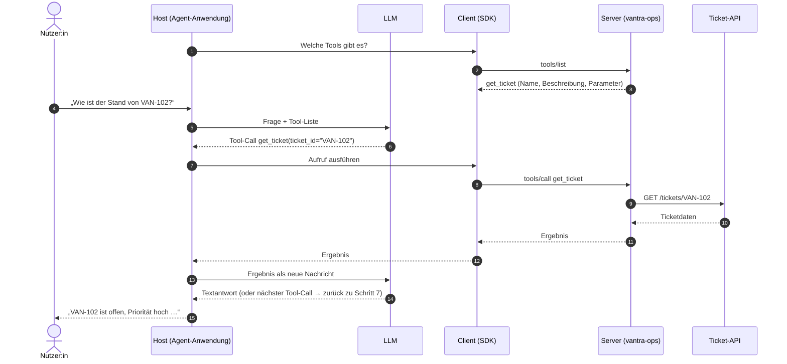
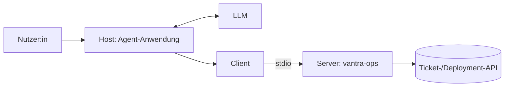

# Lab 1.1: Motivation und Architektur-Überblick

**Leitfragen:**

<details>
<summary>Wie bekommt ein KI-Assistent heute Zugriff auf ein internes System, z. B. ein Ticketsystem?</summary>

Über eigenen Integrationscode in der Anwendung: Sie beschreibt dem Modell die verfügbaren Funktionen, das Modell antwortet mit einem Funktionsaufruf statt mit Text (Function Calling), die Anwendung führt den Aufruf gegen die API des Systems aus. Jede Anwendung baut das für jedes System selbst.

</details>

<details>
<summary>Fünf KI-Anwendungen sollen dieselben drei internen Systeme nutzen. Wie viele Anbindungen entstehen?</summary>

Ohne gemeinsamen Standard 5 × 3 = 15 eigene Adapter, jeder einzeln zu bauen und zu pflegen. Mit MCP: 3 Server (einer je System) plus ein generischer MCP-Client aus dem SDK in jeder der 5 Anwendungen; verbunden wird weiterhin jede Anwendung mit jedem Server, aber ohne eigenen Adaptercode.

</details>

- Ein LLM erzeugt nur Text. Erst die Anwendung um das LLM herum liest Tickets oder ändert Daten.
- MCP legt fest, wie eine Anwendung Tools findet und aufruft, die ein separates Programm (der Server) anbietet.

## Begriffe

| Begriff | Bedeutung in einem Satz |
| --- | --- |
| LLM | Sprachmodell, das aus Text neuen Text erzeugt (z. B. `qwen3:8b`, GPT); es führt selbst nichts aus. |
| Function Calling | Fähigkeit eines LLM, statt einer Textantwort einen Funktionsaufruf als JSON auszugeben (Name plus Argumente). |
| Tool | Eine Funktion, die dem LLM mit Name, Beschreibung und Parametern angeboten wird, z. B. „Ticket lesen“. |
| Agent | Anwendung, in der ein LLM in einer Schleife Tools vorschlägt und die Anwendung sie ausführt, bis eine Textantwort steht. |
| MCP | Model Context Protocol: offener Standard, über den Anwendungen Tools und Daten aus separaten Programmen nutzen – vergleichbar mit USB für Geräte. |
| Host | Anwendung, die die Verbindungen zu den Servern hält und entscheidet, welcher Aufruf passiert (im Agenten schlägt das LLM vor, im Inspector oder Skript-Client entscheidet die Person). |
| Client | Eine Verbindung des Hosts zu genau einem Server; im Code ein Objekt aus dem SDK (`mcp.Client`). |
| Server | Eigenständiges Programm, das Tools, Resources und Prompts anbietet und ausführt (im Kurs `server.py`). |
| SDK | Software Development Kit: Python-Paket `mcp`, das Client und Server fertig mitbringt, damit kein Protokollcode von Hand nötig ist. |
| Transport | Leitung, über die Client und Server Nachrichten austauschen (stdio oder Streamable HTTP). |
| JSON-RPC | Kleines Nachrichtenformat für Funktionsaufrufe über eine Leitung; Details in Lab 2.1. |

## Ausgangspunkt: Function Calling

Die Anwendung gibt dem LLM eine Liste von Funktionen (Name, Beschreibung, Parameter). Statt einer Textantwort liefert das Modell dann einen Funktionsaufruf als JSON:

```json
{ "name": "get_ticket", "arguments": { "ticket_id": "VAN-102" } }
```

| Schritt | Wer |
| --- | --- |
| Funktionen beschreiben und dem Modell mitgeben | Anwendung |
| passende Funktion und Argumente wählen | Modell (Function Calling) |
| Funktion ausführen, Ergebnis zurückgeben | Anwendung |

- Das Modell schlägt den Aufruf nur vor. Ausführen kann ihn nur die Anwendung.
- Format und Anbindung legt ohne MCP jede Anwendung bzw. jeder Modellanbieter selbst fest.

## Ablauf eines Tool-Aufrufs

Das Diagramm zeigt eine Nutzerfrage im Agenten mit MCP, von oben nach unten nummeriert. Auf diesen Ablauf verweisen die späteren Labs als „Ablauf aus Lab 1.1“.



| Schritte | Was passiert |
| --- | --- |
| 1–3 | Entdeckung: Der Host erfährt zur Laufzeit, welche Tools der Server anbietet. |
| 4–6 | Function Calling: Das LLM sieht Frage und Tool-Liste und schlägt einen Aufruf vor. |
| 7–12 | Ausführung über MCP: Client und Server führen das Tool aus, der Server spricht mit der echten API. |
| 13–15 | Schleife: Das Ergebnis geht zurück ans LLM; es antwortet mit Text oder schlägt den nächsten Tool-Call vor. |

Die Schleife aus Schritt 13–14 macht die Anwendung zum Agenten. Auch Fehlermeldungen eines Tools laufen diesen Weg und landen beim LLM, das daraufhin einen korrigierten Aufruf vorschlagen kann.

## Das Problem: M × N Anbindungen

Ohne gemeinsames Protokoll baut jede KI-Anwendung (M) für jede Schnittstelle (N) einen eigenen Adapter. Bei Vantra Systems sind die Schnittstellen die Ticket-API und die Deployment-API.

| | Direkte Integration | MCP |
| --- | --- | --- |
| Aufwand | M · N eigene Adapter | statt M · N eigener Adapter: N Server plus ein generischer MCP-Client (SDK) je Anwendung |
| Tool-Beschreibung | je Anwendung neu (Schema, Prompt-Text) | einmal im Server, per `tools/list` abrufbar (Entdeckung, Schritt 1–3 oben) |
| Neues Tool | in jeder Anwendung nachziehen | im Server ergänzen, Clients entdecken es |
| Anbieterbindung | an das Format eines Modellanbieters oder Plugin-Systems | offenes Protokoll, austauschbare Anwendung und Modell |
| Betrieb | Code in der Anwendung | eigener Prozess mit eigener Rechtegrenze |

Verbunden wird auch mit MCP jede Anwendung mit jedem Server. Der Gewinn: Der Client-Code ist für alle Server gleich und kommt aus dem SDK; systemspezifischer Code steht nur einmal im Server.

## Abgrenzung zu Function Calling und Plugins

| Begriff | Was es festlegt | Was offen bleibt |
| --- | --- | --- |
| Function Calling | Das Modell gibt einen Funktionsnamen mit Argumenten als JSON aus | Wer die Funktion beschreibt, bereitstellt und ausführt |
| Proprietäres Plugin | Anbindung für genau eine Plattform | Wiederverwendung in anderen Anwendungen |
| MCP | Entdeckung, Beschreibung, Aufruf und Ergebnis über einheitliche Nachrichten (JSON-RPC) | Welches Modell die Entscheidung trifft (liegt im Host) |

MCP ersetzt Function Calling nicht. Der Host übergibt die Tool-Beschreibungen aus MCP dem Modell, das per Function Calling ein Tool vorschlägt.

## Die drei Rollen

| Rolle | Aufgabe | Im Kurs |
| --- | --- | --- |
| Host | hält die Verbindungen und entscheidet, welcher Aufruf passiert; im Agenten auf Vorschlag des LLM | `shared/agent_client.py` (ab Modul 4); ohne LLM: MCP Inspector, `shared/script_client.py` |
| Client | Verbindung des Hosts zu genau einem Server; sendet Requests | `mcp.Client` im SDK, genutzt in `script_client.py` und `agent_client.py` |
| Server | bietet Tools, Resources und Prompts an und führt sie aus | `server.py` (Vantra Ops) |

Der Aufbau an Tag 1, von links nach rechts:



- Ein Host kann mehrere Clients halten, je ein Client spricht mit genau einem Server (z. B. ein zweiter Server über Streamable HTTP).
- Das LLM ist kein MCP-Teilnehmer: Es spricht nur mit dem Host.

## Was ein Server anbietet

| Primitive | Gesteuert von | Zweck | Beispiel Vantra |
| --- | --- | --- | --- |
| Tool | Modell | Aktion oder Abfrage, die das LLM vorschlägt | `get_ticket` (ab Lab 2.2) |
| Resource | Anwendung | lesbare Daten unter einer Adresse (URI), die der Host selbst lädt und dem Modell mitgibt | `tickets://VAN-102` |
| Prompt | Nutzer:in | wiederverwendbare Vorlage, die eine Person auswählt, z. B. als Befehl im Chat | „Ticket zusammenfassen“ |

„Primitive“ heißt hier: Grundbaustein, den ein Server anbieten kann. Lab 2.2 zeigt Tool und Resource im Code.

## Transporte

| Transport | Prinzip | Einsatz im Kurs |
| --- | --- | --- |
| stdio | Client startet den Server als Kindprozess (vom Client gestartetes Programm); Nachrichten laufen über dessen Standard-Ein- und -Ausgabe (stdin/stdout) | Tag 1, alle Labs bis Modul 5 |
| Streamable HTTP | Server läuft eigenständig und nimmt Nachrichten über eine URL an (z. B. `http://localhost:8000/mcp`) | Container ab Modul 6 |

> **Merksatz:** MCP regelt Entdeckung und Ausführung von Tools; das Modell schlägt im Host nur vor, welches Tool aufgerufen wird.

## Fazit

- MCP ersetzt M · N eigene Adapter durch N Server plus einen generischen SDK-Client je Anwendung.
- Host, Client und Server haben getrennte Aufgaben; der Kurscode von Tag 1 ist der Server.
- Function Calling bleibt die Modell-Seite, MCP regelt Entdeckung und Ausführung (Ablauf eines Tool-Aufrufs, Schritt 1–15).

Die Übung füllt eine Vergleichstabelle MCP gegen direkte API-Integration für das Vantra-Szenario.

## Vertiefung: Versionsstand

- Grundlage ist die MCP-Spezifikation 2026-07-28 mit dem Python-SDK `mcp` 2.3.0 (Stand: 27.10.2026; Quelle: [Changelog der Spezifikation](https://modelcontextprotocol.io/specification/2026-07-28/changelog)).
- Ältere Tutorials nutzen SDK 1.x (`FastMCP`), den Transport HTTP+SSE (Vorgänger von Streamable HTTP) und einen `initialize`-Handshake (Begrüßungsnachricht vor dem ersten Aufruf, entfallen seit 2026-07-28, siehe Lab 2.1). Sie dienen nicht als Vorlage.
