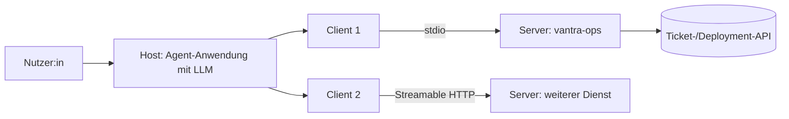

# Lab 1.1: Motivation und Architektur-Überblick

**Leitfragen:**

Welches Problem löst MCP, das Function Calling allein nicht löst?

Function Calling beschreibt nur, wie ein Modell einen Funktionsaufruf formuliert. MCP standardisiert zusätzlich, wie Tools entdeckt, beschrieben und ausgeführt werden: ein Server funktioniert dadurch mit jeder MCP-fähigen Anwendung, ohne neue Anbindung.

Welche der drei Rollen übernimmt der Code, den wir gleich schreiben?

Die Rolle Server: `server.py` bietet Tools an. Der Client (Skript-Client, Inspector, später der Agent) und der Host (die Anwendung um das LLM) kommen fertig aus `shared/` bzw. vom Inspector.

- MCP (Model Context Protocol) ist ein offenes Protokoll zwischen KI-Anwendungen und Werkzeugen bzw. Datenquellen.
- Es trennt die Anwendung mit dem LLM von der Anbindung der Tools: ein Server, viele Anwendungen.

## Das Problem: M × N Anbindungen

Ohne gemeinsames Protokoll baut jede KI-Anwendung für jede Schnittstelle einen eigenen Adapter. Bei Vantra Systems sind das die Ticket-API und die Deployment-API.

| | Direkte Anbindung | MCP |
| --- | --- | --- |
| Aufwand | M Anwendungen × N Schnittstellen = M·N Adapter | M Clients + N Server = M+N Bausteine |
| Tool-Beschreibung | je Anwendung neu (Schema, Prompt-Text) | einmal im Server, per `tools/list` abrufbar |
| Neues Tool | in jeder Anwendung nachziehen | im Server ergänzen, Clients entdecken es |
| Anbieterbindung | an das Format eines Modellanbieters oder Plugin-Systems | offenes Protokoll, austauschbare Anwendung und Modell |
| Betrieb | Code in der Anwendung | eigener Prozess mit eigener Rechtegrenze |

## Abgrenzung zu Function Calling und Plugins

| Begriff | Was es festlegt | Was offen bleibt |
| --- | --- | --- |
| Function Calling | Das Modell gibt einen Funktionsnamen mit Argumenten als JSON aus | Wer die Funktion beschreibt, bereitstellt und ausführt |
| Proprietäres Plugin | Anbindung für genau eine Plattform | Wiederverwendung in anderen Anwendungen |
| MCP | Entdeckung, Beschreibung, Aufruf und Ergebnis über JSON-RPC | Welches Modell die Entscheidung trifft (liegt im Host) |

MCP ersetzt Function Calling nicht. Der Host übergibt die Tool-Beschreibungen aus MCP dem Modell, das per Function Calling ein Tool auswählt.

## Die drei Rollen

| Rolle | Aufgabe | Im Kurs |
| --- | --- | --- |
| Host | Anwendung mit dem LLM; steuert Gespräch und Benutzerfreigaben | `shared/agent_client.py` (ab Modul 4), MCP Inspector |
| Client | Verbindung des Hosts zu genau einem Server; sendet Requests | `mcp.Client` im SDK, genutzt in `script_client.py` und `agent_client.py` |
| Server | Bietet Tools, Resources und Prompts an | `server.py` (Vantra Ops) |

- Ein Host kann mehrere Clients halten, je ein Client spricht mit einem Server.
- Das LLM wählt ein Tool nur als Vorschlag. Ausgeführt wird es über Host und Client im Server.

## Was ein Server anbietet

| Primitive | Gesteuert von | Zweck | Beispiel Vantra |
| --- | --- | --- | --- |
| Tool | Modell | Aktion oder Berechnung | `get_ticket` (ab Lab 2.2) |
| Resource | Anwendung | lesbare Daten per URI | `tickets://VAN-102` |
| Prompt | Nutzer:in | wiederverwendbare Vorlage | Zusammenfassung eines Tickets |

## Transporte

| Transport | Prinzip | Einsatz im Kurs |
| --- | --- | --- |
| stdio | Client startet den Server als Kindprozess, Nachrichten laufen über stdin/stdout | Tag 1, alle Labs bis Modul 5 |
| Streamable HTTP | Server lauscht auf einer URL (z. B. `http://localhost:8000/mcp`) | Container ab Modul 6 |

Grundlage ist die MCP-Spezifikation 2026-07-28 mit dem Python-SDK `mcp` 2.3.0. Tutorials mit SDK 1.x, HTTP+SSE oder `initialize`-Handshake beschreiben ältere Revisionen und dienen nicht als Vorlage.

> **Merksatz:** MCP regelt Entdeckung und Ausführung von Tools, das Modell entscheidet im Host nur, welches Tool es vorschlägt.

## Fazit

- MCP senkt die Zahl der Anbindungen von M·N auf M+N.
- Host, Client und Server haben getrennte Aufgaben; der Kurscode von Tag 1 ist der Server.
- Function Calling bleibt die Modell-Seite, MCP regelt Entdeckung und Ausführung.

Die Übung füllt eine Vergleichstabelle MCP gegen direkte API-Anbindung für das Vantra-Szenario.
