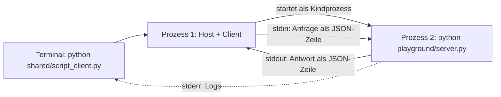

# Lab 1.2: Dev-Setup und erster eigener MCP-Server

**Leitfragen:**

<details>
<summary>Woher weiß eine Anwendung, welche Tools ein Server anbietet, ohne dass sie im Code der Anwendung stehen?</summary>

Sie fragt den laufenden Server: Die Nachricht `tools/list` liefert jedes Tool mit Name, Beschreibung und Parametern (Schritt 1–3 im Ablauf aus Lab 1.1). Der Server ist damit die einzige Stelle, an der die Tools beschrieben sind.

</details>

<details>
<summary>Welcher der beiden Transporte aus Lab 1.1 passt für einen Server, der nur auf dem eigenen Rechner läuft, und warum?</summary>

stdio: Der Client startet den Server selbst als Kindprozess, es gibt keinen Netzwerkport und damit nichts, was von außen erreichbar ist. Das ist für lokale Entwicklung am einfachsten; `mcp.run()` ohne Argumente startet genau diesen Transport.

</details>

- Ein MCP-Server in Python besteht aus einem `MCPServer`-Objekt und einem Aufruf von `mcp.run()`.
- Ein Server ohne Tools ist gültig: Er läuft, meldet sich mit Namen und liefert eine leere Tool-Liste.

## Begriffe

| Begriff | Bedeutung in einem Satz |
| --- | --- |
| venv | Virtuelle Python-Umgebung im Projektordner (`.venv`); die Kurspakete liegen nur dort, nicht im System-Python. |
| `MCPServer` | Klasse aus dem SDK, die einen MCP-Server samt Protokoll-Handling bereitstellt (SDK 2.x; in 1.x hieß sie `FastMCP`). |
| stdin / stdout / stderr | Die drei Standardkanäle eines Programms: Eingabe, Ausgabe, Fehler- und Logausgabe. |
| Kindprozess | Programm, das ein anderes Programm startet und dessen stdin/stdout es in der Hand hält – wie ein Telefonat, das nur die beiden Prozesse führen. |
| Skript-Client | `shared/script_client.py`: Host plus Client ohne LLM; listet Tools und ruft auf Befehl eins auf. |
| MCP Inspector | Offizielles Testwerkzeug mit Weboberfläche; Host plus Client, gesteuert per Klick. |
| `server/discover` | Optionale Anfrage, mit der ein Client Name, Beschreibung, unterstützte Protokollversionen und Fähigkeiten des Servers erfragt. |
| Fähigkeiten (`capabilities`) | Liste, welche Bereiche ein Server unterstützt, z. B. `tools`, `resources`, `prompts`. |

## Ablauf im Projekt

Voraussetzung: Projekt und venv sind eingerichtet ([`../00-setup-and-installation.md`](../00-setup-and-installation.md), Schritt 0–3). Alle Befehle laufen in Bash (Windows: Git Bash) im Ordner `output/project/` mit aktiver venv.

| Schritt | Befehl |
| --- | --- |
| Pakete prüfen | `pip list` zeigt `mcp 2.3.0` |
| Starter in den Playground kopieren | `cp starters/m01-l02-first-server.py playground/server.py` |
| Lücken schließen | `TODO(Aufgabe n)` in `playground/server.py` |
| Server mit Skript-Client prüfen | `python shared/script_client.py --server playground/server.py` |
| Server mit MCP Inspector prüfen | `npx @modelcontextprotocol/inspector python playground/server.py` |

Der Playground ist der einzige Arbeitsbereich. Das fertige Vergleichsbeispiel liegt unter `examples/m01-mcp-foundations-and-setup/l02-dev-setup/server.py`.

## Der minimale Server

```python
"""Vantra Ops Agent – leerer MCP-Server (Lab 1.2)."""

from mcp.server import MCPServer          # SDK 2.x: MCPServer, nicht FastMCP (SDK 1.x)

mcp = MCPServer(
    "vantra-ops",                         # Servername, der Clients angezeigt wird
    instructions="MCP-Server des Vantra Ops Agent. Noch ohne Tools: Aufbau folgt in den nächsten Labs.",
)

if __name__ == "__main__":
    mcp.run()  # stdio: der Client startet diesen Prozess und spricht über stdin/stdout
```

| Teil | Bedeutung |
| --- | --- |
| `MCPServer("vantra-ops", instructions=…)` | Name und Kurzbeschreibung; beides liefert der Server auf `server/discover` |
| `mcp.run()` | startet den Standardtransport stdio und blockiert, bis der Client die Verbindung schließt |
| `if __name__ == "__main__":` | Der Client startet die Datei als Programm (`python server.py`) |

Der Starter `starters/m01-l02-first-server.py` ist unvollständig: `MCPServer()` hat keinen Namen und `mcp.run()` fehlt. Er bricht ab mit:

```text
TODO(Aufgabe 3): Server starten, hier fehlt der Aufruf von mcp.run()
```

## Transportwahl: stdio oder Streamable HTTP

| | stdio | Streamable HTTP |
| --- | --- | --- |
| Start | Client startet den Server als Kindprozess | Server läuft eigenständig und lauscht auf einer URL |
| Verbindung | stdin/stdout, eine JSON-Nachricht pro Zeile | HTTP-Endpunkt (z. B. `http://localhost:8000/mcp`) |
| Aufruf im Server | `mcp.run()` | `mcp.run(transport="streamable-http", host=…, port=…)` |
| Typischer Einsatz | lokale Entwicklung, Tag 1 | entfernter Betrieb, Container ab Modul 6 |

So sieht stdio beim Skript-Client aus:



Bei stdio gehört stdout dem Protokoll. Ausgaben mit `print()` im Server würden die Nachrichten stören; Logs gehören auf stderr.

## Der Server von außen: server/discover und tools/list

Der Skript-Client verbindet den Server und fragt ab:

```bash
python shared/script_client.py --server playground/server.py
```

```text
Server: vantra-ops · Protokoll 2026-07-28
Tools: (keine)
```

Dahinter stehen zwei Anfragen: `server/discover` (Name, Protokollversion) und `tools/list` (Tools). Die Antwort des leeren Servers auf `server/discover`, zur Lesbarkeit umbrochen:

```json
{
  "jsonrpc": "2.0",
  "id": 1,
  "result": {
    "capabilities": {
      "prompts":   {"listChanged": true},
      "resources": {"listChanged": true, "subscribe": true},
      "tools":     {"listChanged": true}
    },
    "instructions": "MCP-Server des Vantra Ops Agent. Noch ohne Tools: Aufbau folgt in den nächsten Labs.",
    "supportedVersions": ["2026-07-28"],
    "cacheScope": "private",
    "resultType": "complete",
    "ttlMs": 0,
    "_meta": {"io.modelcontextprotocol/serverInfo": {"name": "vantra-ops", "version": ""}}
  }
}
```

| Feld | Bedeutung | Jetzt wichtig? |
| --- | --- | --- |
| `capabilities` | Fähigkeiten: Der Server kann Tools, Resources und Prompts anbieten | ja |
| `instructions` | Text aus `MCPServer(..., instructions=…)` | ja |
| `supportedVersions` | Protokollversionen, die der Server spricht | ja |
| `_meta…serverInfo.name` | Servername aus `MCPServer("vantra-ops")` | ja |
| `listChanged`, `subscribe` | Server kann Änderungen an Listen bzw. Resources melden | nein |
| `cacheScope`, `ttlMs`, `resultType` | Angaben zum Zwischenspeichern und zur Vollständigkeit der Antwort | nein, kann ignoriert werden |

Aufbau der Nachrichten (`jsonrpc`, `id`, `result`, `_meta`) im Detail: Lab 2.1.

## MCP Inspector

Der Inspector ist der Standard-Testclient des Kurses. Er startet den Server als Kindprozess und zeigt Tools, Resources und Nachrichten.

| Befehl | Wirkung |
| --- | --- |
| `npx @modelcontextprotocol/inspector python playground/server.py` | Weboberfläche, Server über stdio |
| `npx @modelcontextprotocol/inspector --cli python playground/server.py --method tools/list` | Ausgabe in der Konsole, ohne Browser |

Weboberfläche bedienen (Bezeichnungen laut [Inspector-README](https://github.com/modelcontextprotocol/inspector), Stand: 28.10.2026):

1. Befehl starten. Beim ersten Mal lädt `npx` das Paket (Rückfrage `Ok to proceed? (y)` mit `y` bestätigen).
2. Das Terminal zeigt eine Adresse der Form `http://localhost:6274/?MCP_PROXY_AUTH_TOKEN=…`; der Browser öffnet sie meist selbst, sonst die Adresse kopieren.
3. Links prüfen: **Transport Type** `STDIO`, **Command** `python`, **Arguments** `playground/server.py`.
4. **Connect** klicken. Der Verbindungsstatus wechselt auf verbunden, der Servername `vantra-ops` erscheint.
5. Oben den Tab **Tools** öffnen und **List Tools** klicken. Beim leeren Server bleibt die Liste leer.
6. Mit `Ctrl+C` im Terminal beenden.

Ausgabe von `--method tools/list` für den leeren Server:

```json
{
  "tools": []
}
```

## Typische Fehler

| Symptom | Ursache | Lösung |
| --- | --- | --- |
| `ModuleNotFoundError: No module named 'mcp'` | venv nicht aktiv | `source .venv/bin/activate` (Git Bash: `source .venv/Scripts/activate`) |
| `ImportError … FastMCP` | Code aus einem SDK-1.x-Tutorial | `from mcp.server import MCPServer` |
| Server startet und zeigt nichts | normal: stdio-Server wartet auf einen Client | `Ctrl+C`, danach Skript-Client oder Inspector |
| `TODO(Aufgabe 3): Server starten …` | Starter noch nicht vervollständigt | `mcp.run()` ergänzen |
| Inspector findet den Server nicht | Pfad relativ zum falschen Ordner | Befehl im Ordner `output/project/` ausführen |
| Inspector meldet nach **Connect** einen Verbindungsfehler | `python` außerhalb der venv gestartet oder Tippfehler in **Arguments** | venv im Terminal aktivieren und Inspector neu starten; Feld **Arguments** prüfen |
| Browser meldet einen Authentifizierungsfehler des Proxys | Adresse ohne Token geöffnet | vollständige Adresse mit `MCP_PROXY_AUTH_TOKEN` aus dem Terminal verwenden |
| `npx` lädt endlos | Netzwerk blockiert die npm-Registry | Skript-Client statt Inspector verwenden |

## Fazit

- `MCPServer(name, instructions=…)` plus `mcp.run()` genügt für einen lauffähigen Server.
- Der Server nutzt stdio; der Client startet ihn als Kindprozess.
- Skript-Client und Inspector erkennen Name, Protokollversion und Tools über `server/discover` und `tools/list`.

Die Übung vervollständigt den Starter und verbindet den Server mit Skript-Client und Inspector.

## Vertiefung: kein Handshake

Ältere MCP-Versionen begannen jede Verbindung mit einem `initialize`-Handshake: einer Begrüßungsnachricht, in der beide Seiten Version und Fähigkeiten austauschten, bevor andere Anfragen erlaubt waren. Seit Spezifikation 2026-07-28 trägt jede Anfrage diese Angaben selbst; `server/discover` ist optional ([Changelog](https://modelcontextprotocol.io/specification/2026-07-28/changelog), Stand: 27.10.2026). Details in Lab 2.1.
