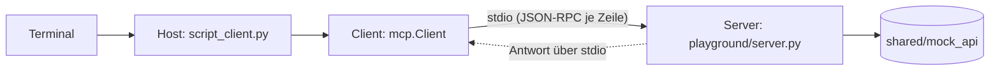

# Lab 1.3 – Lösung: Architektur-Mapping am eigenen Server

## Aufgabe 1: Ausgabe des Skript-Clients

```text
Server: vantra-ops · Protokoll 2026-07-28
Tools: (keine)
```

Name und Tool-Liste kommen aus den Antworten des Servers (`server/discover`, `tools/list`). Die Zeilen druckt `shared/script_client.py`, der Client-Prozess. Der Server-Prozess gibt selbst nichts aus.

## Aufgabe 2 und 3: Komponenten und Rollen

| Komponente | Rolle |
| --- | --- |
| Terminal, in dem der Befehl läuft | Nutzer:in-Oberfläche |
| `shared/script_client.py` | Host (steuert den Ablauf, trifft hier keine Modellentscheidung) |
| `mcp.Client` im Skript | Client |
| `playground/server.py` mit `MCPServer("vantra-ops")` | Server |
| stdin/stdout zwischen beiden Prozessen | Transport (stdio) |
| `shared/mock_api` | Datenquelle (ab Lab 2.2, im Server-Prozess) |

## Aufgabe 4: Diagramm



## Aufgabe 5: Wer entscheidet über den Tool-Aufruf?

| Werkzeug | Entscheidung |
| --- | --- |
| Skript-Client | die Person per `--call TOOL '{…}'` |
| Inspector | die Person per Klick in der Oberfläche |
| Agent (Modul 4) | das LLM im Host wählt aus der Tool-Liste, der Host führt den Aufruf aus |

Der Server entscheidet nie, welches Tool aufgerufen wird. Er führt aus, was der Client anfragt.

## Aufgabe 6: Vertrauensgrenze

Die gestrichelte Linie liegt zwischen Client und Server (Prozessgrenze, stdio).

| Seite | Prüfung |
| --- | --- |
| Server | validiert Tool-Argumente (Typ, Pflichtfelder) und lehnt ungültige Werte ab (Lab 2.2/2.3) |
| Client/Host | behandelt Tool-Ergebnisse als nicht vertrauenswürdige Daten, bevor sie das Modell erreichen (Modul 7) |

## Erweiterung: Container mit Streamable HTTP

| Element | Ändert sich? |
| --- | --- |
| Rollen Host, Client, Server | bleiben |
| Transport | stdio → Streamable HTTP über `http://localhost:8000/mcp` |
| Start des Servers | Client startet ihn nicht mehr, der Container läuft eigenständig |
| Vertrauensgrenze | wird zur Netzwerkgrenze; Authentifizierung wird nötig (Modul 7) |
