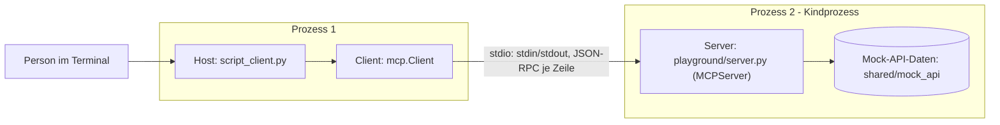

# Lab 1.3: Architektur-Mapping am eigenen Server

**Leitfragen:**

Welche Komponente trifft die Entscheidung, welches Tool aufgerufen wird?

Der Host: Er legt dem Modell die Tool-Liste vor und führt dessen Vorschlag über den Client aus. Im Skript-Client entscheidet stattdessen der Befehl mit `--call`, im Inspector die klickende Person.

Wo liegt die Vertrauensgrenze zwischen Client und Server?

An der Transportverbindung (bei stdio: Prozessgrenze mit stdin/stdout). Der Server prüft Eingaben des Clients, der Host prüft Ergebnisse des Servers, bevor sie das Modell erreichen.

- Lab 1.3 ordnet die in Lab 1.2 gestarteten Prozesse den Rollen aus Lab 1.1 zu.
- Ein Setup besteht immer aus Host, Client, Server und einer Verbindung dazwischen; welche Datei welche Rolle spielt, hängt vom Werkzeug ab.

## Rollen in den Werkzeugen des Kurses

| Werkzeug | Host | Client | Server | Verbindung |
| --- | --- | --- | --- | --- |
| `python shared/script_client.py --server playground/server.py` | Skript (keine Modellentscheidung) | `mcp.Client` im Skript | `playground/server.py` | stdio |
| `npx @modelcontextprotocol/inspector python playground/server.py` | Inspector-Anwendung mit Browser-Oberfläche | Client im Inspector | `playground/server.py` | stdio |
| `python shared/agent_client.py --server playground/server.py` (ab Modul 4) | Agent-Anwendung mit LLM | `mcp.Client` im Agent | `playground/server.py` | stdio |

In allen Fällen startet der Client den Server als Kindprozess. Der Server ist nie der Initiator der Verbindung.

## Das Setup als Diagramm

| Element im Diagramm | Datei oder Befehl |
| --- | --- |
| Host und Client | `shared/script_client.py` (ein Prozess) |
| Server | `playground/server.py`, vom Client mit `sys.executable` gestartet |
| Datenquelle | `shared/mock_api` (ab Lab 2.2, im Server-Prozess) |
| Verbindung | stdio; jede Nachricht eine JSON-Zeile |

## Vertrauensgrenzen

| Grenze | Zwischen | Prüfung |
| --- | --- | --- |
| Client → Server | Client-Eingaben (Tool-Argumente) gelten als nicht vertrauenswürdig | Server validiert Typen und Werte (Lab 2.2/2.3) |
| Server → Client | Tool-Ergebnisse können fremde Texte enthalten | Host prüft, bevor Inhalte ins Modell gehen (Modul 7) |
| Nutzer:in → Host | Freigabe sensibler Aktionen | Host holt Bestätigung ein (Modul 7) |

Bei stdio ist die Prozessgrenze zugleich die Grenze: der Server läuft mit den Rechten der Person, die den Client startet.

## Fazit

- Rollen sind Funktionen im Setup, keine Dateien: ein Skript kann Host und Client zugleich sein.
- Die Tool-Entscheidung liegt im Host.
- Die Vertrauensgrenze verläuft an der Verbindung zwischen Client und Server.

Die Übung zeichnet das eigene Setup aus Lab 1.2 und beschriftet jedes Element mit seiner Rolle.
