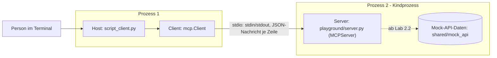

# Lab 1.3: Architektur-Mapping am eigenen Server

**Leitfragen:**

Welche Komponente trifft die Entscheidung, welches Tool aufgerufen wird?

Der Host. Im Agenten schlägt das LLM ein Tool vor und der Host führt es über den Client aus (Ablauf aus Lab 1.1, Schritt 5–7); im Skript-Client entscheidet die Person per `--call`, im Inspector per Klick.

Welche Seite muss Eingaben der anderen prüfen, statt ihnen blind zu vertrauen?

Beide, an der Verbindung zwischen Client und Server: Der Server prüft die Argumente, die der Client schickt; der Host prüft Ergebnisse des Servers, bevor sie das Modell erreichen, weil sie fremden Text enthalten können.

- Lab 1.3 ordnet die in Lab 1.2 gestarteten Prozesse den Rollen aus Lab 1.1 zu.
- Rollen sind Aufgaben, keine Dateien: Ein Skript kann Host und Client zugleich sein.

## Begriffe

| Begriff | Bedeutung in einem Satz |
| --- | --- |
| Rolle | Aufgabe im Setup (Host, Client, Server), unabhängig davon, in welcher Datei sie steckt. |
| Datenquelle | Das System hinter dem Server, z. B. die Ticket-API; im Projekt die Mock-API `shared/mock_api` (ab Lab 2.2). |
| Mock-API | Nachgebaute Ticket-/Deployment-API mit festen Testdaten, damit kein echtes System nötig ist. |
| Vertrauensgrenze (Trust Boundary) | Stelle, ab der Daten von der anderen Seite als ungeprüft gelten – wie eine Passkontrolle zwischen zwei Ländern. |

## Rollen in den Werkzeugen des Kurses

Host nach Lab 1.1: die Anwendung, die die Verbindungen zu den Servern hält und entscheidet, welcher Aufruf passiert.

| Werkzeug | Host (wer entscheidet) | Client | Server | Verbindung |
| --- | --- | --- | --- | --- |
| `python shared/script_client.py --server playground/server.py` | Skript; die Person entscheidet per `--call` | `mcp.Client` im Skript | `playground/server.py` | stdio |
| `npx @modelcontextprotocol/inspector python playground/server.py` | Inspector-Anwendung; die Person entscheidet per Klick | Client im Inspector | `playground/server.py` | stdio |
| `python shared/agent_client.py --server playground/server.py` (ab Modul 4) | Agent-Anwendung; das LLM schlägt vor | `mcp.Client` im Agent | `playground/server.py` | stdio |

In allen Fällen startet der Client den Server als Kindprozess. Der Server ist nie der Initiator der Verbindung.

## Das Setup als Diagramm

Das Diagramm zeigt das Setup mit dem Skript-Client; die Datenquelle ist gestrichelt, weil der Server sie erst ab Lab 2.2 nutzt.

| Element im Diagramm | Datei oder Befehl |
| --- | --- |
| Host und Client | `shared/script_client.py` (ein Prozess) |
| Server | `playground/server.py`, vom Client mit `sys.executable` (dem Python der venv) gestartet |
| Datenquelle | `shared/mock_api` (ab Lab 2.2, im Server-Prozess) |
| Verbindung | stdio; jede Nachricht eine JSON-Zeile |

## Vertrauensgrenzen

| Grenze | Zwischen | Prüfung |
| --- | --- | --- |
| Client → Server | Client-Eingaben (Tool-Argumente) gelten als nicht vertrauenswürdig | Server prüft Typen und Werte; einen Teil davon übernimmt das SDK automatisch (Lab 2.2/2.3) |
| Server → Client | Tool-Ergebnisse können fremde Texte enthalten, z. B. eine Ticketbeschreibung mit versteckten Anweisungen | Host prüft, bevor Inhalte ins Modell gehen (vertieft in Modul 7) |
| Nutzer:in → Host | Freigabe sensibler Aktionen | Host holt Bestätigung ein (vertieft in Modul 7) |

Bei stdio ist die Prozessgrenze zugleich die Vertrauensgrenze: Der Server läuft mit den Rechten der Person, die den Client startet.

## Fazit

- Rollen sind Aufgaben im Setup, keine Dateien: Ein Skript kann Host und Client zugleich sein.
- Die Tool-Entscheidung liegt im Host (Person oder LLM-Vorschlag).
- Die Vertrauensgrenze verläuft an der Verbindung zwischen Client und Server.

Die Übung zeichnet das eigene Setup aus Lab 1.2 und beschriftet jedes Element mit seiner Rolle.
