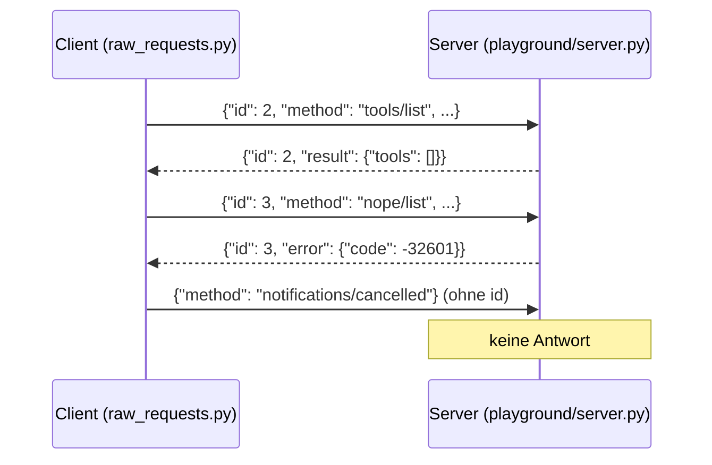

# Lab 2.1: JSON-RPC live am eigenen Server

**Leitfragen:**

<details>
<summary>Braucht jede Nachricht zwischen Client und Server eine Antwort?</summary>

Nein. Eine Anfrage (Request) erwartet genau eine Antwort und trägt dafür eine Nummer, die `id`. Eine reine Mitteilung (Notification), etwa „Vorgang abgebrochen“, hat keine `id` und bekommt keine Antwort.

</details>

<details>
<summary>Mehrere Anfragen sind gleichzeitig offen. Wie ordnet der Client eine Antwort ihrer Anfrage zu?</summary>

Über eine Kennung: Jede Anfrage trägt eine `id`, die Antwort übernimmt denselben Wert – wie eine Vorgangsnummer auf einem Rückruf. Bei mehreren offenen Anfragen ist das die einzige Zuordnung.

</details>

- Alle MCP-Nachrichten haben dasselbe JSON-Format: JSON-RPC 2.0.
- Bei stdio steht je Nachricht eine JSON-Zeile auf stdin (Client → Server) bzw. stdout (Server → Client).

## Begriffe

| Begriff | Bedeutung in einem Satz |
| --- | --- |
| RPC | Remote Procedure Call: eine Funktion in einem anderen Programm aufrufen, als wäre sie lokal. |
| JSON-RPC 2.0 | Kleiner Standard, der festlegt, wie so ein Aufruf als JSON aussieht: `method` = Funktionsname, `params` = Argumente, `id` = Vorgangsnummer. |
| Request | Nachricht mit `id`, die genau eine Antwort erwartet – vergleichbar mit einem HTTP-Request. |
| Response | Antwort mit derselben `id`; enthält entweder `result` (Erfolg) oder `error` (Fehler). |
| Notification | Nachricht ohne `id`; der Empfänger antwortet nicht. |
| Methode (`method`) | Name der aufgerufenen Funktion, z. B. `tools/list` oder `server/discover`. |
| Hülle (`params._meta`) | Feld in jedem Request mit Protokollversion, Fähigkeiten und Name des Clients – wie der Briefkopf auf jedem Brief. |
| Fehlercode | Zahl in `error.code`, die die Fehlerart angibt, z. B. `-32601` = Methode unbekannt. |

## Vom Python-Aufruf zur JSON-Zeile

Ein Request ist ein Funktionsaufruf in JSON-Form. Zum Vergleich mit HTTP:

| Gedanke | HTTP (bekannt) | JSON-RPC über stdio |
| --- | --- | --- |
| Was soll passieren? | `GET /tools` | `"method": "tools/list"` |
| Mit welchen Daten? | Query/Body | `"params": {...}` |
| Welche Antwort gehört wozu? | eine Verbindung je Anfrage | `"id": 2` in Anfrage und Antwort |
| Erfolg oder Fehler? | Statuscode 200 / 4xx | `"result"` oder `"error"` |



## Die drei Nachrichtenarten

| Art | Pflichtfelder | Antwort |
| --- | --- | --- |
| Request | `jsonrpc: "2.0"`, `id`, `method`, optional `params` | genau eine Response mit gleicher `id` |
| Response (Erfolg) | `jsonrpc`, `id`, `result` | – |
| Response (Fehler) | `jsonrpc`, `id`, `error` mit `code` und `message` | – |
| Notification | `jsonrpc`, `method`, optional `params`, **kein** `id` | keine |

> **Merksatz:** Request und Antwort gehören über die `id` zusammen; eine Nachricht ohne `id` ist eine Notification und bleibt unbeantwortet.

## Die Hülle in params._meta

Jeder Request trägt in `params._meta` dieselben drei Angaben. Die Schlüssel beginnen mit `io.modelcontextprotocol/`, damit sie nicht mit eigenen Feldern kollidieren.

| Schlüssel in `params._meta` | Inhalt | Pflicht |
| --- | --- | --- |
| `io.modelcontextprotocol/protocolVersion` | `"2026-07-28"` | ja |
| `io.modelcontextprotocol/clientCapabilities` | Fähigkeiten des Clients; darf `{}` sein | ja |
| `io.modelcontextprotocol/clientInfo` | `{"name": …, "version": …}` | vom SDK mitgesendet |

Antworten tragen umgekehrt den Servernamen in `result._meta["io.modelcontextprotocol/serverInfo"]`.

## Request und Response: tools/list am eigenen Server

Request (eine Zeile, hier umbrochen):

```json
{"jsonrpc": "2.0", "id": 2, "method": "tools/list",
 "params": {"_meta": {"io.modelcontextprotocol/protocolVersion": "2026-07-28",
                      "io.modelcontextprotocol/clientInfo": {"name": "raw-script", "version": "0.1"},
                      "io.modelcontextprotocol/clientCapabilities": {}}}}
```

Antwort des leeren Servers aus Lab 1.2, umbrochen:

```json
{
  "jsonrpc": "2.0",
  "id": 2,
  "result": {
    "tools": [],
    "cacheScope": "private",
    "resultType": "complete",
    "ttlMs": 0,
    "_meta": {"io.modelcontextprotocol/serverInfo": {"name": "vantra-ops", "version": ""}}
  }
}
```

| Feld | Bedeutung | Jetzt wichtig? |
| --- | --- | --- |
| `id: 2` | gleiche `id` wie im Request | ja |
| `result.tools` | Liste der Tools; leer, weil der Server noch keine hat (Tools ab Lab 2.2) | ja |
| `_meta…serverInfo` | Name des Servers | ja |
| `cacheScope`, `ttlMs` | Hinweise, ob und wie lange ein Client die Antwort zwischenspeichern darf | nein, kann ignoriert werden |
| `resultType: "complete"` | Antwort ist vollständig | nein, kann ignoriert werden |

## Protokollfehler: unbekannte Methode und fehlende Hülle

Ist eine Nachricht ungültig, antwortet der Server mit `error` statt `result`:

```json
{"jsonrpc": "2.0", "id": 3, "error": {"code": -32601, "message": "Method not found", "data": "nope/list"}}
```

```json
{"jsonrpc": "2.0", "id": 4, "error": {"code": -32602,
 "message": "params._meta must be an object carrying the required 'io.modelcontextprotocol/protocolVersion' and 'io.modelcontextprotocol/clientCapabilities' envelope keys"}}
```

| Code | Bedeutung (JSON-RPC-Standard) | Auslöser hier |
| --- | --- | --- |
| `-32601` | Methode nicht gefunden | `nope/list` |
| `-32602` | ungültige Parameter | Request ohne `params._meta` |

## Rohe Requests im Projekt

`starters/m02-l01-raw-requests.py` startet den eigenen Server als Kindprozess und schickt eigene Zeilen:

```python
proc = subprocess.Popen([sys.executable, SERVER], stdin=subprocess.PIPE,
                        stdout=subprocess.PIPE, stderr=subprocess.DEVNULL, text=True)
proc.stdin.write(json.dumps(message) + "\n")      # eine Nachricht = eine Zeile
proc.stdin.flush()
if "id" in message:                               # nur Requests bekommen eine Antwort
    print("<<", proc.stdout.readline().strip())
```

Das vollständige Vergleichsbeispiel liegt unter `examples/m02-protocol-and-messages/l01-jsonrpc/raw_requests.py`.

## Typische Fehler

| Symptom | Ursache | Lösung |
| --- | --- | --- |
| Skript hängt ohne Ausgabe | Request mit `id`, auf den keine Zeile kommt (z. B. Server abgestürzt) oder `id` an einer Notification | `Ctrl+C`; im Skript `stderr=None` setzen, um Fehler des Servers zu sehen |
| `FileNotFoundError` / Server startet nicht | `SERVER`-Pfad falsch oder Skript außerhalb von `output/project/` gestartet | im Projektordner `python playground/raw_requests.py` ausführen |
| `TypeError: Object of type … is not JSON serializable` | Nachricht enthält kein reines dict/list/str/int | nur JSON-Typen in `message` verwenden |
| Alle Requests liefern plötzlich `-32600` | erste Nachricht der Verbindung ohne Hülle gesendet (siehe Vertiefung) | Request mit `_meta` zuerst senden, Skript neu starten |
| `printf … \| python server.py` liefert nichts | Dateiende beendet den Server vor den Antworten | Skript mit `subprocess` verwenden |

## Fazit

- Request mit `id` → Response mit derselben `id`; Notification ohne `id` → keine Antwort.
- Jeder Request trägt Protokollversion und Fähigkeiten in `params._meta`.
- Ungültige Nachrichten beantwortet der Server mit `error` und einem Fehlercode.

Die Übung schickt diese Nachrichten selbst an den eigenen Server und liest die Rohantworten.

## Vertiefung

### Kein Handshake seit 2026-07-28

Ältere Revisionen begannen jede Verbindung mit einem `initialize`-Handshake: Client und Server tauschten in einer ersten Nachricht Version und Fähigkeiten aus, erst danach waren andere Anfragen erlaubt. Seit Spezifikation 2026-07-28 trägt jeder Request diese Angaben selbst in `params._meta`; der Client sendet direkt `tools/list` oder `tools/call` ([Changelog](https://modelcontextprotocol.io/specification/2026-07-28/changelog), Stand: 27.10.2026).

Der Server unterstützt beide Formen. Die erste Nachricht einer Verbindung legt fest, welche gilt: Beginnt sie ohne Hülle, schaltet der Server in den alten Handshake-Modus und lehnt danach Requests mit Hülle ab (`-32600`, ungültiger Request). Beobachtet mit `mcp` 2.3.0.

### Live-Trace aller Nachrichten

`shared/trace_proxy.py` sitzt zwischen Client und Server, leitet jede Zeile unverändert weiter und schreibt sie zusätzlich mit Richtung auf stderr. Im Inspector als **Command** `python` und als **Arguments** `shared/trace_proxy.py -- python playground/server.py` eintragen:

```text
[17:58:41] CLIENT -> SERVER {"jsonrpc":"2.0","id":1,"method":"server/discover","params":{...}}
[17:58:41] SERVER -> CLIENT {"jsonrpc":"2.0","id":1,"result":{...}}
```

Der SDK-Client sendet zuerst `server/discover` (id 1), dann `tools/list` (id 2), danach die Aufrufe. Ab Modul 4 schreibt der Agent-Client denselben Trace mit `python shared/agent_client.py --server playground/server.py --replay --trace trace.log` in eine Datei (Showcase A).
