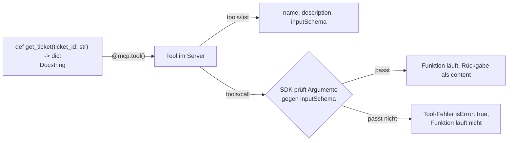

# Lab 2.2: Erstes eigenes Tool implementieren

**Leitfragen:**

<details>
<summary>Welche Angaben braucht ein Modell über ein Tool, um es korrekt aufzurufen?</summary>

Name, eine Beschreibung, wofür das Tool da ist, und die Parameter mit Typ und Angabe, welche Pflicht sind. MCP liefert genau das in `tools/list`; das SDK baut die Parameterbeschreibung (das Eingabeschema) aus den Typhinweisen der Python-Funktion.

</details>

<details>
<summary>Warum ist eine Resource kein Tool?</summary>

Eine Resource (Lab 1.1) sind lesbare Daten unter einer festen Adresse wie `tickets://VAN-102`, die die Anwendung selbst lädt. Ein Tool ist eine Aktion, die das Modell vorschlägt und mit eigenen Argumenten aufruft.

</details>

- Ein Tool ist eine Python-Funktion mit Typhinweisen und Docstring, registriert mit `@mcp.tool()`.
- Name, Beschreibung und Eingabeschema entstehen aus der Funktion; das Modell sieht sie in `tools/list` (Ablauf aus Lab 1.1, Schritt 1–3 und 5).

## Begriffe

| Begriff | Bedeutung in einem Satz |
| --- | --- |
| Dekorator | Zeile mit `@` über einer Funktion, die sie bei einem Framework anmeldet – hier `@mcp.tool()`. |
| Typhinweis | Angabe des erwarteten Typs in Python, z. B. `ticket_id: str`. |
| Docstring | Text in `"""…"""` direkt unter `def`; wird zur Tool-Beschreibung für das LLM. |
| Schema / `inputSchema` | Maschinenlesbare Beschreibung der Parameter im Format JSON Schema: Namen, Typen, Pflichtfelder – wie ein Formular mit Pflichtfeldern. |
| Annotation (`readOnlyHint`) | Zusatzhinweis an Clients, z. B. „dieses Tool ändert nichts“. |
| `ToolError` | Ausnahme aus dem SDK für erwartete Fehler; ihre Meldung erreicht das Modell. |
| Mock-API / `backend` | Nachgebaute Ticket-API mit Testdaten (`shared/mock_api/tickets.json`), im Server als `backend` angebunden. |
| URI | Adresse einer Resource, z. B. `tickets://VAN-102`; `{ticket_id}` darin ist ein Platzhalter. |

## Die drei Primitives

| Primitive | Wer wählt aus | Wirkung | Wann nutzen | Beispiel Vantra |
| --- | --- | --- | --- | --- |
| Tool | Modell | kann rechnen, abfragen, ändern | Aktion oder Abfrage mit Parametern | `get_ticket(ticket_id)` |
| Resource | Anwendung | nur lesen, adressiert per URI | Daten, die der Host selbst lädt und dem Modell mitgibt | `tickets://VAN-102` |
| Prompt | Nutzer:in | liefert eine Nachrichtenvorlage | wiederkehrende Arbeitsabläufe | „Ticket zusammenfassen“ |

So sieht „wer wählt aus“ in einer Chat-Anwendung aus:

| Primitive | Typische Bedienung |
| --- | --- |
| Tool | Das LLM entscheidet mitten im Gespräch, `get_ticket` aufzurufen. |
| Resource | Die Person hängt `tickets://VAN-102` als Anhang an (z. B. per Auswahlliste), oder der Host lädt sie automatisch in den Kontext. |
| Prompt | Die Person wählt die Vorlage „Ticket zusammenfassen“ aus einem Menü oder als `/`-Befehl. |

Faustregel: Soll das Modell selbst entscheiden und Parameter wählen, ist es ein Tool. Sind es feste Daten unter einer Adresse, ist es eine Resource.

## Vom Python-Code zum Tool



## Das Tool im Server

Datei `playground/server.py` (Beispiel: `examples/m02-protocol-and-messages/l02-first-tool/server.py`):

```python
import sys
from pathlib import Path

# Sucht den Projektordner (den mit shared/), damit "import shared…" funktioniert – nicht ändern.
sys.path.insert(0, next(str(p) for p in Path(__file__).resolve().parents if (p / "shared").is_dir()))

from mcp.server import MCPServer
from mcp.server.mcpserver.exceptions import ResourceNotFoundError, ToolError
from mcp.types import ToolAnnotations

from shared.mock_api.client import get_backend
from shared.mock_api.store import NotFound

mcp = MCPServer("vantra-ops", instructions="MCP-Server des Vantra Ops Agent: Tickets abfragen.")
backend = get_backend()                       # Ticket-Daten aus shared/mock_api


@mcp.tool(annotations=ToolAnnotations(read_only_hint=True))   # Tool registrieren, nur lesend
def get_ticket(ticket_id: str) -> dict:
    """Ticket anhand seiner ID (z. B. VAN-102) abfragen: Titel, Status, Priorität, Version."""
    try:
        return backend.get_ticket(ticket_id)
    except NotFound as exc:
        raise ToolError(str(exc)) from exc    # erwarteter Fehler: Text erreicht das Modell


if __name__ == "__main__":
    mcp.run()
```

| Teil | Wirkung |
| --- | --- |
| `@mcp.tool(...)` | registriert die Funktion; Name = Funktionsname (`get_ticket`) |
| `ticket_id: str` | erzeugt `inputSchema`: Eigenschaft `ticket_id` vom Typ `string`, Pflichtfeld |
| Typhinweis bei jedem Aufruf | Das SDK prüft die Argumente automatisch gegen das Schema (Bibliothek Pydantic), bevor die Funktion läuft; fehlt `ticket_id` oder ist es kein Text, entsteht ein Tool-Fehler (Lab 2.3) |
| Docstring | wird zur `description`; das LLM liest ihn bei der Tool-Auswahl |
| `ToolAnnotations(read_only_hint=True)` | Hinweis an Clients: ändert nichts |
| Rückgabe `dict` | erscheint als JSON-Text in `content[0].text` |
| `ToolError` | erwarteter Fehler: Meldung geht an das Modell, Ergebnis mit `isError: true` |

Der Eintrag von `get_ticket` in `tools/list`, umbrochen:

```json
{
  "name": "get_ticket",
  "description": "Ticket anhand seiner ID (z. B. VAN-102) abfragen: Titel, Status, Priorität, Version.",
  "inputSchema": {
    "type": "object",
    "properties": {"ticket_id": {"type": "string", "title": "Ticket Id"}},
    "required": ["ticket_id"],
    "title": "get_ticketArguments"
  },
  "annotations": {"readOnlyHint": true}
}
```

| Feld | Herkunft im Code |
| --- | --- |
| `name` | Funktionsname |
| `description` | Docstring |
| `inputSchema.properties.ticket_id.type` | Typhinweis `str` → `"string"` |
| `inputSchema.required` | Parameter ohne Standardwert |
| `annotations.readOnlyHint` | `ToolAnnotations(read_only_hint=True)` |
| `title` (zweimal) | automatisch erzeugte Beschriftung; kann ignoriert werden |

## Tool aufrufen

Mit dem Skript-Client:

```bash
python shared/script_client.py --server playground/server.py --call get_ticket '{"ticket_id": "VAN-102"}'
```

```text
Server: vantra-ops · Protokoll 2026-07-28
Tools: get_ticket
is_error=False
{
  "id": "VAN-102",
  "title": "Login-Seite lädt nach Release 2.14 sehr langsam",
  "status": "open",
  "priority": "high",
  "assignee": "jonas.brandt",
  "service": "auth-service",
  "description": "Seit dem Rollout von auth-service 2.14.1 dauert der Login 8 bis 12 Sekunden. Vor dem Release lag er unter 1 Sekunde.",
  "version": 3,
  "updated_at": "2026-10-27T07:45:00Z"
}
```

Im Inspector (Bedienung aus Lab 1.2): `npx @modelcontextprotocol/inspector python playground/server.py` → **Connect** → Tab **Tools** → **List Tools** → `get_ticket` anklicken → Feld `ticket_id` füllen → **Run Tool**.

## tools/call als Rohnachricht

Derselbe Aufruf als JSON-RPC-Request (Format aus Lab 2.1), gesendet mit `playground/raw_requests.py`:

```json
{"jsonrpc": "2.0", "id": 6, "method": "tools/call",
 "params": {"name": "get_ticket", "arguments": {"ticket_id": "VAN-102"}, "_meta": {…}}}
```

Antwort, umbrochen und gekürzt:

```json
{
  "jsonrpc": "2.0",
  "id": 6,
  "result": {
    "content": [
      {"type": "text", "text": "{\n  \"id\": \"VAN-102\",\n  \"title\": \"Login-Seite lädt nach Release 2.14 sehr langsam\",\n  \"status\": \"open\", … \"version\": 3, …}"}
    ],
    "isError": false,
    "resultType": "complete",
    "_meta": {"io.modelcontextprotocol/serverInfo": {"name": "vantra-ops", "version": ""}}
  }
}
```

| Feld | Bedeutung |
| --- | --- |
| `params.name`, `params.arguments` | Toolname und Argumente – dieselben Angaben wie beim Function Calling (Lab 1.1) |
| `result.content[0].text` | Rückgabe der Funktion als JSON-Text; diesen Text bekommt das LLM |
| `result.isError: false` | Tool lief fehlerfrei |

## Fehler im Tool

Unbekanntes Ticket:

```bash
python shared/script_client.py --server playground/server.py --call get_ticket '{"ticket_id": "VAN-999"}'
```

```text
is_error=True
Error executing tool get_ticket: Ticket VAN-999 nicht gefunden
```

Eine normale Exception im Tool-Code würde dem Modell nur `Error executing tool get_ticket` zeigen; die Meldung bliebe verborgen und der Traceback landet auf stderr. Darum `ToolError` für erwartete Fehler.

## Typische Fehler

| Symptom | Ursache | Lösung |
| --- | --- | --- |
| `Tools: (keine)` | `@mcp.tool()` vergessen oder falsche Datei gestartet | Dekorator prüfen, `--server`-Pfad prüfen |
| `NameError: name 'ToolAnnotations' is not defined` | Import gelöscht | Importe aus dem Starter unverändert lassen |
| `json.decoder.JSONDecodeError` beim Skript-Client | JSON-Argument falsch gequotet | Argument in einfache Anführungszeichen, Schlüssel und Texte in doppelte: `'{"ticket_id": "VAN-102"}'` (Bash/Git Bash) |
| LLM wählt das Tool nicht (ab Modul 4) | Docstring fehlt oder ist vage | Docstring mit Zweck und Beispiel-ID schreiben |
| Meldung nur `Error executing tool …` | normale Exception statt `ToolError` | `ToolError` verwenden |
| `ModuleNotFoundError: shared` | Starter außerhalb von `output/project/` kopiert | Datei im Playground belassen |
| Inspector zeigt das neue Tool nicht | Inspector läuft noch mit altem Serverstand | **Disconnect** und **Connect** klicken oder Inspector neu starten |

## Fazit

- `@mcp.tool()` macht aus Funktion, Typhinweisen und Docstring ein Tool mit Schema; das SDK prüft die Argumente automatisch.
- Tool = Aktion mit Modellentscheidung, Resource = Daten unter einer URI.
- Erwartete Fehler werden mit `ToolError` gemeldet.

Die Übung ergänzt `get_ticket` im Playground-Server und ruft das Tool über Skript-Client, Rohnachricht und Inspector auf.

## Vertiefung: Resource als Gegenstück (Erweiterung der Übung)

```python
@mcp.resource("tickets://{ticket_id}", mime_type="application/json")
def ticket_resource(ticket_id: str) -> dict:
    """Ticket als Resource (nur lesen, von der Anwendung adressierbar)."""
    try:
        return backend.get_ticket(ticket_id)
    except NotFound as exc:
        raise ResourceNotFoundError(str(exc)) from exc
```

| Merkmal | Tool `get_ticket` | Resource `tickets://{ticket_id}` |
| --- | --- | --- |
| Auswahl | Modell, per `tools/call` | Anwendung, per `resources/read` |
| Eintrag in | `tools/list` | `resources/templates/list` (URI-Vorlage mit Platzhalter) |
| Fehler | `isError: true` im Ergebnis | JSON-RPC-Fehler `-32602` |

`mime_type="application/json"` sagt dem Client, dass der Inhalt JSON ist.
