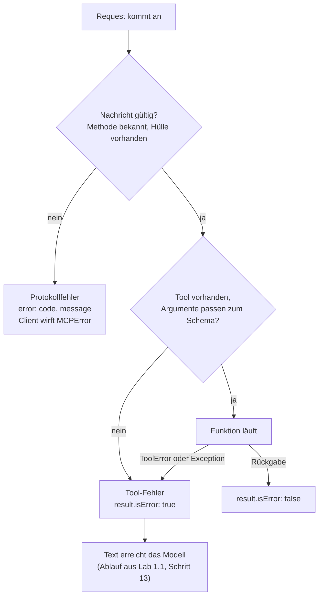

# Lab 2.3: Fehlerfälle provozieren und verstehen

**Leitfragen:**

<details>
<summary>An welcher Stelle würde ein Retry sinnvoll ansetzen?</summary>

Dort, wo die Fehlermeldung gelesen wird: im Agenten beim Modell, das die Meldung als nächste Nachricht erhält und einen korrigierten Aufruf vorschlagen kann (Ablauf aus Lab 1.1, Schritt 13–14). Bei Eingabefehlern mit korrigierten Argumenten, bei vorübergehenden Störungen (Verbindung, Zeitüberschreitung) unverändert; mit denselben fehlerhaften Argumenten bringt ein Retry nichts.

</details>

<details>
<summary>Welche Angaben braucht eine Fehlermeldung, damit Mensch oder Modell den Aufruf korrigieren können?</summary>

Was falsch war, welche Werte erlaubt sind, ob ein erneuter Versuch sinnvoll ist, und eine Fehlerkennung. Eine unbehandelte Python-Exception liefert davon nichts: Das Modell sieht nur „Error executing tool …“, die Ursache steht im Log des Servers.

</details>

- MCP kennt zwei Fehlerebenen: Protokollfehler (JSON-RPC-`error`, Lab 2.1) und Tool-Fehler (`result` mit `isError: true`).
- Tool-Fehler sind für das Modell lesbar und ermöglichen eine Korrektur im nächsten Versuch.

## Begriffe

| Begriff | Bedeutung in einem Satz |
| --- | --- |
| Protokollfehler | Antwort mit `error` statt `result`: Die Nachricht selbst war ungültig, kein Tool-Code lief. |
| Tool-Fehler | Normale Antwort (`result`) mit `isError: true`: Die Nachricht war gültig, aber das Tool scheiterte; der Text geht ans Modell. |
| Validierungsfehler | Tool-Fehler, weil die Argumente nicht zum `inputSchema` passen; das SDK meldet ihn, bevor die Funktion läuft (Lab 2.2). |
| `MCPError` | Ausnahme, die der SDK-Client bei einem Protokollfehler wirft. |
| Retry | Erneuter Versuch eines Aufrufs, unverändert oder mit korrigierten Argumenten. |
| Traceback | Pythons Fehlerbericht mit Aufrufkette; landet beim Server auf stderr, nicht beim Modell. |

## Zwei Fehlerebenen



| Ebene | Form | Ursache | Wer sieht es |
| --- | --- | --- | --- |
| Protokollfehler | `"error": {"code": …, "message": …}` | Nachricht ungültig: fehlende `_meta`, unbekannte Methode, unbekannte Resource | Client (SDK wirft `MCPError`) |
| Tool-Fehler | `"result": {"isError": true, "content": [...]}` | Tool nicht gefunden, Argumente ungültig, Fehler im Tool | Modell über den Host |

| Code | Bedeutung | Beispiel |
| --- | --- | --- |
| `-32602` | ungültige Parameter | fehlende `_meta`-Hülle, unbekannte Resource-URI |
| `-32601` | Methode nicht gefunden | `nope/list` |
| `-32600` | ungültiger Request | Verbindung im Handshake-Modus (Vertiefung in Lab 2.1) |

Ein unbekannter Toolname ist ein Tool-Fehler, keine unbekannte Methode: Die Methode `tools/call` existiert, nur ihr Argument `name` passt nicht. So erreicht die Meldung das Modell, das den Namen aus `tools/list` korrigieren kann (beobachtet mit `mcp` 2.3.0, Ausgabe unten).

## Die Fehlerfälle am Server aus Lab 2.2

Das Skript `examples/m02-protocol-and-messages/l02-first-tool/error_cases.py` löst fünf Fälle aus:

```bash
python examples/m02-protocol-and-messages/l02-first-tool/error_cases.py
```

```text
1) falscher Parameter (id statt ticket_id)
  is_error=True  text='Error executing tool get_ticket: 1 validation error for get_ticketArguments'

2) falscher Typ (Zahl statt Text)
  is_error=True  text='Error executing tool get_ticket: 1 validation error for get_ticketArguments'

3) unbekanntes Ticket
  is_error=True  text='Error executing tool get_ticket: Ticket VAN-999 nicht gefunden'

4) unbekanntes Tool
  is_error=True  text='Unknown tool: get_tickets'

5) unbekannte Resource
  MCPError code=-32602 message='Ticket VAN-999 nicht gefunden'
```

Fall 5 liest die Resource `tickets://VAN-999` aus der Vertiefung von Lab 2.2; das Beispiel enthält sie bereits.

| Fall | Ebene | Ursache | Retry sinnvoll? |
| --- | --- | --- | --- |
| 1 falscher Parameter | Tool-Fehler | Pflichtfeld `ticket_id` fehlt | ja, mit `ticket_id` |
| 2 falscher Typ | Tool-Fehler | Zahl statt Text | ja, mit Text |
| 3 unbekanntes Ticket | Tool-Fehler | ID existiert nicht (`ToolError`) | nein, andere ID wählen |
| 4 unbekanntes Tool | Tool-Fehler | Toolname falsch (`get_tickets`) | ja, mit Namen aus `tools/list` |
| 5 unbekannte Resource | Protokollfehler | URI existiert nicht | nein |

## Die Rohantwort bei falschem Parameter

Aufruf mit `{"id": "VAN-102"}` statt `{"ticket_id": "VAN-102"}`, umbrochen:

```json
{
  "jsonrpc": "2.0",
  "id": 7,
  "result": {
    "content": [{
      "type": "text",
      "text": "Error executing tool get_ticket: 1 validation error for get_ticketArguments\nticket_id\n  Field required [type=missing, input_value={'id': 'VAN-102'}, input_type=dict]\n    For further information visit https://errors.pydantic.dev/2.14/v/missing"
    }],
    "isError": true,
    "resultType": "complete",
    "_meta": {"io.modelcontextprotocol/serverInfo": {"name": "vantra-ops", "version": ""}}
  }
}
```

| Teil | Aussage |
| --- | --- |
| `"result"` statt `"error"` | der Tool-Aufruf wurde zugestellt, das Tool schlug fehl |
| `isError: true` | Fehler-Kennzeichen für den Host |
| `ticket_id … Field required` | Ursache: Pflichtfeld fehlt (Prüfung durch das SDK mit Pydantic) |
| `input_value={'id': 'VAN-102'}` | zeigt, was angekommen ist |
| `For further information visit …` | Link auf die Pydantic-Doku; kann ignoriert werden |

Zum Vergleich der Protokollfehler aus Lab 2.1 (unbekannte Methode):

```json
{"jsonrpc": "2.0", "id": 3, "error": {"code": -32601, "message": "Method not found", "data": "nope/list"}}
```

Und bei fehlender `_meta`-Hülle:

```json
{"jsonrpc": "2.0", "id": 4, "error": {"code": -32602, "message": "params._meta must be an object carrying the required 'io.modelcontextprotocol/protocolVersion' and 'io.modelcontextprotocol/clientCapabilities' envelope keys"}}
```

## ToolError und normale Exception

| Im Tool-Code | Meldung beim Modell | Server-Log (stderr) |
| --- | --- | --- |
| `raise ToolError("Ticket VAN-999 nicht gefunden")` | `Error executing tool get_ticket: Ticket VAN-999 nicht gefunden` | eine Logzeile mit der Meldung |
| beliebige andere Exception | nur `Error executing tool get_ticket` | Traceback |

Erwartete Fehler (unbekannte ID, ungültiger Wert) gehören in `ToolError` mit einer Meldung, die dem Modell die Korrektur erlaubt.

## Retry-Muster

| Fehlerart | Maßnahme | Wo |
| --- | --- | --- |
| Validierungsfehler (Fall 1, 2) | Argumente korrigieren, erneut aufrufen | Modell im Agenten |
| Tool unbekannt (Fall 4) | `tools/list` lesen, Namen korrigieren | Modell im Agenten |
| Fachlicher Fehler (Fall 3) | nicht wiederholen; Nutzer:in informieren oder andere Eingabe wählen | Modell bzw. Nutzer:in |
| Protokollfehler (fehlende `_meta`) | Client korrigieren, kein Modell-Retry | Entwickler:in |
| Verbindungsabbruch, Zeitüberschreitung | Wiederholung, möglichst nur für lesende Tools (`readOnlyHint`) | Client oder Host |

> **Merksatz:** Tool-Fehler erreichen das Modell als Text und sind korrigierbar; Protokollfehler betreffen den Client und sind Programmierfehler.

## Typische Fehler

| Symptom | Ursache | Lösung |
| --- | --- | --- |
| Skript-Client endet mit Exit-Code 1 | gewollt bei `is_error=True` | Ausgabe lesen, kein Defekt |
| Zusätzliche Zeile `Tool 'get_ticket' …` im Terminal | Log des Servers auf stderr | gehört nicht zur Antwort, ignorieren |
| `json.decoder.JSONDecodeError` statt Tool-Fehler | JSON-Argument im Terminal falsch gequotet, Aufruf erreicht den Server nicht | `'{"ticket_id": 102}'` mit äußeren einfachen Anführungszeichen |
| `error_cases.py` Fall 5 fehlt | Skript gegen einen Server ohne Resource gestartet | Skript unverändert aus `examples/` starten |

## Fazit

- Zwei Ebenen: `error` für ungültige Nachrichten, `result` mit `isError: true` für Tool-Fehler.
- Die Fehlermeldung des Tools ist die Debugging-Information; ihre Qualität bestimmt, ob ein Retry gelingt.
- `ToolError` macht erwartete Fehler für das Modell sichtbar.

Die Übung löst Fehlerfälle selbst aus und dokumentiert Ursache und Retry-Eignung.
