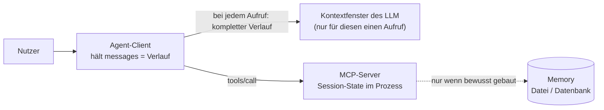

# Lab 3.1: State vs. Memory

**Leitfragen:**

<details>
<summary>Was passiert mit State, wenn der Agent neu startet?</summary>

State (Daten, die ein laufendes Programm im Arbeitsspeicher hält) lebt nur so lange wie der Prozess. Nach einem Neustart ist er leer; erhalten bleibt nur, was bewusst in Datei oder Datenbank gespeichert wurde (Memory).

</details>

<details>
<summary>Welche Daten darf ein Agent nie dauerhaft speichern, auch wenn sie im Gespräch vorkamen?</summary>

Geheimnisse (Tokens, Passwörter, Schlüssel), personenbezogene Daten ohne Zweck und Rechtsgrundlage sowie ungeprüfte Texte aus Tool-Ergebnissen, die dort als versteckte Anweisung überdauern könnten.

</details>

- Ein Agent-System hat drei Orte für Daten: das Kontextfenster des Modells, den Session-State im Prozess und ein persistentes Memory.
- Die drei unterscheiden sich in Lebensdauer, Größe und Risiko; jedes Datum bekommt genau einen Ort.

## Begriffe

| Begriff | Bedeutung in einem Satz |
| --- | --- |
| LLM ist zustandslos | Das Modell merkt sich zwischen zwei Aufrufen nichts; es „erinnert“ sich nur, weil der Client bei jedem Aufruf den bisherigen Verlauf erneut mitschickt. |
| Token | Wortstück, in dem ein Modell Text misst; ein deutsches Wort entspricht grob ein bis drei Tokens. |
| Kontextfenster | Alles, was das Modell bei einem einzelnen Aufruf liest (System-Prompt, Nachrichtenverlauf, Tool-Ergebnisse), begrenzt auf eine feste Zahl Tokens – wie ein Schreibtisch, auf den nur eine bestimmte Menge Papier passt. |
| System-Prompt | Feste Anweisung an das Modell am Anfang jedes Verlaufs, z. B. Rolle und Antwortsprache. |
| Session | Eine Verbindung zwischen Client und Server; bei stdio ist das genau ein Serverprozess. |
| Session-State | Daten, die der Server oder Client während einer Session im Arbeitsspeicher hält – wie ein Notizzettel, der beim Feierabend weggeworfen wird. |
| Memory (persistent) | Bewusst gespeicherte Daten, die einen Neustart überleben (Datei, Datenbank) – wie ein Archivordner. |
| Vektorspeicher | Datenbank, die Texte nach inhaltlicher Ähnlichkeit wiederfindet; eine verbreitete Form von Memory, im Kurs nicht genutzt. |
| Prompt Injection | Text in Daten (z. B. in einer Ticket-Beschreibung), der wie eine Anweisung formuliert ist und das Modell zu ungewollten Aktionen bringen soll (vertieft in Modul 7). |

## Drei Speicherorte

Das Diagramm zeigt, wo jeder Ort liegt und wer ihn füllt:



| Ort | Wo liegt es? | Lebensdauer | Grenze |
| --- | --- | --- | --- |
| Kontextfenster | im Aufruf an das Modell: System-Prompt, Verlauf, Tool-Ergebnisse | ein Modellaufruf; beim nächsten Aufruf wird es aus dem Verlauf neu gefüllt | feste Token-Obergrenze; alles darin kostet Platz, Zeit und bei Cloud-Modellen Geld |
| Session-State | im Server- oder Client-Prozess (Variablen, Objekte) | bis zum Ende des Prozesses bzw. der Session | weg bei Neustart, nicht geteilt zwischen Prozessen |
| Memory (persistent) | Datei, Datenbank, Vektorspeicher | über Sessions hinweg, bis zum Löschen | braucht Schema, Zugriffsschutz und Löschkonzept |

- Der Gesprächsverlauf selbst ist Session-State des Clients (die Liste `messages`); erst beim Aufruf landet er im Kontextfenster.
- Das Kontextfenster ist kein Speicher des Servers: Das Modell sieht nur, was der Client in den Aufruf legt, also Verlauf und Tool-Ergebnisse.

## Entscheidung pro Datentyp

Drei Fragen entscheiden über den Ort:

1. Wird das Datum nach dem Ende der Session noch gebraucht? Wenn nein: kein Memory.
2. Muss das Modell es im nächsten Schritt lesen? Wenn nein: nicht ins Kontextfenster, sondern höchstens in den Session-State.
3. Ist es geheim oder personenbezogen? Wenn ja: nicht ins Kontextfenster und nicht ins Memory ohne Schutzkonzept.

| Datentyp | Beispiel (Vantra) | Ort | Begründung |
| --- | --- | --- | --- |
| Laufende Konversation | Nutzerfrage „Zeige Ticket VAN-102“ und Antwort | Verlauf im Client (Session-State), bei jedem Aufruf im Kontextfenster | Das Modell braucht den Verlauf für den nächsten Schritt; Ende mit der Session |
| Nutzerpräferenz | „Antworten immer kurz und auf Deutsch“ | Memory (persistent) | gilt über Sessions hinweg; klein, nicht geheim, vom Nutzer löschbar |
| Einmaliges Tool-Ergebnis | Deployment-Log von `dep-2041` | ein gekürzter Ausschnitt (letzte Zeilen) als Tool-Ergebnis im Kontextfenster; der Server merkt sich nur die Metadaten im Session-State | groß und nur für diesen Vorgang relevant; jederzeit neu abrufbar |

## Was im Kursprojekt umgesetzt ist

- Session-State: das Objekt `session` in `context.py` (gebaut in Lab 3.2) lebt im Serverprozess. Bei stdio startet der Client den Server als Kindprozess; endet der Client, endet der State.
- Memory ist im Kursprojekt bewusst nicht implementiert. Die Entscheidung „was gehört dorthin“ gehört zum Entwurf, nicht zur Umsetzung.
- Ein Neustart zeigt den Effekt direkt. Der fertige Server aus Lab 3.2 hat ein zweites Tool `get_deployment_log`, das ohne Ticket-ID das zuletzt abgefragte Ticket aus dem Session-State nimmt. Der Skript-Client startet für jeden `--call` einen neuen Serverprozess; im zweiten Prozess fehlt das Ticket:

```text
is_error=True
Error executing tool get_deployment_log: Keine ticket_id angegeben und kein Ticket im Kontext: zuerst get_ticket aufrufen.
```

## Was nicht ins Langzeit-Memory gehört

| Daten | Risiko |
| --- | --- |
| Tokens, Passwörter, API-Schlüssel | dauerhafte Ablage von Geheimnissen, Leck bei jedem Zugriff auf das Memory |
| personenbezogene Daten ohne Zweck | Löschpflichten, Zweckbindung |
| rohe Tool-Ergebnisse mit fremdem Text (z. B. Ticket-Beschreibungen) | eingeschleuste Anweisungen (Prompt Injection) wirken in jeder späteren Session |
| Behauptungen des Modells ohne Prüfung | Fehler verfestigen sich als „Wissen“ |

> **Merksatz:** Session-State ist Arbeitsspeicher, Memory ist Archiv. Was ins Archiv wandert, wird bewusst ausgewählt, geprüft und löschbar gehalten.

## Typische Fehler

| Symptom | Ursache | Lösung |
| --- | --- | --- |
| Zweiter `--call` meldet `kein Ticket im Kontext` | jeder `--call` ist ein neuer Prozess mit leerem State | erwartet; genau das belegt den Neustart-Effekt |
| Vor `Server: …` steht eine Zeile `Tool 'get_deployment_log' failed: …` | Log-Ausgabe des SDK auf stderr | normal, keine Aktion nötig |
| `can't open file …` oder `No such file or directory` | Befehl nicht im Ordner `output/project/` gestartet; die Pfade sind relativ | in den Ordner `output/project/` wechseln, Befehl wiederholen |

## Fazit

- Das LLM ist zustandslos; der Client schickt den Verlauf bei jedem Aufruf neu ins Kontextfenster.
- Kontextfenster, Session-State und Memory unterscheiden sich in Lebensdauer, Größe und Risiko; ein Neustart leert den Session-State.
- Geheimnisse und ungeprüfte Fremdtexte gehören nicht ins Memory.

Die Übung ordnet sieben Datentypen ihrem Speicherort zu und belegt den Neustart-Effekt am Beispielserver.
