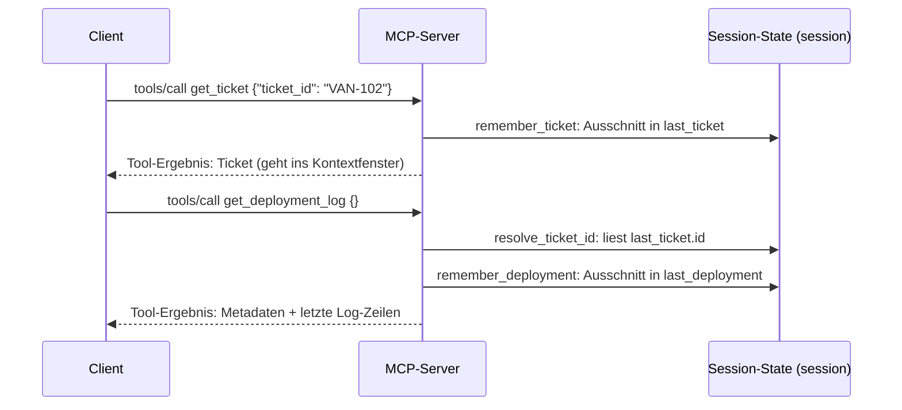

# Lab 3.2: Kontextschema entwerfen und einbauen

**Leitfragen:**

<details>
<summary>Zwei Tools legen ihre Ergebnisse im selben Session-State ab. Wie bleibt das Ergebnis des ersten erhalten, wenn das zweite schreibt?</summary>

Jedes Tool schreibt nur in ein eigenes Feld (z. B. `last_ticket` und `last_deployment`). Gemeinsam genutzt wird nur lesend: Das zweite Tool liest die Ticket-ID aus dem Feld des ersten, überschreibt es aber nie.

</details>

<details>
<summary>Warum sollte nicht alles, was der Server sich merkt, an das LLM gehen?</summary>

Jedes Feld kostet Platz im Kontextfenster, reine Verwaltungsdaten (z. B. ein Aufrufzähler) helfen dem Modell nicht, und Geheimnisse dürfen es nie erreichen. Was das Modell bekommt, steuert der Server über die Rückgabe seiner Tools.

</details>

- Ein Kontextschema legt je Feld des Session-State fest: Name, Quelle, Lebensdauer und Sichtbarkeit.
- Schlank heißt: nur Felder, die ein Tool später braucht, und nur Ausschnitte statt Rohdaten.

## Begriffe

| Begriff | Bedeutung in einem Satz |
| --- | --- |
| Kontextschema | Tabelle, die für jedes Feld des Session-State Quelle, Lebensdauer und Sichtbarkeit festlegt – wie die Spaltenbeschreibung einer Datenbanktabelle. |
| Quelle | Das eine Tool, das ein Feld schreibt. |
| Lebensdauer | Zeitpunkt, an dem ein Feldwert ersetzt oder verworfen wird. |
| Sichtbarkeit (`sichtbar`) | Welche Teile eines Feldes die Resource `context://session` zeigt; Felder mit „nein“ bleiben rein serverintern. |
| Ausschnitt | Nur die benötigten Schlüssel eines Ergebnisses (z. B. `id, title, status, version` statt des ganzen Tickets). |
| Kontext auflösen | Ein fehlendes Argument aus dem Session-State ergänzen, z. B. die Ticket-ID aus dem zuletzt abgefragten Ticket. |
| `@dataclass` | Python-Dekorator, der aus Feldern mit Typhinweisen automatisch eine Klasse mit Konstruktor macht. |

## Was das Modell tatsächlich sieht

Das LLM liest nie direkt den Session-State des Servers. Es sieht nur, was im Kontextfenster landet: den Verlauf und die Tool-Ergebnisse.



| Was | Erreicht das Modell? | Wie |
| --- | --- | --- |
| Rückgabe eines Tools | ja | als Tool-Ergebnis im Verlauf |
| Feld im Session-State (`session.last_ticket`) | nein | nur indirekt, wenn ein Tool es in seine Rückgabe schreibt |
| Resource `context://session` | nein | Ansicht für Menschen und Hosts (z. B. Inspector); der Agent-Client des Kurses lädt sie nicht |

Das Schema steuert damit zweierlei: was der Server sich merkt und was die Resource-Ansicht zeigt. Was das Modell sieht, entscheidet die Rückgabe jedes Tools; deshalb kürzt `get_deployment_log` das Log.

## Kriterien für ein schlankes Schema

| Kriterium | Frage | Beispiel Vantra |
| --- | --- | --- |
| Quelle | Welches Tool schreibt das Feld? Genau eines. | `last_ticket` ← `get_ticket` |
| Lebensdauer | Wann wird der Wert ersetzt oder verworfen? | bis zum nächsten `get_ticket` |
| Sichtbarkeit | Darf die Resource-Ansicht den Wert zeigen? | `tool_calls`: nein |
| Größe | Reicht ein Ausschnitt? | Deployment ohne `log` |
| Vollständigkeit | Kann jedes Tool seine Eingaben aus Argument oder Kontext auflösen? | `get_deployment_log` ohne `ticket_id` |

## Schema im Projekt

Das Schema steht als Daten (`SESSION_SCHEMA`) und als Klasse in `context.py`. Vollständiger Stand: [`context.py`](../project/examples/m03-context-and-state/l02-context-schema/context.py).

| Feld | Quelle | Lebensdauer | sichtbar |
| --- | --- | --- | --- |
| `last_ticket` | Tool `get_ticket` | bis zum nächsten `get_ticket` | `id, title, status, version` |
| `last_deployment` | Tool `get_deployment_log` | bis zum nächsten `get_deployment_log` | `id, service, version, status` |
| `ticket_versions` | `get_ticket` (ab Lab 3.3 auch `update_ticket_status`) | Session | nein (nur Server) |
| `tool_calls` | jeder Tool-Aufruf | Session | nein (nur Server) |

- `ticket_versions` merkt sich je Ticket die zuletzt gelesene Version, damit im Server nachvollziehbar ist, welchen Stand diese Session kannte. Die eigentliche Versionsprüfung beim Schreiben übernimmt in Lab 3.3 das Backend.
- `tool_calls` zählt Aufrufe; ein reiner Verwaltungswert.

```python
@dataclass
class SessionContext:
    last_ticket: dict | None = None
    last_deployment: dict | None = None            # eigenes Feld je Tool
    ticket_versions: dict[str, int] = field(default_factory=dict)
    tool_calls: int = 0

    def remember_ticket(self, ticket: dict) -> None:
        # nur der Ausschnitt, nicht das ganze Ticket
        self.last_ticket = {k: ticket[k] for k in ("id", "title", "status", "version")}
        self.ticket_versions[ticket["id"]] = ticket["version"]

    def remember_deployment(self, deployment: dict) -> None:
        self.last_deployment = {k: deployment[k] for k in ("id", "service", "version", "status")}

    def resolve_ticket_id(self, explicit: str | None) -> str | None:
        if explicit:                                # explizite ID gewinnt
            return explicit
        return self.last_ticket["id"] if self.last_ticket else None

    def to_view(self) -> dict:                      # Ansicht für die Resource, nicht automatisch beim LLM
        return {"last_ticket": self.last_ticket, "last_deployment": self.last_deployment}


session = SessionContext()                          # eine Instanz je Serverprozess
```

## Zweites Tool am Kontext

`get_deployment_log` löst die Ticket-ID aus Argument oder Kontext auf und legt danach seinen Ausschnitt in `last_deployment` ab ([`server.py`](../project/examples/m03-context-and-state/l02-context-schema/server.py)):

```python
READ_ONLY = ToolAnnotations(read_only_hint=True)   # einmal definiert, für beide Lese-Tools

@mcp.tool(annotations=READ_ONLY)
def get_deployment_log(ticket_id: str | None = None, tail: int = 20) -> dict:
    """Log des letzten Deployments zu einem Ticket lesen. Ohne ticket_id gilt das zuletzt abgefragte Ticket."""
    session.tool_calls += 1
    resolved = session.resolve_ticket_id(ticket_id)
    if resolved is None:
        raise ToolError("Keine ticket_id angegeben und kein Ticket im Kontext: zuerst get_ticket aufrufen.")
    try:
        deployment = backend.latest_deployment(resolved)  # Mock-API: neuestes Deployment zum Ticket
    except NotFound as exc:                                # Ticket ohne Deployment
        raise ToolError(str(exc)) from exc
    session.remember_deployment(deployment)               # nur last_deployment wird geschrieben
    return {**{k: deployment[k] for k in ("id", "ticket_id", "service", "version", "environment", "status")},
            "log": deployment["log"][-tail:]}             # letzte `tail` Zeilen
```

- Der Docstring ist die Tool-Beschreibung, die das Modell zur Auswahl sieht; `ticket_id: str | None = None` macht das Argument optional.
- `ToolError` liefert eine lesbare Meldung (`isError: true`), wie in Lab 2.2.
- Das Log wird auf `tail` Zeilen gekürzt: Das ist die Stelle, an der der Server bestimmt, wie viel ins Kontextfenster gelangt.

## Kontext als Resource

Die Resource `context://session` zeigt Schema und sichtbaren Ausschnitt. Sie ist eine Prüfstelle für Menschen und Hosts, z. B. im Inspector unter „Resources“:

```python
@mcp.resource("context://session", mime_type="application/json")
def session_context() -> dict:
    return {"schema": SESSION_SCHEMA, "aktuell": session.to_view()}
```

## Zusammenspiel prüfen: Inspector statt Skript-Client

Der Skript-Client startet für jeden `--call` einen neuen Serverprozess; der Kontext ist dort immer leer. Zwei Aufrufe in derselben Session ermöglicht der MCP Inspector aus Lab 1.2: Er hält einen Serverprozess offen, solange die Verbindung besteht.

| Werkzeug | Prozesse | Kontext zwischen zwei Aufrufen |
| --- | --- | --- |
| `script_client.py --call …` | ein neuer Prozess je Befehl | geht verloren |
| MCP Inspector | ein Prozess je Verbindung | bleibt erhalten |

## Typische Fehler

| Symptom | Ursache | Lösung |
| --- | --- | --- |
| `NotImplementedError: TODO(Aufgabe n)` | Methode in `context.py` noch nicht implementiert | Aufgabe `n` umsetzen |
| `ModuleNotFoundError: No module named 'context'` | `context.py` liegt nicht neben `server.py` | `context.py` nach `playground/` kopieren |
| `NameError: READ_ONLY` | Konstante nicht definiert | `READ_ONLY = ToolAnnotations(read_only_hint=True)` nach `backend = get_backend()` ergänzen |
| `get_deployment_log({})` meldet „kein Ticket im Kontext“, obwohl zuvor `get_ticket` lief | zwei getrennte Prozesse (Skript-Client) oder `remember_ticket` fehlt in `get_ticket` | im Inspector in einer Verbindung prüfen; Aufruf in `get_ticket` ergänzen |
| Inspector zeigt nach Codeänderung altes Verhalten | Server läuft noch mit altem Code | im Inspector „Disconnect“, dann „Connect“ |

## Grenzen

- Der Kontext gilt je Serverprozess, nicht je Nutzer: Bei mehreren Clients auf demselben Prozess (HTTP, ab Modul 6) teilen sie ihn.
- Der Zustand geht beim Neustart verloren; Memory ist nicht umgesetzt (Lab 3.1).

## Fazit

- Schema = Feld, Quelle, Lebensdauer, Sichtbarkeit; ein Tool schreibt genau ein Feld.
- Das Modell sieht nur Tool-Ergebnisse; der Server steuert über die Rückgabe, wie viel davon ins Kontextfenster gelangt.
- `resolve_ticket_id` verbindet die Tools lesend; die Resource `context://session` zeigt Menschen und Hosts den sichtbaren Ausschnitt.

Die Übung baut `context.py` aus dem Starter, ergänzt `get_deployment_log` und prüft das Zusammenspiel im Inspector.
