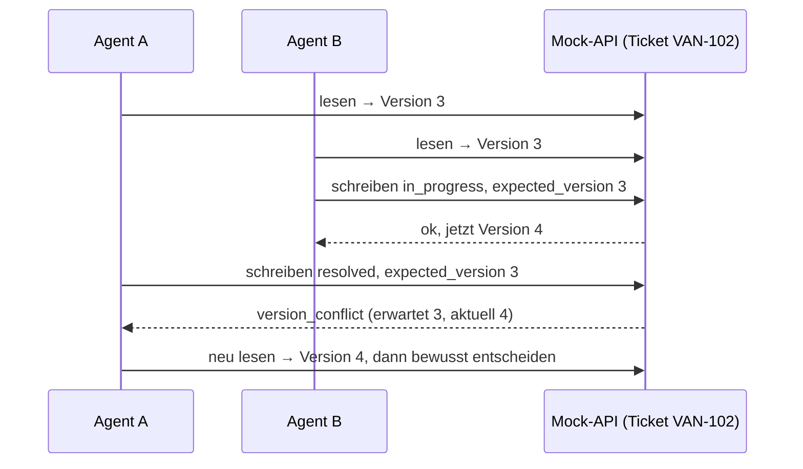
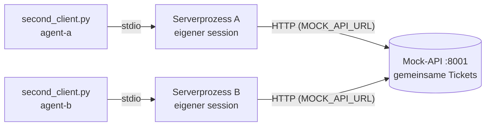

# Lab 3.3: Zwei Agenten, ein Kontext

**Leitfragen:**

<details>
<summary>Zwei Agenten ändern dasselbe Ticket fast gleichzeitig. Woran merkt der zweite, dass seine Daten veraltet sind?</summary>

Nur wenn er beim Schreiben mitteilt, welchen Stand er gelesen hat. Jede Änderung erhöht eine Versionsnummer am Ticket; weicht die mitgesendete Nummer von der aktuellen ab, hat jemand dazwischen geschrieben, und der Server lehnt mit einem Konfliktfehler ab.

</details>

<details>
<summary>Sperren, zusammenführen oder ablehnen: Was passt, wenn ein Fehler im Betrieb teuer ist?</summary>

Ablehnen mit klarer Meldung und erneutem Lesen: Nichts wird still überschrieben. Zusammenführen nur bei eindeutig vereinbaren Änderungen, Sperren nur für kurze, kritische Schreibvorgänge.

</details>

- Zwei Agenten auf demselben Ticket erzeugen das Lost-Update-Problem: Der spätere Schreibvorgang überschreibt den früheren, ohne ihn zu kennen.
- Ein Versionsfeld macht den Konflikt sichtbar, bevor Daten verloren gehen.

## Begriffe

| Begriff | Bedeutung in einem Satz |
| --- | --- |
| Lost Update | Eine Änderung geht verloren, weil ein zweiter Schreiber auf Basis eines veralteten Stands speichert – wie zwei Personen, die dieselbe Datei öffnen und nacheinander speichern. |
| Version | Zahl am Ticket, die bei jeder erfolgreichen Änderung um 1 steigt (`VAN-102` startet mit Version 3). |
| `expected_version` | Die Version, die der Schreibende zuvor gelesen hat und beim Schreiben mitschickt. |
| Versionsprüfung (optimistisch) | Schreiben ohne vorherige Sperre, aber nur, wenn `expected_version` noch aktuell ist; „optimistisch“, weil Konflikte als selten angenommen werden. |
| Sperre (pessimistisch) | Wer schreiben will, reserviert das Objekt vorab; andere warten. |
| Zusammenführen | Zwei Änderungen werden nach fachlichen Regeln zu einem Ergebnis verrechnet. |
| idempotent | Eine Aktion, die beim Wiederholen nichts mehr ändert, z. B. Status auf `in_progress` setzen, wenn er schon `in_progress` ist. |
| strukturierter Fehler | Tool-Ergebnis mit `isError: true`, dessen Text JSON mit festen Feldern ist (`error`, `message`, Details), damit ein Programm oder Modell gezielt reagieren kann. |
| simulierter Agent | Das Skript `shared/second_client.py`: liest, wartet und schreibt wie ein Agent, aber ohne LLM. |

## Das Problem: stilles Überschreiben

```text
Zeit ─►   Agent A                       Agent B                      Ticket VAN-102
  t1      liest: open, Version 3        liest: open, Version 3       open, v3
  t2      überlegt ...                  setzt in_progress            in_progress, v4
  t3      setzt resolved (ohne Prüfung)                              resolved, v5   ← B's Änderung ist weg
```

So sieht das mit dem Starter-Server (Schreib-Tool ohne Versionsprüfung) aus. Ausgabe von Agent B und Agent A, gekürzt:

```text
[agent-b] gelesen: VAN-102 Status=open Version=3
[agent-b] update_ticket_status({'ticket_id': 'VAN-102', 'status': 'in_progress'}) -> ok: {   "id": "VAN-102", ...
[agent-a] gelesen: VAN-102 Status=open Version=3
[agent-a] überlegt 10.0 s ...
[agent-a] update_ticket_status({'ticket_id': 'VAN-102', 'status': 'resolved'}) -> ok: {   "id": "VAN-102", ... "status": "resolved", ...
```

Am Ende steht `VAN-102` auf `resolved`, Version 5. Agent A bekommt `ok`; die Änderung von Agent B ist ohne Meldung verloren.

## Lösung: Versionsprüfung



## Synchronisationsstrategien

| Strategie | Prinzip | Vorteil | Nachteil | Passt zu |
| --- | --- | --- | --- | --- |
| Versionsprüfung (optimistisch) | Schreiben nur, wenn `expected_version` der aktuellen Version entspricht | einfach, keine Wartezeit, Konflikt wird gemeldet | Aufrufer muss neu lesen und wiederholen | Ops-Tickets, seltene Konflikte |
| Sperre (pessimistisch) | Wer schreiben will, sperrt das Objekt vorab | verhindert Konflikte im Voraus | Wartezeiten, verwaiste Sperren (Timeout nötig) | kurze, kritische Schreibvorgänge |
| Zusammenführen | Änderungen werden verrechnet, z. B. verschiedene Felder oder gleicher Zielstatus | weniger Abbrüche | fachliche Regeln nötig, Fehlerquelle bei Widersprüchen | idempotente oder feldgetrennte Änderungen |

Bei niedriger Fehlertoleranz gilt: lieber ein sichtbarer Konflikt als eine falsch zusammengeführte Änderung.

## Versionsprüfung im Projekt

Die Prüfung selbst steckt bereits in der Mock-API (`shared/mock_api/store.py`): Jede erfolgreiche Änderung erhöht `version` um 1, und `update_ticket` vergleicht die erwartete Version.

```python
# shared/mock_api/store.py (Ausschnitt)
if expected_version is not None and ticket["version"] != expected_version:
    raise VersionConflict(ticket_id, expected_version, ticket["version"])
ticket["status"] = status
ticket["version"] += 1
```

Wird `expected_version` nicht übergeben (`None`), prüft das Backend nichts. Genau das tut der Starter-Server. Die Übung reicht die Version im Tool durch und übersetzt die Ausnahme in einen strukturierten Fehler ([`server.py`](../project/examples/m03-context-and-state/l03-multi-agent/server.py)):

```python
@mcp.tool(annotations=WRITE)
def update_ticket_status(ticket_id: str, status: str, expected_version: int) -> Any:
    """Ticket-Status ändern (open, in_progress, resolved, closed). expected_version ist die zuvor gelesene Version des Tickets."""
    session.tool_calls += 1
    try:
        ticket = backend.update_ticket(ticket_id, status, expected_version)
    except NotFound as exc:
        raise ToolError(str(exc)) from exc
    except InvalidStatus as exc:
        return error_result("invalid_status", str(exc), ticket_id=ticket_id)
    except VersionConflict as exc:
        return error_result(
            "version_conflict",
            f"Ticket {ticket_id} wurde zwischenzeitlich geändert. Neu lesen mit get_ticket und erneut versuchen.",
            ticket_id=ticket_id, expected_version=exc.expected, current_version=exc.current,
        )
    session.remember_ticket(ticket)
    return ticket
```

- `expected_version` ist Pflichtargument: Wer schreibt, muss die gelesene Version mitsenden. `get_ticket` liefert sie im Feld `version`.
- `WRITE` ist wie `READ_ONLY` eine Konstante mit `ToolAnnotations`, hier mit `read_only_hint=False`: Hinweis an Clients, dass das Tool Daten ändert.
- Die Meldung sagt dem Agenten, was zu tun ist: neu lesen, dann erneut versuchen.

## Der Helfer `error_result`

`ToolError` aus Lab 2.2 liefert nur einen Text. Für einen Konflikt braucht der Aufrufer aber Felder, die ein Programm auslesen kann (`current_version`). Der Starter enthält dafür einen fertigen Helfer:

```python
def error_result(code: str, message: str, **details) -> CallToolResult:
    """Strukturierter Tool-Fehler: Code, Meldung und Details als JSON (is_error=True)."""
    payload = {"error": code, "message": message, **details}
    return CallToolResult(
        content=[TextContent(type="text", text=json.dumps(payload, ensure_ascii=False))],
        structured_content=payload,
        is_error=True,
    )
```

| | `raise ToolError("…")` | `return error_result(…)` |
| --- | --- | --- |
| Ergebnis | `isError: true`, Text `Error executing tool …: <Meldung>` | `isError: true`, Text ist JSON mit `error`, `message`, Details |
| Auswertbar für Programme | nur per Textsuche | per Feld, z. B. `structured_content["current_version"]` |
| Einsatz im Projekt | unbekanntes Ticket, fehlende ID | `version_conflict`, `invalid_status` |

Fehlerergebnis bei `expected_version` 3 und aktueller Version 4:

```json
{"error": "version_conflict", "message": "Ticket VAN-102 wurde zwischenzeitlich geändert. Neu lesen mit get_ticket und erneut versuchen.", "ticket_id": "VAN-102", "expected_version": 3, "current_version": 4}
```

## Zwei Agenten lokal

Geteilt wird hier nicht der Session-State aus Lab 3.2: Jeder stdio-Server ist ein eigener Prozess mit eigenem `session`. Geteilt werden die Ticketdaten. Dafür läuft die Mock-API als eigener HTTP-Dienst (Port 8001), den beide Serverprozesse über `MOCK_API_URL` nutzen; ohne diese Variable hält jeder Serverprozess seine eigene Kopie der Daten.



| Baustein | Aufgabe |
| --- | --- |
| `python shared/mock_api/app.py` | startet die Mock-API (gemeinsamer Zustand) in einem eigenen Terminal |
| `MOCK_API_URL=http://localhost:8001 python …` | setzt die Variable nur für diesen einen Befehl (Bash, unter Windows Git Bash) und schaltet den Server auf die HTTP-Mock-API |
| `shared/second_client.py` | simulierter Agent: liest ein Ticket, wartet `--hold` Sekunden, schreibt den Status `--status` |
| `curl localhost:8001/tickets/VAN-102` | aktuellen Stand des Tickets lesen |
| `curl -X POST localhost:8001/reset` | Tickets auf den Ausgangszustand zurücksetzen (Version 3) |

`second_client.py` sendet `expected_version` nur mit, wenn das Tool-Schema von `update_ticket_status` diesen Parameter enthält. Am Starter-Server fehlt er, also schreibt das Skript ungeprüft; nach Aufgabe 1 der Übung sendet es die gelesene Version automatisch mit.

## Zusammenführen als Erweiterung

Ein Konflikt ist unkritisch, wenn der gewünschte Status schon gilt (idempotent). Dann kann der Server das aktuelle Ticket zurückgeben statt einen Fehler zu melden. Bei abweichendem Status bleibt es beim Konflikt.

## Typische Fehler

| Symptom | Ursache | Lösung |
| --- | --- | --- |
| beide Agenten melden `ok`, Änderung von B fehlt | Server ohne `expected_version` (Starter-Stand) | Aufgaben 1 bis 3 umsetzen |
| kein Konflikt trotz zwei Clients | `MOCK_API_URL` fehlt: zwei Prozesse mit getrennten Daten | Befehl mit `MOCK_API_URL=http://localhost:8001` davor starten |
| Konflikt schon beim ersten Lauf, `current_version` größer als 4 | Daten vom vorigen Lauf nicht zurückgesetzt | `curl -X POST localhost:8001/reset` |
| `[agent-a] Lesen fehlgeschlagen: Error executing tool get_ticket` ohne weiteren Text | Mock-API in Terminal 1 läuft nicht; der Server erreicht `localhost:8001` nicht | `python shared/mock_api/app.py` starten, `curl localhost:8001/health` prüfen |
| Agent B meldet `ok`, Agent A auch, Version 5 | Terminal 3 zu spät gestartet (nach Ende der 10 Sekunden) | `reset`, dann Terminal 3 direkt nach Terminal 2 starten |
| `InvalidSignature` beim Serverstart | Rückgabetyp `dict \| CallToolResult` statt `Any` | Rückgabetyp `Any` verwenden (siehe Vertiefung) |

## Fazit

- Ohne Versionsprüfung überschreibt der spätere Schreibvorgang still.
- `expected_version` plus strukturierter Fehler `version_conflict` macht den Konflikt sichtbar und nennt den Weg zur Lösung.
- Geteilt werden die Daten im Backend, nicht der Session-State der einzelnen Serverprozesse.

Die Übung ergänzt die Versionsprüfung im Server und löst den Konflikt mit zwei simulierten Agenten aus.

## Vertiefung

- Der Rückgabetyp von `update_ticket_status` ist `Any`, weil das Tool entweder ein Ticket (`dict`) oder ein `CallToolResult` liefert. Die Angabe `dict | CallToolResult` lehnt das SDK beim Registrieren ab (`InvalidSignature`).
- Ein `CallToolResult` gibt das SDK unverändert an den Client weiter; ein `dict` wandelt es selbst in JSON-Text um.
- `store.py` prüft und erhöht die Version unter einer Python-Sperre (`threading.Lock`), damit zwei gleichzeitige Anfragen an die Mock-API nicht beide dieselbe Version sehen.
