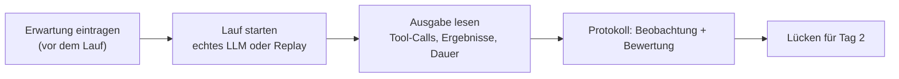

# Lab 4.2: End-to-End-Testlauf

**Leitfragen:**

Wo verhält sich der Agent heute noch nicht produktionsreif?

Das Schreib-Tool `update_ticket_status` ist ohne Rollenprüfung und Bestätigung aufrufbar, der Server schreibt kein Protokoll der Aufrufe, und er läuft nur als lokaler Prozess.

Was fehlt einem lokal laufenden Prototyp, bevor andere Teams ihn nutzen können?

Betrieb (Container, Orchestrierung), Absicherung (Zugriffskontrolle, Policy) und Monitoring (Logging, Alarme). Diese drei Lücken sind die Themen von Tag 2.

- Ein End-to-End-Test läuft vom Nutzertext über das Modell und MCP bis zum Tool und zurück.
- Das Protokoll hält fest, was erwartet war, was passierte und welche Lücke daraus folgt.

## Begriffe

| Begriff | Bedeutung in einem Satz |
| --- | --- |
| End-to-End-Test | Test des ganzen Wegs von der Nutzereingabe über Modell, Client und Server bis zum Tool und zurück. |
| Testprotokoll | Datei, die Befehl, erwartetes und tatsächliches Verhalten sowie die Bewertung festhält, sodass eine andere Person den Lauf nachvollziehen kann. |
| Auffälligkeit | Beobachtung, die funktioniert, aber anders als erwartet. |
| Lücke | Beobachtung, die vor dem produktiven Einsatz behoben werden muss. |
| `shared/agent_client.py` | Vorbereiteter Agent-Client: dieselbe Tool-Schleife wie `playground/agent.py` aus Lab 4.1, zusätzlich mit den Optionen `--server`, `--replay <Skript>` und `--prompt`. |

## Der Testlauf im Überblick

Getestet wird mit `shared/agent_client.py` statt mit dem eigenen `playground/agent.py`: Die Schleife ist dieselbe, aber `--prompt` erlaubt einzelne Testeingaben, und andere Replay-Skripte (`workflow`) lassen sich wählen. So ist jeder Lauf mit einem einzigen Befehl wiederholbar.

| Option | Wirkung |
| --- | --- |
| `--server playground/server.py` | welcher Server als Kindprozess startet |
| `--replay` | Replay-LLM mit Skript `dialog`; `--replay workflow` wählt das Skript Ticket → Log → Statusänderung |
| `--prompt "…"` | feste Nutzereingabe statt Skript oder Tastatur; mehrfach möglich |

## Aufbau eines Testprotokolls

Vorlage: `starters/m04-l02-testrun.md`. Fertiges Beispiel: `examples/m04-agent-prototype/l02-testrun/testdialog.md` mit dem Lauf in `testlauf.log`.

| Abschnitt | Inhalt |
| --- | --- |
| Befehl | genauer Aufruf; echtes LLM mit Modellname oder Skript-Agent (Replay) |
| Testdialog | je Schritt: Eingabe, erwarteter Tool-Call, tatsächlicher Tool-Call, Ergebnis ok? |
| Beobachtungen | Tool-Auswahl, Argumente, Antwortqualität, Dauer; je Zeile eine Bewertung |
| Lücken | was für den produktiven Einsatz fehlt, je Lücke eine Zeile |

## Worauf der Lauf zu lesen ist

| Ausgabezeile | Bedeutung |
| --- | --- |
| `Verbunden mit vantra-ops, Protokoll 2026-07-28` | Verbindung steht, Server meldet die Protokollversion |
| `Tools: …  ·  LLM: …` | entdeckte Tools und verwendetes Backend (`replay` = Skript-Agent) |
| `→ Tool-Call: name(args)` | Wahl des Modells, mit Argumenten |
| `← ok: …` / `← FEHLER: …` | Ergebnis des Tools; bei Fehler erhält das Modell den Text |
| `Agent: …` | Antwort an den Nutzer |

Bewertung einer Beobachtung: wie erwartet, Auffälligkeit (funktioniert, aber unerwartet) oder Lücke (für den Betrieb zu beheben).

Dauer: Je Antwort die Sekunden vom Absenden bis zur Zeile `Agent: …` notieren. Replay antwortet praktisch sofort; beim echten LLM hängt die Dauer von Modell und Rechner ab. Mehr als 60 Sekunden je Antwort gilt im Kurs als zu langsam für den Dialog.

## Kennzeichnung der Läufe

| Lauf | Aussage | Kennzeichnung im Protokoll |
| --- | --- | --- |
| echtes LLM | prüft Tool-Auswahl des Modells; Ergebnis kann schwanken | Modellname, z. B. `qwen3:8b` |
| Replay (`--replay`) | prüft Server, Kontext und Verdrahtung; Tool-Calls sind vorgegeben | „Skript-Agent (Replay)“ |

## Typische Fehler

| Symptom | Ursache | Lösung |
| --- | --- | --- |
| `Start nicht möglich: …` oder `Fehler: APIConnectionError` | Ollama nicht erreichbar | wie in Lab 4.1, „Typische Fehler“; sonst Replay-Lauf |
| `Tools: (keine)` oder Server-Fehler beim Start | `playground/server.py` fehlt oder ist defekt | Dateien aus `examples/m04-agent-prototype/l01-agent-client/` kopieren |
| `Replay: Für diese Eingabe gibt es kein Skript.` | eigener Satz mit `--replay` | nur die Sätze aus der Übung verwenden |
| `Agent: Abbruch nach zu vielen Tool-Schritten.` | Modell ruft endlos Tools auf | als Beobachtung „Lücke“ notieren |

## Fazit

- Ein Testprotokoll hat vier Teile: Befehl, Testdialog, Beobachtungen, Lücken.
- Replay-Läufe sind reproduzierbar, sagen aber nichts über die Auswahl eines Modells.

Die Übung führt den Dialog „Ticket abfragen, dann Deployment-Log prüfen“ durch und dokumentiert ihn im Protokoll.
