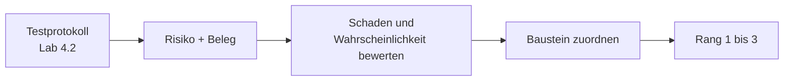

# Lab 4.3: Debrief

**Leitfragen:**

Welches Risiko wäre in einer echten Vantra-Umgebung am kritischsten?

Der ungeschützte Schreibzugriff: Ein Agent, dem fremder Text (z. B. eine Ticket-Beschreibung) als Anweisung dient, könnte Tickets ändern, ohne dass Rolle, Bestätigung oder Protokoll greifen.

Was braucht der Prototyp zuerst – Absicherung, Betrieb oder Monitoring?

Absicherung: Betrieb und Monitoring verteilen bzw. beobachten sonst einen ungeschützten Dienst. Monitoring erkennt Vorfälle, verhindert sie aber nicht. Eine andere Reihenfolge ist mit Begründung vertretbar.

- Der Debrief verdichtet den Testlauf zu einer priorisierten Liste offener Punkte.
- Priorität ergibt sich aus Schaden und Eintrittswahrscheinlichkeit, nicht aus der Reihenfolge der Entdeckung.

## Begriffe

| Begriff | Bedeutung in einem Satz |
| --- | --- |
| Risiko | Etwas, das im Betrieb schiefgehen kann, zusammen mit seinen Folgen. |
| Schaden | Wie schwer die Folgen wären, wenn das Risiko eintritt. |
| Eintrittswahrscheinlichkeit | Wie oft oder wie leicht das Risiko im normalen Betrieb eintritt. |
| Beleg | Konkrete Beobachtung aus dem Testlauf, die das Risiko stützt. |
| Annahme | Risiko ohne eigenen Beleg im Testlauf; wird als solche markiert und später geprüft. |
| Baustein | Themenblock, der ein Risiko behebt: Absicherung, Betrieb oder Monitoring. |

## Von der Beobachtung zum Risiko

| Schritt | Frage | Quelle |
| --- | --- | --- |
| Sammeln | Welche Lücken und Auffälligkeiten stehen im Testprotokoll? | `playground/testlauf.md` (Lab 4.2) |
| Beschreiben | Was kann konkret schiefgehen? | Beleg aus dem Lauf |
| Bewerten | Wie hoch ist der Schaden, wie wahrscheinlich der Eintritt (hoch / mittel / niedrig)? | Einschätzung der Gruppe |
| Zuordnen | Welcher Baustein behebt es? | Tabelle unten |
| Priorisieren | Welche drei Punkte zuerst? | Schaden vor Wahrscheinlichkeit |

## Lücken und Bausteine

| Lücke aus dem Testlauf | Risiko | Baustein |
| --- | --- | --- |
| Schreib-Tool ohne Rollenprüfung und Bestätigung | unbefugte oder untergeschobene Änderungen | Zugriffskontrolle, Policy, Bestätigung |
| Fremdtext aus Tool-Ergebnissen wird dem Modell als Daten gegeben | Prompt Injection | Policy-Layer, Eingabevalidierung |
| Kein Protokoll der Aufrufe auf Serverseite | Vorfälle nicht nachvollziehbar | Logging, Alarme |
| Nur lokaler Prozess, kein Dienstbetrieb | kein Betrieb für mehrere Nutzer, keine Wiederherstellung | Container, Orchestrierung, Pipeline |
| Kontext nur im Prozess | Verlust bei Neustart | Memory-Entscheidung (Lab 3.1) |

## Bewertungsraster

| Stufe | Schaden | Beispiel |
| --- | --- | --- |
| hoch | Daten ändern oder abfließen, Dienst ausfallen | Ticket ohne Berechtigung auf `closed` |
| mittel | falsche Antwort, mühsame Fehlersuche | fehlendes Protokoll bei Fehlverhalten |
| niedrig | Komfort | Antwort ohne alle Log-Zeilen |

| Stufe | Eintrittswahrscheinlichkeit | Beispiel |
| --- | --- | --- |
| hoch | tritt bei normaler Nutzung oder bei jedem Vorfall ein | fehlendes Protokoll bei jeder Fehlersuche |
| mittel | braucht einen Fehler, eine Verwechslung oder einen präparierten Text | Modell wählt bei vager Frage das Schreib-Tool |
| niedrig | braucht mehrere seltene Umstände zugleich | Neustart genau während einer laufenden Analyse |

Fremdtext als Anweisung (Prompt Injection, Lab 3.1) zeigt der Testlauf aus Lab 4.2 nicht; diese Zeile ist eine Annahme und wird als solche markiert.

## Fazit

- Der Debrief erzeugt eine kurze Liste mit Risiko, Bewertung, Baustein und Rangfolge.
- Der ungeschützte Schreibzugriff ist die größte offene Lücke des Prototyps.

Die Übung verdichtet das Testprotokoll aus Lab 4.2 zu dieser Liste.
