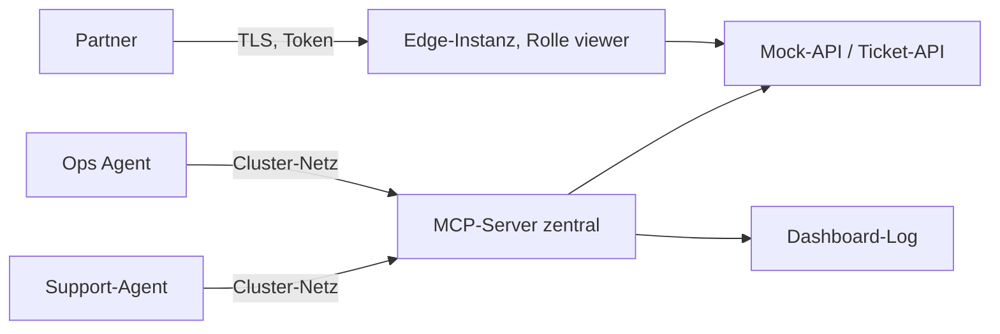

# Lab 5.1 – Lösung: Platzierung des Vantra-MCP-Servers entscheiden

## Aufgabe 1: Tabelle bewerten

| Kriterium | Sidecar | Zentraler Service | Edge |
| --- | --- | --- | --- |
| Latenz für interne Agenten | + | o | – |
| Angriffsfläche | + | o | – |
| Ein Betriebspunkt für Version und Rechte | – | + | + |
| Zwei interne Agenten teilen Server | – | + | o |
| Externer Partner-Zugriff möglich | – | – | + |
| Kontext und Rolle je Agent getrennt | + | – | – |

- Sidecar: Latenz und Angriffsfläche sind am besten, weil der Server nur über localhost erreichbar ist. Ein Betriebspunkt fehlt: jeder Agent bringt eine eigene Instanz mit.
- Zentraler Service: ein Deployment mit Service bedient beide internen Agenten. Der Partner bleibt ausgeschlossen, weil der Service nur im Cluster erreichbar ist.
- Edge: ermöglicht den Partner-Zugriff, kostet aber Latenz und vergrößert die Angriffsfläche.

## Aufgabe 2: Summen

| | Sidecar | Zentraler Service | Edge |
| --- | --- | --- | --- |
| `+` | 3 | 2 | 2 |
| `–` | 3 | 2 | 3 |

Die Summen allein entscheiden nicht; die Pflichtzeilen (Betriebspunkt, geteilter Server) sind für Sidecar `–`.

## Aufgabe 3: Entscheidung

```text
Entscheidung: Der MCP-Server läuft als zentraler Service (ein Deployment mit Service) im Vantra-Cluster.
Begründung: Beide internen Agenten nutzen dieselben Tools, und das Betriebsteam will einen Ort für Version
und Rechte; das erfüllt nur der zentrale Service (Zeilen 3 und 4). Die Latenz bleibt ein Hop im Cluster.
Der Partner-Zugriff entfällt bewusst, bis eine getrennte Edge-Instanz mit eigener Rolle besteht.
```

## Aufgabe 4: Adresse und Konfiguration

```text
Adresse:   http://vantra-ops-mcp:8000/mcp
Variable:  MCP_SERVER_URL (Konfiguration des Agent-Clients, nicht im Code)
```

Der Name `vantra-ops-mcp` ist der Service-Name aus `k8s.yaml`; innerhalb desselben Namespaces genügt er als DNS-Name.

## Aufgabe 5: Versionierung

```text
Image-Tag:  vantra-ops-mcp:1.0.0   (alternativ der Commit-SHA, wie in der Pipeline)
Kommando:   kubectl rollout history deployment/vantra-ops-mcp
```

Ein fester Tag macht jede Revision eindeutig; mit `latest` wäre ein Rollback nicht nachvollziehbar.

## Aufgabe 6: Risiko

```text
Risiko: Kontext und Rolle gelten je Serverprozess; beide internen Agenten teilen sich den Kontext
        (z. B. last_ticket), und mit 2 Replikas sieht jeder Pod einen eigenen.
Maßnahme: Kontext je Sitzung statt je Prozess ersetzen bzw. je Team ein eigenes Deployment betreiben;
          bis dahin den Kontext nur für nicht vertrauliche Daten nutzen.
```

## Gültige Alternativen

| Entscheidung | Wann sie trägt |
| --- | --- |
| Sidecar je Agent | Kontext und Rolle müssen strikt je Agent getrennt bleiben; höherer Betriebsaufwand wird akzeptiert |
| Zentraler Service intern plus Edge-Instanz für den Partner | der Partner-Zugriff kommt tatsächlich; Edge bekommt eigene Rolle `viewer`, TLS und Rate-Limit |

## Erweiterung



| Grenze | Wer verbindet | Authentifizierung | Protokollierung |
| --- | --- | --- | --- |
| Internet → Edge | Partner | Token, TLS (Details in Modul 7) | jeder Aufruf mit Client-Kennung |
| Cluster → Zentraler Server | Ops Agent, Support-Agent | NetworkPolicy auf diese Pods; Rolle je Prozess | Tool-Call-Protokoll |
| Server → Mock-API | nur MCP-Server-Pods | NetworkPolicy; optional `MOCK_API_TOKEN` | API-Log |

Der Partner-Zugriff läuft über eine getrennte Edge-Instanz: eigene Rolle `viewer`, eigene Rate-Limits, und ein Fehler dort gefährdet das interne Deployment nicht.
