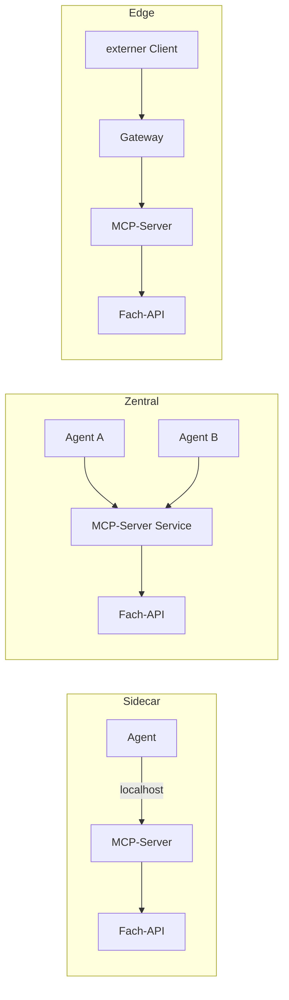

# Lab 5.1: Integrationsmuster für MCP-Server

**Leitfragen:**

Welche Latenz-/Sicherheits-Trade-offs ergeben sich je Platzierung?

Sidecar: kürzester Weg (localhost) und kleinste Angriffsfläche, dafür ein Server je Agent. Zentraler Service: ein Betriebspunkt, aber Netzwerk-Hop und gemeinsame Angriffsfläche. Edge: ideal für externe Clients, braucht Authentifizierung am Rand und kostet einen weiteren Hop.

Wie wird der Server beim Deployment versioniert?

Über den Image-Tag (fest, z. B. `1.0.0` oder Commit-SHA, nie `latest`), der Deployment-Revision und das Tool-Schema. Das Protokoll hat eine eigene Version (`2026-07-28`); die Server-Version meldet das SDK im Projekt nicht (`serverInfo.version` ist leer).

- Ein MCP-Server ist ein Netzwerkdienst wie jeder andere: Platzierung, Namensauflösung und Netzwerkgrenzen bestimmen Latenz und Sicherheit.
- Drei Grundmuster decken die meisten Fälle ab: Sidecar, zentraler Service, Edge.

## Ausgangslage Vantra

Im Kurs läuft der Server bisher als stdio-Kindprozess des Agenten. Ab Modul 6 läuft er als Container mit Streamable HTTP.

| Baustein | Port | Rolle |
| --- | --- | --- |
| MCP-Server (`vantra-ops`) | 8000 | Endpunkt `/mcp`, Health `/health` |
| Mock-API (Tickets, Deployments) | 8001 | interne Fachanwendung |
| Dashboard | 8080 | liest das Tool-Call-Protokoll |
| Agent-Client | – | Aufrufer, spricht MCP |

Eigenschaften des Projekt-Servers, die jede Platzierung beeinflussen:

- Der Kontext (`context://session`) lebt je Serverprozess, nicht je Client.
- Die Rolle (`VANTRA_ROLE`) gilt je Serverprozess und damit für alle Verbindungen dieses Prozesses.
- Der Zustand der Fachdaten liegt in der Mock-API, nicht im MCP-Server.

## Drei Platzierungsmuster

| Muster | Aufbau | Transport | Passt zu |
| --- | --- | --- | --- |
| Sidecar | Server läuft neben dem Agenten (gleicher Pod oder Host) | stdio oder localhost-HTTP | ein Agent, eigener Kontext, strenge Isolation |
| Zentraler Service | ein Deployment mit Service im Cluster, mehrere Agenten | Streamable HTTP | mehrere interne Agenten, ein Betriebspunkt |
| Edge | Server oder Gateway am Rand, vor externen Clients | Streamable HTTP, TLS | Partner, externe Agenten, IDE-Clients |

## Trade-offs je Muster

| Kriterium | Sidecar | Zentraler Service | Edge |
| --- | --- | --- | --- |
| Latenz | niedrig (kein Netzwerk-Hop) | ein Hop im Cluster | Hop über Rand, TLS-Aufbau |
| Angriffsfläche | klein (nur localhost) | mittel (Cluster-Netz) | groß (von außen erreichbar) |
| Isolation von Kontext und Rolle | pro Agent, natürlich | je Prozess, gemeinsam | je Prozess, gemeinsam |
| Betrieb und Updates | viele Instanzen, jede Agent-Version bringt ihren Server mit | eine Instanz, ein Rollout | eine Instanz plus Gateway-Regeln |
| Skalierung | mit dem Agenten | Replikate hinter dem Service | Replikate plus Rate-Limits |
| Pflicht-Absicherung | Container-Rechte | Netzwerkregeln, Rolle, Bestätigung | Authentifizierung, TLS, Rate-Limit |

## Service Discovery und Netzwerkgrenzen

| Umgebung | Adresse des Servers | Mechanismus |
| --- | --- | --- |
| lokal | `http://localhost:8000/mcp` | Portfreigabe `-p 8000:8000` |
| Docker Compose | `http://mcp-server:8000/mcp` | Dienstname als DNS-Name im Compose-Netz |
| Kubernetes | `http://vantra-ops-mcp:8000/mcp` (im Namespace) | Service-DNS; namespaceübergreifend `vantra-ops-mcp.<namespace>.svc.cluster.local` |

- Der Agent bekommt die Server-URL aus Konfiguration (`MCP_SERVER_URL`), nie fest im Code.
- Grenzen sind Vertrauensgrenzen: Agent → MCP-Server, MCP-Server → Fach-API, Internet → Edge. Je Grenze zählt: wer darf verbinden, wer authentifiziert, was wird protokolliert.
- Im Cluster begrenzen Namespaces und NetworkPolicies, welche Pods den Server erreichen; die Mock-API sollte nur der MCP-Server erreichen.
- Der Container bindet an `0.0.0.0`. Dann ist der DNS-Rebinding-Schutz des SDK aus (nur bei `127.0.0.1`/`localhost` automatisch an); im Projekt ist `transport_security` nicht gesetzt. Erreichbarkeit regeln darum Netzwerk und Portfreigabe (`127.0.0.1:8000:8000`).

## Versionierung beim Deployment

| Ebene | Wert | Wo sichtbar |
| --- | --- | --- |
| Image | fester Tag (`vantra-ops-mcp:1.0.0` oder Commit-SHA) | `k8s.yaml`, Registry |
| Deployment-Revision | Kubernetes-Revisionsnummer | `kubectl rollout history deployment/vantra-ops-mcp` |
| Protokoll | `2026-07-28` | `server/discover` → `supportedVersions` |
| Tool-Schema | Namen und Parameter der Tools | `tools/list` |

- Eine Änderung an Toolnamen oder Pflichtparametern bricht Clients; neue Tools oder optionale Parameter bleiben kompatibel.
- Rollout ohne Ausfall: neue Replikate starten, erst nach bestandenem Readiness-Check geht Verkehr dorthin (Lab 6.2).
- Rollback ist nur eindeutig, wenn jede Revision einen festen Tag trägt.

> **Merksatz:** Die Platzierung entscheidet, wer den Server erreichen kann; Authentifizierung und Rechte (Modul 7) entscheiden, was dieser Kreis damit darf.

## Fazit

- Sidecar für Isolation, zentraler Service für gemeinsamen Betrieb, Edge für externe Clients.
- Je Platzierung verschiebt sich der Trade-off zwischen Latenz, Angriffsfläche und Betriebsaufwand.
- Versioniert wird über feste Image-Tags; das Protokoll hat eine eigene Version.

In der Übung entsteht für Vantra eine ausgefüllte Entscheidungstabelle mit Begründung.
