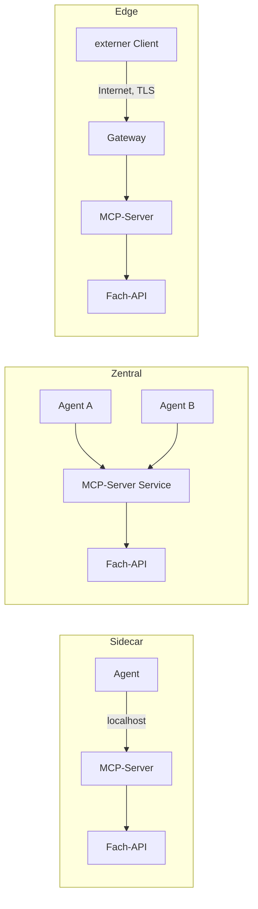

# Lab 5.1: Integrationsmuster für MCP-Server

**Leitfragen:**

Ein MCP-Server läuft direkt neben dem Agenten oder als zentraler Dienst für viele Agenten. Was spricht jeweils dafür?

Direkt daneben (Sidecar, „Beiwagen“): kürzester Weg über `localhost`, kleinste Angriffsfläche, dafür ein Server je Agent. Zentraler Dienst: eine Stelle für Betrieb und Updates, dafür ein Netzwerkweg mehr und eine gemeinsame Angriffsfläche. Für Zugriffe von außen kommt ein vorgeschaltetes Gateway am Netzwerkrand (Edge) hinzu.

Wie wird der Server beim Deployment versioniert?

Über einen festen Image-Tag (z. B. `1.0.0` oder die Kennung des Git-Commits), nie `latest`, dazu über die Namen und Parameter der Tools. Das Protokoll hat eine eigene Version (`2026-07-28`), unabhängig von der Version des Servers.

- Ein MCP-Server ist ein Netzwerkdienst wie jeder andere: Platzierung, Adresse und Netzwerkgrenzen bestimmen Latenz und Sicherheit.
- Drei Grundmuster decken die meisten Fälle ab: Sidecar, zentraler Service, Edge.

## Begriffe

| Begriff | Bedeutung in einem Satz |
| --- | --- |
| Sidecar | Der MCP-Server läuft als eigener Prozess oder Container direkt neben genau einem Agenten, wie ein Beiwagen am Motorrad. |
| Zentraler Service | Ein einziger MCP-Server im Firmennetz bedient viele Agenten, wie ein gemeinsamer Drucker im Büro. |
| Gateway | Vorgeschalteter Dienst, der Anfragen von außen annimmt, prüft (Anmeldung, Verschlüsselung, Mengenbegrenzung) und nach innen weiterreicht, wie ein Empfang mit Ausweiskontrolle. |
| Edge | Der Rand des eigenen Netzes zum Internet; dort steht das Gateway. |
| TLS | Verschlüsselung der HTTP-Verbindung (`https://`). |
| Rate-Limit | Obergrenze für Aufrufe je Zeitraum, z. B. 60 je Minute und Client. |
| Netzwerk-Hop | Ein Weg über das Netzwerk zu einem anderen Rechner oder Container; jeder Hop kostet etwas Zeit. |
| Vertrauensgrenze | Stelle, an der Daten von einem Bereich in einen anderen wechseln und geprüft werden müssen (z. B. Internet → Firmennetz). |
| Cluster | Verbund mehrerer Rechner, auf denen eine Plattform (z. B. Kubernetes) Container verteilt und am Laufen hält (Lab 6.2). |
| Pod | Kleinste Einheit in Kubernetes: ein oder wenige Container, die zusammen starten, ähnlich einem `docker run` (Lab 6.2). |
| Service (Kubernetes) | Fester Name und feste Adresse für eine Gruppe von Pods, ähnlich dem Dienstnamen in Docker Compose (Lab 6.1, 6.2). |
| Replika | Eine von mehreren gleichen Kopien desselben Containers, die sich die Last teilen (Lab 6.2). |
| Namespace | Abgetrennter Bereich in einem Cluster, z. B. je Team; Namen gelten zunächst nur darin (Lab 6.2). |

## Ausgangslage Vantra

Im Kurs läuft der Server bisher als stdio-Kindprozess des Agent-Clients (Lab 1.2). Ab Modul 6 läuft er als Container mit Streamable HTTP (Lab 1.2: Server lauscht auf einer URL).

| Baustein | Port | Rolle |
| --- | --- | --- |
| MCP-Server (`vantra-ops`) | 8000 | Endpunkt `/mcp`, Health-Pfad `/health` (Lab 5.2) |
| Mock-API (Tickets, Deployments) | 8001 | interne Fachanwendung |
| Dashboard | 8080 | zeigt Tool-Aufrufe an (vorbereitet, gefüllt ab Lab 8.1) |
| Agent-Client | – | Aufrufer, spricht MCP |

Eigenschaften des Projekt-Servers, die jede Platzierung beeinflussen:

- Der Kontext (`context://session`, Lab 3.2) lebt je Serverprozess, nicht je Client: Zwei Agenten an einem Server teilen sich `last_ticket`.
- Der Zustand der Fachdaten liegt in der Mock-API, nicht im MCP-Server.
- Rechte je Aufrufer (Rollen) kommen erst in Modul 7 hinzu; sie gelten dort ebenfalls je Serverprozess.

## Drei Platzierungsmuster

- **Sidecar:** Der Server läuft neben genau einem Agenten auf demselben Rechner oder im selben Pod; nur dieser Agent erreicht ihn über `localhost`.
- **Zentraler Service:** Der Server läuft einmal im Firmennetz oder Cluster; mehrere interne Agenten verbinden sich über seinen Namen.
- **Edge:** Ein Gateway am Netzwerkrand nimmt Aufrufe externer Clients an, prüft sie und reicht sie an einen Server dahinter weiter.

Das Diagramm zeigt die drei Muster nebeneinander:

| Muster | Aufbau | Transport | Passt zu |
| --- | --- | --- | --- |
| Sidecar | Server läuft neben dem Agenten (gleicher Rechner oder Pod) | stdio oder localhost-HTTP | ein Agent, eigener Kontext, strenge Isolation |
| Zentraler Service | ein Server mit festem Namen im Cluster, mehrere Agenten | Streamable HTTP | mehrere interne Agenten, ein Betriebspunkt |
| Edge | Gateway am Rand, Server dahinter | Streamable HTTP über TLS | Partner, externe Agenten, IDE-Clients |

## Trade-offs je Muster

| Kriterium | Sidecar | Zentraler Service | Edge |
| --- | --- | --- | --- |
| Latenz | niedrig (kein Netzwerk-Hop) | ein Hop im Cluster | Hop über das Internet, TLS-Aufbau |
| Angriffsfläche | klein (nur localhost) | mittel (Firmen- bzw. Cluster-Netz) | groß (von außen erreichbar) |
| Trennung des Kontexts | pro Agent, natürlich | gemeinsam für alle Agenten | gemeinsam für alle Clients |
| Betrieb und Updates | viele Instanzen, jede Agent-Version bringt ihren Server mit | eine Instanz, ein Update | eine Instanz plus Gateway-Regeln |
| Skalierung | wächst mit der Zahl der Agenten | Replikas hinter dem Service | Replikas plus Rate-Limits |
| Pflicht-Absicherung | Container-Rechte | Netzwerkregeln, Rechte je Aufrufer (Modul 7) | Anmeldung, TLS, Rate-Limit |

## Adressen und Netzwerkgrenzen

Ein Client braucht die Adresse des Servers. Wie sie lautet, hängt von der Umgebung ab:

| Umgebung | Adresse des Servers | Mechanismus |
| --- | --- | --- |
| lokal | `http://localhost:8000/mcp` | Portfreigabe `-p 8000:8000` (Docker-Grundlagen) |
| Docker Compose | `http://mcp-server:8000/mcp` | Dienstname dient als Hostname (Lab 6.1) |
| Kubernetes | `http://vantra-ops-mcp:8000/mcp` | Service-Name dient als Hostname im selben Namespace (Lab 6.2) |
| Kubernetes, anderer Namespace | `http://vantra-ops-mcp.<namespace>.svc.cluster.local:8000/mcp` | voller Service-Name |

Das Finden eines Dienstes über einen Namen statt über eine feste IP-Adresse heißt **Service Discovery**.

- Der Agent bekommt die Server-URL aus der Konfiguration (Umgebungsvariable `MCP_SERVER_URL`), nie fest im Code.
- Vertrauensgrenzen im Projekt: Agent → MCP-Server, MCP-Server → Fach-API, Internet → Edge. Je Grenze zählt: wer darf verbinden, wer meldet sich wie an, was wird protokolliert.
- Im Cluster begrenzen Netzwerkregeln (in Kubernetes: NetworkPolicy), welche Pods den Server erreichen; die Mock-API soll nur der MCP-Server erreichen.
- Der Server im Container lauscht auf allen Netzwerkschnittstellen (`0.0.0.0`, Lab 5.2). Damit ist ein Schutz des SDK aus, der Webseiten im Browser den Zugriff auf lokale Dienste verwehrt (DNS-Rebinding-Schutz, nur bei `127.0.0.1`/`localhost` aktiv). Erreichbarkeit regeln darum Netzwerk und Portfreigabe, z. B. `127.0.0.1:8000:8000`.

## Versionierung beim Deployment

| Ebene | Wert | Wo sichtbar |
| --- | --- | --- |
| Image | fester Tag (`vantra-ops-mcp:1.0.0` oder die ersten Zeichen der Commit-Kennung, z. B. `3f9c2a1b7e04`) | Docker-Befehle, später `k8s.yaml` |
| Deployment-Revision | laufende Nummer je Ausrollen in Kubernetes | `kubectl rollout history deployment/vantra-ops-mcp` (Lab 6.2) |
| Protokoll | `2026-07-28` | `server/discover` → `supportedVersions` (Lab 2.1) |
| Tool-Schema | Namen und Parameter der Tools | `tools/list` (Lab 1.2) |

- Eine Änderung an Toolnamen oder Pflichtparametern bricht Clients; neue Tools oder optionale Parameter bleiben kompatibel.
- Ein Update ohne Ausfall startet zuerst die neue Version und schaltet erst um, wenn sie antwortet (Lab 6.2).
- Ein Rollback (Zurückgehen auf die vorige Version) ist nur eindeutig, wenn jede Version einen festen Tag trägt.

> **Merksatz:** Die Platzierung entscheidet, wer den Server erreichen kann; Anmeldung und Rechte (Modul 7) entscheiden, was dieser Kreis damit darf.

## Typische Fehler

| Symptom | Ursache | Lösung |
| --- | --- | --- |
| Zweiter Agent sieht `last_ticket` des ersten | Kontext gilt je Serverprozess, beide nutzen denselben zentralen Server | Sidecar je Agent oder Kontext je Sitzung |
| Agent findet den Server nach Umzug nicht | URL fest im Code | URL aus `MCP_SERVER_URL` lesen |
| Fach-API von außen erreichbar | Edge reicht alles durch, keine Netzwerkregel | Gateway nur vor dem MCP-Server, Fach-API nur intern |
| Rollback landet auf unbekanntem Stand | Image-Tag `latest` | fester Tag je Release |

## Fazit

- Sidecar für Isolation, zentraler Service für gemeinsamen Betrieb, Edge für externe Clients.
- Je Platzierung verschiebt sich der Trade-off zwischen Latenz, Angriffsfläche und Betriebsaufwand.
- Versioniert wird über feste Image-Tags; das Protokoll hat eine eigene Version.

In der Übung entsteht für Vantra eine ausgefüllte Entscheidungstabelle mit Begründung.
