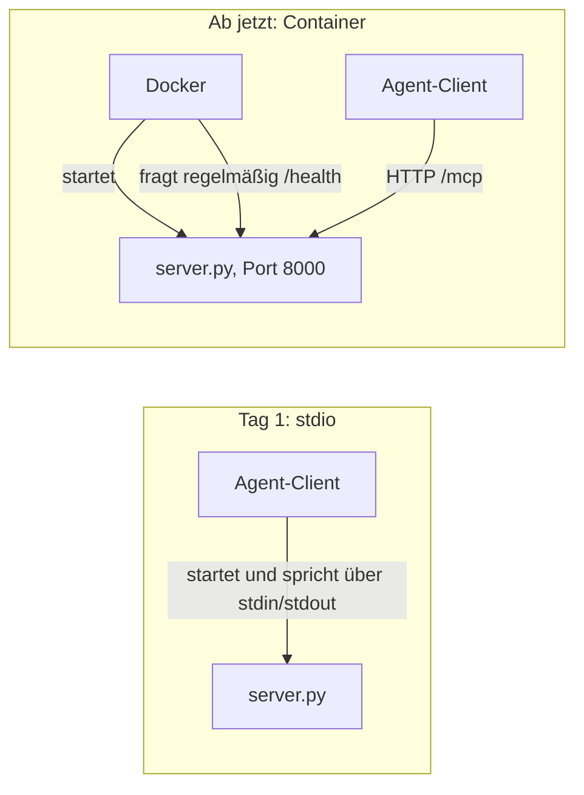

# Lab 5.2: Vorbereitung auf Containerisierung

**Leitfragen:**

<details>
<summary>Welche Konfiguration darf nicht im Image landen?</summary>

Alles Geheime: Schlüssel, Tokens, Passwörter (z. B. `LLM_API_KEY`) und `.env`-Dateien. Ein Image wird geteilt und ändert sich nicht mehr; Geheimnisse (Secrets) kommen erst beim Start des Containers über Umgebungsvariablen hinzu.

</details>

<details>
<summary>Woran erkennt eine Plattform, dass ein Container zwar läuft, aber nicht mehr antwortet?</summary>

Daran, dass sie regelmäßig eine kleine Testanfrage schickt und keine Antwort bekommt. Dafür bietet der Server eine eigene Adresse an (Health-Pfad `/health`); Docker fragt sie mit `HEALTHCHECK` ab, Kubernetes mit sogenannten Probes (Lab 6.2).

</details>

- Ein containerfähiger MCP-Server liest seine Konfiguration aus Umgebungsvariablen, bietet einen Health-Pfad und läuft ohne Root-Rechte.
- Im Container ersetzt Streamable HTTP den stdio-Transport (Lab 1.2); derselbe Servercode läuft in beiden Modi.

## Begriffe

| Begriff | Bedeutung in einem Satz |
| --- | --- |
| Umgebungsvariable | Wert, den ein Prozess beim Start von außen bekommt (`MCP_PORT=8000`), statt ihn im Code fest zu schreiben. |
| Secret | Geheimer Wert (Schlüssel, Token, Passwort), der nie ins Image und nie ins Repository gehört. |
| Health-Pfad (Health-Endpunkt) | Eigene HTTP-Adresse (`/health`), die nur „lebt“ meldet; Plattformen fragen sie regelmäßig ab, wie ein Puls-Check. |
| Orchestrator | Plattform, die Container startet, überwacht und bei Bedarf neu startet, z. B. Docker Compose (Lab 6.1) oder Kubernetes (Lab 6.2). |
| Nicht-Root | Der Prozess im Container läuft als normaler Nutzer statt als Administrator (`root`); bei einem Einbruch kann er weniger anrichten. |
| Layer-Cache | Docker merkt sich jeden Schritt des Dockerfiles; unveränderte Schritte werden beim nächsten Build übersprungen. |
| Build-Kontext | Ordner, den `docker build` an Docker übergibt; `COPY` liest nur daraus (hier: `output/project`). |
| `.dockerignore` | Liste von Dateien, die nicht in den Build-Kontext gelangen, ähnlich `.gitignore`. |
| `0.0.0.0` | „Auf allen Netzwerkschnittstellen lauschen“; nötig, damit Anfragen von außerhalb des Containers ankommen. |
| Volume | Speicherbereich außerhalb des Containers, der einen Neustart überlebt. |

## Vom Prototyp zum Container

Der Prototyp aus Lab 4.1 startet als Kindprozess des Agent-Clients. Im Container startet Docker den Server allein; der Client verbindet sich danach über HTTP:



- stdio ginge im Container nur mit `docker run -i` und dem Client als startendem Prozess; für einen Dienst, den mehrere Clients nutzen, passt das nicht.
- Streamable HTTP lässt den Server unabhängig vom Client laufen; der Client braucht nur die URL.

## Anforderungen an einen containerfähigen Server

| Anforderung | Grund | Umsetzung im Projekt |
| --- | --- | --- |
| Konfiguration per Umgebung | ein Image für alle Umgebungen | `MCP_TRANSPORT`, `MCP_HOST`, `MCP_PORT`, `MOCK_API_URL`; vorbereitet: `TOOL_CALL_LOG` (wirkt ab Lab 8.1), `VANTRA_ROLE` (wirkt ab Lab 7.1) |
| Netzwerk-Transport | der Server läuft ohne startenden Client | Streamable HTTP auf Port 8000, Endpunkt `/mcp` |
| Health-Pfad | Orchestrator erkennt Start, Bereitschaft, Hänger | `GET /health` → `{"status":"ok"}` |
| Keine Secrets im Image | Image ist teilbar und unveränderlich | Secrets zur Laufzeit (`docker run -e`, später Compose und Kubernetes) |
| Nicht-Root | begrenzt Schaden bei einem Einbruch | Nutzer `app`, uid 10001 |
| Ein beschreibbares Verzeichnis | der Rest des Dateisystems kann schreibgeschützt bleiben | `/data` (für das Tool-Call-Protokoll ab Lab 8.1) |
| Logs auf stdout/stderr | Plattform sammelt sie ein (`docker logs`) | Server loggt auf stderr, JSON-RPC läuft über HTTP |

`TOOL_CALL_LOG` und `VANTRA_ROLE` stehen bereits in den Dateien, damit spätere Labs nichts am Container ändern müssen. Der Server dieses Stands liest beide noch nicht.

## Server: Transport und Health per Umgebung

Beispiel: `examples/m05-cloud-integration/l02-container-prep/server.py`. Gegenüber dem Prototyp aus Lab 4.1 ändern sich zwei Stellen plus Imports:

```python
from starlette.requests import Request
from starlette.responses import JSONResponse

# 1) Health-Pfad neben /mcp: keine Authentifizierung, keine Daten
@mcp.custom_route("/health", methods=["GET"])
async def health(request: Request) -> JSONResponse:
    return JSONResponse({"status": "ok"})

# 2) Transport und Bindung nur über Umgebungsvariablen
if __name__ == "__main__":
    if os.getenv("MCP_TRANSPORT", "stdio") == "streamable-http":
        mcp.run(transport="streamable-http", host=os.getenv("MCP_HOST", "0.0.0.0"), port=int(os.getenv("MCP_PORT", "8000")))
    else:
        mcp.run()      # lokal weiter stdio
```

| Stelle | Bedeutung |
| --- | --- |
| `starlette` | Web-Bibliothek, auf der der HTTP-Teil des MCP-SDK aufbaut; wird mit `mcp` installiert. |
| `@mcp.custom_route("/health")` | hängt eine normale HTTP-Adresse neben den MCP-Endpunkt `/mcp`; kein Tool, das Modell sieht sie nicht. |
| `os.getenv("MCP_TRANSPORT", "stdio")` | ohne Variable bleibt alles wie an Tag 1 (stdio). |
| `host="0.0.0.0"` | im Container nötig, sonst ist der Port von außen nicht erreichbar. |

- Bei `0.0.0.0` ist ein Schutz des SDK aus, der Webseiten im Browser den Zugriff auf lokale Dienste verwehrt (DNS-Rebinding-Schutz). Bekannte Lücke im Kursprojekt; Erreichbarkeit regeln Netzwerk und Portfreigabe.

Lokale Probe ohne Docker (Bindung an `127.0.0.1`), im Projektordner:

```bash
MCP_TRANSPORT=streamable-http MCP_HOST=127.0.0.1 python playground/server.py
curl -i http://127.0.0.1:8000/health     # zweites Terminal
```

Tatsächliche Ausgabe von `curl` (Auszug):

```text
HTTP/1.1 200 OK
server: uvicorn
content-type: application/json

{"status":"ok"}
```

Die Schreibweise `NAME=wert befehl` setzt eine Umgebungsvariable nur für diesen einen Befehl (Bash; unter Windows in Git Bash).

## Dockerfile mit Anmerkungen

`examples/m05-cloud-integration/l02-container-prep/Dockerfile`:

```dockerfile
# feste Basis, kleine Variante
FROM python:3.13-slim

# Build-Argument: welcher Server-Stand wird eingepackt (Standard: playground)
ARG APP_DIR=playground

# Konfiguration: nur unkritische Werte, keine Secrets
ENV PYTHONUNBUFFERED=1 \
    PYTHONDONTWRITEBYTECODE=1 \
    PIP_NO_CACHE_DIR=1 \
    MCP_TRANSPORT=streamable-http \
    MCP_HOST=0.0.0.0 \
    MCP_PORT=8000 \
    TOOL_CALL_LOG=/data/tool_calls.jsonl

WORKDIR /app

# zuerst nur die Abhängigkeiten: nutzt den Layer-Cache
COPY requirements-server.txt .
RUN pip install -r requirements-server.txt

# Nicht-Root-Nutzer; /data ist das einzige beschreibbare Verzeichnis
RUN useradd --system --uid 10001 --no-create-home app \
    && mkdir /data \
    && chown app:app /data

# Server-Stand und gemeinsame Hilfsmodule (Mock-API-Client u. a.)
COPY ${APP_DIR}/ /app/
COPY shared/ /app/shared/

# ab hier kein Root mehr; EXPOSE dokumentiert nur, öffnet keinen Port
USER app
EXPOSE 8000

# Docker-Healthcheck mit Python, kein curl im Image nötig
HEALTHCHECK --interval=15s --timeout=4s --start-period=10s --retries=3 \
    CMD ["python", "-c", "import os, urllib.request; urllib.request.urlopen('http://127.0.0.1:' + os.getenv('MCP_PORT', '8000') + '/health', timeout=3)"]

CMD ["python", "server.py"]
```

Bauen aus dem Projektordner (Build-Kontext ist immer `output/project`):

```bash
docker build -f playground/Dockerfile -t vantra-ops-mcp:local .
```

| Baustein | Wirkung |
| --- | --- |
| `ARG APP_DIR=playground` | Build-Argument; `--build-arg APP_DIR=<ordner>` packt einen anderen Server-Stand ein |
| `ENV PYTHONUNBUFFERED=1` | Python gibt Logs sofort aus, statt sie zu puffern; `docker logs` zeigt sie ohne Verzögerung |
| `COPY requirements-server.txt` vor `COPY ${APP_DIR}/` | Abhängigkeiten werden nur neu installiert, wenn sich `requirements-server.txt` ändert |
| `USER app` | Prozess läuft mit uid 10001; Schreiben außerhalb von `/data` scheitert |
| `HEALTHCHECK` mit Python | kein `curl` im schlanken Image nötig |
| `HEALTHCHECK`-Optionen | alle 15 s prüfen, 4 s Zeit je Prüfung, 10 s Schonfrist beim Start, nach 3 Fehlschlägen `unhealthy` |
| `.dockerignore` | hält `.env`, `.venv/`, `logs/`, `tests/`, `.git/` aus dem Build-Kontext |

## Konfiguration und Secrets: wohin womit

| Wert | Beispiel | Ort |
| --- | --- | --- |
| Unkritisch, fest | `MCP_PORT=8000`, `MCP_TRANSPORT` | `ENV` im Dockerfile |
| Unkritisch, je Umgebung | `MOCK_API_URL`, `LOG_LEVEL`, später `VANTRA_ROLE` | beim Start: `docker run -e`, Compose `environment` (Lab 6.1), Kubernetes ConfigMap (Lab 6.2) |
| Geheim | `LLM_API_KEY`, `MOCK_API_TOKEN` (Platzhalter; die Mock-API prüft es im Kurs nicht) | beim Start: `docker run -e`, Kubernetes Secret (Lab 6.2); nie `ENV`/`COPY` im Dockerfile |
| Daten, die bleiben | `tool_calls.jsonl` | Volume nach `/data` |

Ein Secret beim Start übergeben, ohne den Wert ins Image zu schreiben:

```bash
export MOCK_API_TOKEN=<wert>                      # nur in dieser Shell, nicht in einer Datei im Repo
docker run -d -p 8000:8000 -e MOCK_API_TOKEN vantra-ops-mcp:local
```

`-e NAME` ohne `=wert` übernimmt den Wert aus der eigenen Shell; er erscheint weder im Dockerfile noch in `docker history`.

- `ENV`-Werte stehen im Image und in `docker history`/`docker inspect`: sichtbar für jeden mit Zugriff auf das Image.
- Die `.env`-Datei des Projekts steht in `.dockerignore` und gelangt nicht in den Build.

## Health-Checks

| Ebene | Mechanismus | Reaktion bei Ausfall |
| --- | --- | --- |
| Docker | `HEALTHCHECK` im Dockerfile | Status `unhealthy` in `docker ps`; kein automatischer Neustart |
| Docker Compose (Lab 6.1) | `healthcheck` je Dienst; Startreihenfolge nach Gesundheit | ein Dienst startet erst, wenn ein anderer gesund ist |
| Kubernetes (Lab 6.2) | drei Probes auf `GET /health`: Start, Bereitschaft (Readiness), Lebendigkeit (Liveness) | keine Anfragen an den Container bzw. Neustart |

- `/health` prüft hier nur, dass der Prozess antwortet. Eine tiefere Prüfung (Mock-API erreichbar) sagt mehr aus, meldet aber auch dann „krank“, wenn nur die Mock-API ausfällt.

## Typische Fehler

| Symptom | Ursache | Lösung |
| --- | --- | --- |
| Port freigegeben, Verbindung wird abgewiesen | Server bindet im Container an `127.0.0.1` | `MCP_HOST=0.0.0.0` |
| Jede Codeänderung installiert alles neu | `COPY . .` vor `pip install` | Abhängigkeiten zuerst kopieren |
| `docker image inspect` zeigt leeren `User` | Image läuft als Root | `useradd` plus `USER` |
| Wert in `docker inspect` lesbar | Secret in `ENV` | Übergabe beim Start (`-e`) |
| Rollback nicht eindeutig | `latest` als Tag | fester Tag |
| `PermissionError` beim Schreiben | Prozess schreibt außerhalb von `/data` | nur nach `/data` schreiben oder Rechte im Dockerfile setzen |
| `curl` ohne Antwort bei lokaler Probe | Server läuft im selben Terminal und blockiert es | `curl` in einem zweiten Terminal |

## Fazit

- Konfiguration per Umgebung, Health-Pfad und Nicht-Root machen den Server containerfähig.
- Geheimnisse gehören beim Start in die Umgebung, nie ins Image.
- Docker-`HEALTHCHECK` und Kubernetes-Probes sind getrennte Mechanismen für denselben Pfad.

In der Übung wird das Starter-Dockerfile um Konfiguration, Nicht-Root-Nutzer und Healthcheck ergänzt und gebaut.
