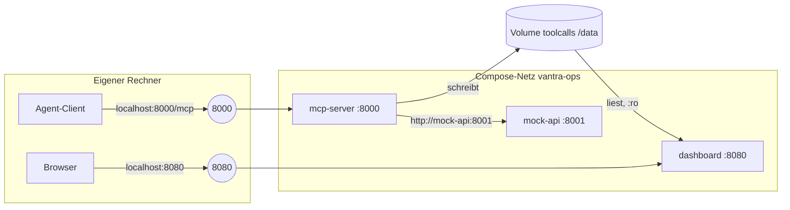

# Lab 6.1: Container bauen und starten

**Leitfragen:**

<details>
<summary>Welche Portfreigabe ist für den HTTP-Transport (Streamable HTTP) nötig?</summary>

Der Container-Port 8000 wird auf einen Port des eigenen Rechners veröffentlicht (`-p 8000:8000`). Der Server muss dazu an `0.0.0.0` binden (Lab 5.2); der Client erreicht ihn unter `http://localhost:8000/mcp`. Ein zweiter Port ist nicht nötig.

</details>

<details>
<summary>Wie wird ein Absturz des Containers erkannt?</summary>

Ein beendeter Prozess zeigt sich in `docker ps -a` als `Exited` mit Exit-Code; die Ursache steht in `docker logs`. Ein Prozess, der läuft, aber nicht mehr antwortet, fällt erst über den Healthcheck auf (`unhealthy`, Lab 5.2).

</details>

- Ein MCP-Server im Container ist ein HTTP-Dienst: Port veröffentlichen, Server an `0.0.0.0` binden, Client auf `/mcp` zeigen.
- Docker Compose beschreibt mehrere zusammengehörige Container (Server, Mock-API, Dashboard) in einer Datei und startet sie mit einem Befehl.

## Begriffe

| Begriff | Bedeutung in einem Satz |
| --- | --- |
| Docker Compose | Werkzeug, das mehrere Container aus einer YAML-Datei (`docker-compose.yml`) gemeinsam baut, startet und stoppt; ein Befehl statt mehrerer `docker run`. |
| Dienst (`service`) | Ein Eintrag in der Compose-Datei = Vorlage für einen Container, ähnlich einem gespeicherten `docker run`-Befehl. |
| Compose-Netz | Compose verbindet alle Dienste einer Datei in einem gemeinsamen Netz; jeder Dienst ist dort unter seinem Namen erreichbar (`http://mock-api:8001`). |
| Portfreigabe (`ports`) | Leitet einen Port des eigenen Rechners auf einen Port im Container weiter (`Host:Container`). |
| Benanntes Volume | Speicher, den Compose anlegt und der Neustarts überlebt; mehrere Dienste können ihn einbinden. |
| `depends_on` | Startreihenfolge: ein Dienst startet erst nach einem anderen, auf Wunsch erst, wenn dieser gesund ist. |
| Restart-Policy | Regel, ob Docker einen beendeten Container neu startet (`restart: unless-stopped`). |
| Exit-Code | Zahl, mit der ein Prozess endet: `0` = normal, alles andere = Fehler. |

## Docker in fünf Befehlen

| Befehl | Wirkung |
| --- | --- |
| `docker build -f <Dockerfile> -t <name>:<tag> .` | Image bauen, `.` ist der Build-Kontext |
| `docker run -d -p 8000:8000 --name vantra-mcp vantra-ops-mcp:local` | Container im Hintergrund starten, Host-Port 8000 → Container-Port 8000 |
| `docker ps` / `docker ps -a` | laufende / alle Container samt Status |
| `docker logs vantra-mcp` | stdout und stderr des Containers |
| `docker stop vantra-mcp` und `docker rm vantra-mcp` | stoppen und entfernen |

## Besonderheiten bei MCP-Servern: stdio oder Port

| | stdio | Streamable HTTP |
| --- | --- | --- |
| Wer startet den Server? | der Client als Kindprozess | Docker bzw. Compose, unabhängig vom Client |
| Verbindung | stdin/stdout des Prozesses | HTTP auf Port 8000, Endpunkt `/mcp` |
| Im Container | nur mit `docker run -i` und Client als startendem Prozess, umständlich | Standard: Port veröffentlichen |
| Mehrere Clients | ein Client je Prozess | mehrere Verbindungen zum selben Prozess |
| Logs | stderr (stdout gehört dem Protokoll) | stdout und stderr frei |

- Im Container gilt `MCP_TRANSPORT=streamable-http`; den Rest regelt `server.py` (Lab 5.2).
- `localhost` im Container ist der Container selbst, nicht der eigene Rechner. Dienste im Compose-Netz erreichen sich über den Dienstnamen (`http://mock-api:8001`).
- Der Kontext (`context://session`) gilt bei HTTP je Serverprozess, nicht je Client (Lab 5.1).

## Das Bild hinter der Compose-Datei

Drei Dienste aus demselben Image, ein gemeinsames Netz, ein gemeinsames Volume:



- Von außen geht es nur über veröffentlichte Ports (`ports`); innen sprechen die Dienste über ihre Namen.
- Das Volume verbindet Server und Dashboard: Der Server schreibt das Tool-Call-Protokoll (ab Lab 8.1), das Dashboard liest es nur.

## Compose-Datei, Grundform

So sieht die Datei der Übung aus (Stand nach den Aufgaben, ohne Dashboard):

```yaml
name: vantra-ops                         # Projektname, Präfix der Containernamen

services:
  mcp-server:
    build:
      context: ..                        # Build-Kontext relativ zur Datei: output/project
      dockerfile: playground/Dockerfile  # aus Lab 5.2, relativ zum Kontext
    image: vantra-ops-mcp:local          # Name des gebauten Images
    environment:                         # Umgebungsvariablen wie docker run -e
      MCP_TRANSPORT: streamable-http
      MCP_PORT: "8000"
      MOCK_API_URL: http://mock-api:8001 # Dienstname als Hostname
      TOOL_CALL_LOG: /data/tool_calls.jsonl   # vorbereitet, wirkt ab Lab 8.1
      VANTRA_ROLE: ${VANTRA_ROLE:-viewer}     # vorbereitet, wirkt ab Lab 7.1
    ports:
      - "8000:8000"                      # Host:Container
    depends_on:
      mock-api:
        condition: service_healthy       # erst starten, wenn die Mock-API gesund ist
    volumes:
      - toolcalls:/data                  # benanntes Volume nach /data

  mock-api:
    build:
      context: ..
      dockerfile: playground/Dockerfile
    image: vantra-ops-mcp:local          # dasselbe Image, anderer Startbefehl
    command: ["python", "shared/mock_api/app.py"]
    environment:
      MOCK_API_HOST: 0.0.0.0
      MOCK_API_PORT: "8001"
    ports:
      - "8001:8001"
    healthcheck:                         # eigener Healthcheck: das Image prüft Port 8000
      test: ["CMD", "python", "-c", "import urllib.request; urllib.request.urlopen('http://127.0.0.1:8001/health', timeout=3)"]
      interval: 10s
      timeout: 4s
      retries: 3
      start_period: 5s

volumes:
  toolcalls:                             # Compose legt das Volume beim ersten Start an
```

| Schlüssel | Bedeutung | Entspricht bei `docker run` |
| --- | --- | --- |
| `build.context` / `build.dockerfile` | Ordner, aus dem `COPY` liest / Dockerfile darin | `docker build -f … <kontext>` |
| `image` | Name des Images | `-t vantra-ops-mcp:local` |
| `command` | Startbefehl statt `CMD` aus dem Dockerfile | Befehl am Ende von `docker run` |
| `environment` | Umgebungsvariablen | `-e NAME=wert` |
| `ports: "8000:8000"` | veröffentlicht; `"127.0.0.1:8000:8000"` beschränkt auf den eigenen Rechner | `-p 8000:8000` |
| `volumes: toolcalls:/data` | benanntes Volume; `:ro` bindet nur lesend ein | `-v toolcalls:/data` |
| `depends_on … service_healthy` | Startreihenfolge nach Healthcheck, nicht nur nach Containerstart | – |
| `healthcheck` | Prüfbefehl je Dienst, überschreibt den `HEALTHCHECK` des Images | `--health-cmd` |
| `restart: unless-stopped` | Docker startet beendete Container neu, außer sie wurden gestoppt | `--restart unless-stopped` |
| `${VANTRA_ROLE:-viewer}` | Wert der Umgebungsvariable der eigenen Shell, ohne Variable `viewer` | – |

## Compose-Datei im Beispielordner: Anker und Variablen

`examples/m06-containerization-cicd/l01-docker/docker-compose.yml` beschreibt dieselben Dienste plus Dashboard, schreibt den Build-Block aber nur einmal:

```yaml
x-build: &build                         # Block mit Namen "build" (YAML-Anker)
  context: ../../..                     # Projektordner, von examples/m06-…/l01-docker aus
  dockerfile: examples/m05-cloud-integration/l02-container-prep/Dockerfile
  args:
    APP_DIR: ${APP_DIR:-playground}     # Build-Argument aus Lab 5.2; Standard: playground

services:
  mcp-server:
    build: *build                       # setzt den Block "build" hier ein
    ports:
      - "${MCP_PORT:-8000}:8000"        # Host-Port per Variable änderbar
    restart: unless-stopped
    # … Rest wie in der Grundform
  mock-api:
    build: *build
    # …
  dashboard:                            # liest dasselbe Volume nur lesend
    build: *build
    command: ["python", "shared/dashboard/server.py"]
    ports:
      - "${DASHBOARD_PORT:-8080}:8080"
    volumes:
      - toolcalls:/data:ro
```

| Schreibweise | Bedeutung |
| --- | --- |
| `x-build:` | Oberster Schlüssel mit `x-`: Compose ignoriert ihn, er dient nur als Ablage. |
| `&build` | YAML-Anker: gibt dem folgenden Block den Namen `build`. |
| `*build` | YAML-Alias: setzt den Block mit diesem Namen an dieser Stelle ein. |
| `${NAME:-standard}` | Umgebungsvariable der Shell, die `docker compose` startet; fehlt sie, gilt `standard`. |

Der Beispielordner ist damit von überall startbar und wählt den Server-Stand per `APP_DIR`.

## Starten und testen

Aus dem Projektordner (`output/project`):

```bash
APP_DIR=examples/m05-cloud-integration/l02-container-prep \
  docker compose -f examples/m06-containerization-cicd/l01-docker/docker-compose.yml up --build -d
docker compose -f examples/m06-containerization-cicd/l01-docker/docker-compose.yml ps
curl -i http://localhost:8000/health
python shared/agent_client.py --url http://localhost:8000/mcp --replay
```

Der Agent-Client verbindet sich mit der URL statt einen Kindprozess zu starten. Ausgabe des Replay-Dialogs gegen den Server im Container (Docker 29.2.0, Compose v5.0.2):

```text
Verbunden mit vantra-ops, Protokoll 2026-07-28
Tools: get_ticket, get_deployment_log, update_ticket_status  ·  LLM: replay

Nutzer: Zeige Ticket VAN-102
  → Tool-Call: get_ticket({"ticket_id": "VAN-102"})
  ← ok: {   "id": "VAN-102",   "title": "Login-Seite lädt nach Release 2.14 sehr langsam",   "status": "open",   "priority": "high",   "assignee": "jonas.brandt",   "se…
Agent: Ticket VAN-102: Login-Seite lädt nach Release 2.14 sehr langsam (Status open, Version 3).

Nutzer: Zeige das Deployment-Log dazu
  → Tool-Call: get_deployment_log({})
  ← ok: {   "id": "dep-2041",   "ticket_id": "VAN-102",   "service": "auth-service",   "version": "2.14.1",   "environment": "production",   "status": "degraded",   "lo…
Agent: Deployment dep-2041 (auth-service 2.14.1, Status degraded). Letzte Zeilen: auth      token cache disabled by config key AUTH_CACHE_TTL=0;  deploy    finished with warnings, rollback not triggered
```

`docker compose ps` listet die Dienste mit Status (`Up …`, bei Healthcheck zusätzlich `(health: starting)` und danach `(healthy)`); Ports stehen in der Spalte `PORTS`.

## Absturz und Fehler erkennen

| Signal | Befehl | Bedeutung |
| --- | --- | --- |
| Status | `docker compose ps -a` | `Exited (1)` = Prozess beendet; `Up … (unhealthy)` = Prozess läuft, `/health` antwortet nicht |
| Exit-Code | `docker inspect --format '{{.State.ExitCode}}' <container>` | 0 normal, 1 Fehler, 137 von außen beendet (z. B. Speicherlimit) |
| Health | `docker inspect --format '{{.State.Health.Status}}' <container>` | `starting`, `healthy`, `unhealthy` |
| Ursache | `docker compose logs mcp-server` | Traceback bzw. Startmeldung |

- Der Healthcheck des Images prüft den MCP-Port (8000); Dienste mit anderem Port (Mock-API, Dashboard) brauchen einen eigenen `healthcheck` in der Compose-Datei.
- Docker startet `unhealthy` Container nicht von selbst neu; das übernimmt erst Kubernetes (Lab 6.2).
- Das Dashboard bleibt bis Lab 8.1 leer („Noch keine Tool-Calls“); der Server dieses Stands schreibt noch kein Protokoll.

## Typische Fehler

| Symptom | Ursache | Lösung |
| --- | --- | --- |
| `Connection refused` auf `localhost:8000` | `ports` fehlt oder Server bindet an `127.0.0.1` | `ports` ergänzen, `MCP_HOST=0.0.0.0` |
| `curl` ohne Antwort direkt nach `up -d`, Status `(health: starting)` | Server startet noch (auf einem ausgelasteten Rechner bis zu einer halben Minute) | warten, bis `docker compose ps` `(healthy)` zeigt |
| `port is already allocated` | Host-Port belegt | anderen Host-Port: `MCP_PORT=8010 docker compose ...` (Beispieldatei) und `--url http://localhost:8010/mcp` |
| Server kann Mock-API nicht erreichen | `MOCK_API_URL` zeigt auf `localhost` | Dienstname verwenden: `http://mock-api:8001` |
| Änderung am Code wirkt nicht | Image nicht neu gebaut | `up --build` |
| `failed to read dockerfile` / `COPY failed` | Befehl nicht im Projektordner gestartet oder `context` falsch | im Ordner `output/project` starten; `context: ..` gilt relativ zur Compose-Datei |
| `mapping values are not allowed here` | Einrückung in YAML falsch (Tabs oder falsche Ebene) | nur Leerzeichen, zwei je Ebene; `docker compose … config` zeigt die Zeile |
| Dienst `unhealthy`, obwohl er antwortet | Healthcheck des Images prüft Port 8000, der Dienst lauscht auf einem anderen | eigenen `healthcheck` im Dienst setzen |

## Fazit

- Der Container braucht einen veröffentlichten Port; der Client nutzt `http://localhost:8000/mcp`.
- Compose koppelt Dienste über Namen, Healthchecks und Startreihenfolge.
- Abstürze zeigen Status und Exit-Code, Hänger der Healthcheck.

In der Übung wird die Starter-Compose-Datei ergänzt, der Server gestartet und der Agent gegen den Container getestet.
