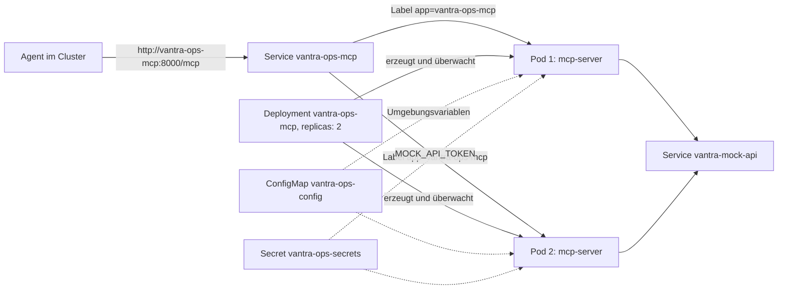
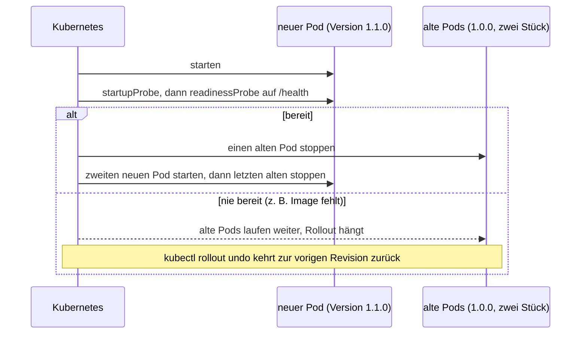
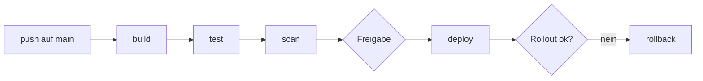

# Lab 6.2: Orchestrierung und CI/CD-Pipeline

**Leitfragen:**

<details>
<summary>Welcher Pipeline-Schritt verhindert, dass ein kompromittiertes Tool in Produktion gelangt?</summary>

Ein Prüfschritt vor dem Ausrollen: Scanner (`pip-audit`, Trivy) vergleichen Pakete und Image mit Listen bekannter Schwachstellen und stoppen die Kette. Grenze: Sie finden nur Bekanntes; ein frisch manipuliertes Paket fällt erst durch feste Versionen mit Prüfsummen, Review der Tool-Definitionen und die manuelle Freigabe vor Produktion auf.

</details>

<details>
<summary>Wie wird ein Rollback bei einem fehlerhaften MCP-Server-Release ausgelöst?</summary>

Kubernetes merkt sich jede ausgerollte Version; `kubectl rollout undo deployment/vantra-ops-mcp` kehrt zur vorigen zurück. Die Pipeline führt diesen Befehl automatisch aus, wenn das Ausrollen scheitert. Feste Image-Tags (Lab 5.1) machen die Zielversion eindeutig.

</details>

- Kubernetes betreibt den MCP-Server als Deployment mit Service; Konfiguration kommt aus ConfigMap und Secret, Gesundheit aus Probes.
- Eine Pipeline automatisiert Build, Test, Scan, Deploy und im Fehlerfall den Rollback.

## Kubernetes in fünf Sätzen

1. Kubernetes ist ein Orchestrator (Lab 5.2) für viele Rechner: Es startet Container, verteilt sie und startet sie bei Ausfall neu.
2. Gewünschte Zustände stehen in YAML-Dateien (Manifeste), z. B. „zwei Kopien des MCP-Servers mit Image `1.0.0`“; Kubernetes gleicht den echten Zustand laufend daran an.
3. Ein **Deployment** hält eine Anzahl gleicher **Pods** am Laufen; ein Pod ist ein laufender Container mit seiner Umgebung.
4. Ein **Service** gibt diesen Pods einen festen Namen und verteilt Anfragen auf sie; er findet seine Pods über ein Etikett (Label, hier `app: vantra-ops-mcp`).
5. **ConfigMap** und **Secret** liefern die Umgebungsvariablen, **Probes** fragen `/health` ab und entscheiden über Anfragen und Neustarts.

Das Zusammenspiel im Vantra-Manifest:



| Aus Docker/Compose bekannt (Lab 6.1) | In Kubernetes |
| --- | --- |
| Container aus `docker run` | Pod |
| Dienst in `docker-compose.yml` mit Anzahl 1 | Deployment mit `replicas: N` |
| Dienstname als Hostname (`http://mock-api:8001`) | Service-Name als Hostname (`http://vantra-mock-api:8001`) |
| `environment` | ConfigMap (unkritisch) und Secret (geheim) |
| `healthcheck` | Probes |
| `docker compose up` | `kubectl apply -f k8s.yaml` |
| `restart: unless-stopped` | Kubernetes startet immer neu, zusätzlich bei Hängern (Liveness) |

## Begriffe

| Begriff | Bedeutung in einem Satz |
| --- | --- |
| Cluster / Node | Verbund von Rechnern (Nodes), die Kubernetes gemeinsam verwaltet. |
| Manifest | YAML-Datei mit einer oder mehreren Ressourcen, getrennt durch `---`. |
| `kubectl` | Kommandozeile für Kubernetes, ähnlich `docker` für Docker. |
| Label / Selector | Etikett an einem Pod (`app: vantra-ops-mcp`) / Auswahlregel, die alle Pods mit diesem Etikett findet. |
| Replika | Eine von mehreren gleichen Kopien eines Pods. |
| Probe | Regelmäßige Prüfung durch Kubernetes, hier eine HTTP-Anfrage an `/health`. |
| Rollout | Ausrollen einer neuen Version: neue Pods starten, alte stoppen. |
| Rollback | Rückkehr zur vorigen Version nach einem fehlerhaften Rollout. |
| Namespace | Abgetrennter Bereich im Cluster; ohne Angabe gilt `default`. |
| `kubeconform` | Prüfprogramm, das ein Manifest ohne Cluster gegen die offiziellen Feldbeschreibungen (Schemas) prüft. |

## ConfigMap: unkritische Konfiguration

`examples/m06-containerization-cicd/l02-kubernetes-cicd/k8s.yaml`, Teil 1:

```yaml
apiVersion: v1                             # API-Version der Ressourcenart
kind: ConfigMap                            # Ressourcenart
metadata:
  name: vantra-ops-config                  # Name, über den das Deployment sie findet
  labels:
    app: vantra-ops-mcp
data:                                      # Schlüssel und Werte = spätere Umgebungsvariablen
  MCP_TRANSPORT: streamable-http
  MCP_HOST: 0.0.0.0
  MCP_PORT: "8000"                         # Zahlen in Anführungszeichen: ConfigMap-Werte sind Texte
  MOCK_API_URL: http://vantra-mock-api:8001
  TOOL_CALL_LOG: /data/tool_calls.jsonl    # vorbereitet, wirkt ab Lab 8.1
  VANTRA_ROLE: viewer                      # vorbereitet, wirkt ab Lab 7.1
  LOG_LEVEL: INFO
```

Jede Ressource beginnt mit denselben vier Feldern: `apiVersion`, `kind`, `metadata` (Name, Labels) und dem Inhalt (`data` bzw. `spec`).

## Secret: Referenz statt Wert

Der Wert steht nie in Git. Der Betrieb legt das Secret direkt im Cluster an:

```bash
kubectl create secret generic vantra-ops-secrets --from-literal=MOCK_API_TOKEN=<wert>
```

Das Deployment verweist nur darauf (`optional: true`: der Pod startet auch ohne Secret):

```yaml
env:
  - name: MOCK_API_TOKEN          # Name der Umgebungsvariable im Container
    valueFrom:
      secretKeyRef:
        name: vantra-ops-secrets  # Name des Secrets
        key: MOCK_API_TOKEN       # Schlüssel darin
        optional: true
```

- Secrets sind in Kubernetes nur Base64-kodiert (umkehrbar umgeschrieben), nicht verschlüsselt. Wer sie lesen darf, regelt die Rechtevergabe im Cluster (RBAC, Role-Based Access Control).

## Deployment: Pods am Laufen halten

Teil 2 derselben Datei, mit Anmerkungen:

```yaml
apiVersion: apps/v1
kind: Deployment
metadata:
  name: vantra-ops-mcp
spec:
  replicas: 2                        # zwei gleiche Pods
  selector:
    matchLabels:
      app: vantra-ops-mcp            # dieses Deployment verwaltet Pods mit diesem Label …
  strategy:
    type: RollingUpdate              # Update Pod für Pod statt alle auf einmal
    rollingUpdate:
      maxUnavailable: 0              # nie unter 2 bereite Pods
      maxSurge: 1                    # ein zusätzlicher Pod beim Update
  template:                          # Bauplan je Pod
    metadata:
      labels:
        app: vantra-ops-mcp          # … und gibt neuen Pods genau dieses Label
    spec:
      securityContext:               # gilt für alle Container des Pods
        runAsNonRoot: true
        runAsUser: 10001             # gleiche uid wie im Dockerfile (Lab 5.2)
        seccompProfile:
          type: RuntimeDefault
      containers:
        - name: mcp-server
          image: vantra-ops-mcp:1.0.0   # fester Tag statt latest
          ports:
            - name: mcp                 # benannter Port, auf den Probes und Service verweisen
              containerPort: 8000
          envFrom:
            - configMapRef:
                name: vantra-ops-config # alle Schlüssel der ConfigMap als Umgebungsvariablen
          startupProbe:              # gibt dem Start Zeit: 15 x 2 s
            httpGet: { path: /health, port: mcp }
            periodSeconds: 2
            failureThreshold: 15
          readinessProbe:            # Anfragen nur an bereite Pods
            httpGet: { path: /health, port: mcp }
            periodSeconds: 5
            failureThreshold: 3
          livenessProbe:             # Neustart bei Hänger
            httpGet: { path: /health, port: mcp }
            periodSeconds: 15
            failureThreshold: 3
          resources:
            requests: { cpu: 100m, memory: 128Mi }
            limits: { cpu: 500m, memory: 256Mi }
          securityContext:           # gilt für diesen Container
            allowPrivilegeEscalation: false
            readOnlyRootFilesystem: true
            capabilities:
              drop: ["ALL"]
          volumeMounts:
            - name: data
              mountPath: /data       # einziges beschreibbares Verzeichnis
      volumes:
        - name: data
          emptyDir: {}
```

(Gekürzt: Labels der Metadaten, `imagePullPolicy` und der Secret-Block aus dem vorigen Abschnitt stehen in der Projektdatei; die Probes sind dort ausgeschrieben, d. h. `httpGet:` mit `path:` und `port:` in eigenen Zeilen.)

### Probes

| Probe | Frage | Folge bei Fehlschlag |
| --- | --- | --- |
| `startupProbe` | Ist der Server fertig gestartet? | Die anderen Probes warten; nach 15 Fehlschlägen Neustart |
| `readinessProbe` | Darf der Pod jetzt Anfragen bekommen? | Der Service schickt ihm keine Anfragen mehr, der Pod läuft weiter |
| `livenessProbe` | Lebt der Prozess noch? | Kubernetes startet den Container neu |

`periodSeconds` ist der Abstand zwischen zwei Prüfungen, `failureThreshold` die Zahl erlaubter Fehlschläge in Folge.

### Einheiten und Sicherheitskontext

| Feld | Bedeutung |
| --- | --- |
| `cpu: 100m` | 100 Milli-CPU = 0,1 CPU-Kern; `500m` = ein halber Kern |
| `memory: 128Mi` | 128 Mebibyte (1 Mi = 1.048.576 Byte), ungefähr 134 MB |
| `requests` | Mindestbedarf; danach sucht Kubernetes einen Node mit genug freiem Platz aus |
| `limits` | Obergrenze; mehr CPU wird gebremst, mehr Speicher beendet den Container (Exit-Code 137) |
| `runAsNonRoot` / `runAsUser` | Kubernetes startet den Container nur als Nicht-Root, hier uid 10001 |
| `allowPrivilegeEscalation: false` | Der Prozess kann sich später keine zusätzlichen Rechte verschaffen |
| `readOnlyRootFilesystem: true` | Das Dateisystem des Containers ist schreibgeschützt |
| `emptyDir` auf `/data` | leeres, beschreibbares Verzeichnis je Pod; verschwindet mit dem Pod |
| `capabilities: drop: ["ALL"]` | entzieht alle Linux-Sonderrechte (z. B. Netzwerk umkonfigurieren) |
| `seccompProfile: RuntimeDefault` | Standardfilter, der gefährliche Systemaufrufe an den Linux-Kern blockiert |

### Rollout und Rollback

Ein Update mit `RollingUpdate`, `replicas: 2`, `maxSurge: 1` und `maxUnavailable: 0` läuft so ab:



- Mit `maxUnavailable: 0` bleiben immer zwei bereite Pods im Dienst; ein kaputter Release nimmt dem Service keine Pods weg.
- `kubectl rollout status` wartet auf das Ende des Rollouts und meldet einen Fehler, wenn er hängt; `kubectl rollout history` zeigt die Revisionen.

## Service: fester Name für die Pods

```yaml
apiVersion: v1
kind: Service
metadata:
  name: vantra-ops-mcp               # wird zum Hostnamen im Cluster
spec:
  type: ClusterIP                    # nur im Cluster erreichbar
  selector:
    app: vantra-ops-mcp              # wählt die Pods des Deployments über ihr Label
  ports:
    - name: mcp
      port: 8000                     # Port des Service
      targetPort: mcp                # benannter Container-Port
```

Agenten im Cluster erreichen den Server unter `http://vantra-ops-mcp:8000/mcp`. Stimmen `selector` des Service und Label der Pods nicht überein, hat der Service keine Ziele.

## Validieren ohne Cluster

| Befehl | Prüft | Braucht Cluster? |
| --- | --- | --- |
| `python -c "import yaml; print([d['kind'] for d in yaml.safe_load_all(open('playground/k8s.yaml')) if d])"` | YAML-Syntax und Liste der Ressourcen | nein |
| `kubeconform -strict -summary playground/k8s.yaml` | Feldnamen und Typen je Ressource, unbekannte Felder (`-strict`) | nein (lädt Schemas aus dem Internet) |
| `kubectl apply --dry-run=client --validate=false -f playground/k8s.yaml` | Manifest lesen und Ressourcen erkennen | kann scheitern: `kubectl` fragt dabei je nach Version den Cluster nach den Ressourcenarten; ohne Cluster meldet es einen Verbindungsfehler |
| `kubectl apply -f playground/k8s.yaml` | echtes Anwenden | ja |

Eine Schema-Prüfung findet Tippfehler bei Feldnamen, nicht fehlende Inhalte: Ein Manifest ohne Service ist gültig, aber unvollständig. Die Anzahl der Ressourcen im Summary zeigt das.

## CI/CD-Pipeline

CI/CD (Continuous Integration / Continuous Delivery) heißt: Jede Änderung im Repository löst automatisch Bauen, Testen, Prüfen und Ausrollen aus. Das Beispiel nutzt GitHub Actions; andere Plattformen (GitLab CI, Azure Pipelines) folgen demselben Muster.

### Begriffe einer Pipeline

| Begriff | Bedeutung in einem Satz |
| --- | --- |
| Workflow | Die YAML-Datei der Pipeline; `on:` legt fest, wann sie startet (z. B. bei `push` auf `main`). |
| Job | Eine Stufe (`build`, `test`, …), die auf einem eigenen, frischen Rechner läuft. |
| Step | Ein Schritt in einem Job: ein Shell-Befehl (`run:`) oder eine fertige Action (`uses:`). |
| Runner | Der Rechner, auf dem ein Job läuft (`runs-on: ubuntu-latest`). |
| Action | Wiederverwendbarer Baustein, z. B. `actions/checkout` (Code holen) oder `actions/setup-python` (Python installieren). |
| Registry | Ablage für Images, aus der Kubernetes sie lädt, z. B. `ghcr.io`; wie ein Git-Server für Images. |
| `needs` | Reihenfolge: ein Job startet erst, wenn die genannten Jobs erfolgreich waren. |
| `${{ … }}` | Ausdruck, den die Plattform vor dem Start einsetzt, z. B. Ausgaben anderer Jobs oder Secrets. |
| Environment | Benannte Zielumgebung (`production`) mit Schutzregeln, z. B. manueller Freigabe durch eine Person. |



### Ausgearbeitetes Beispiel: Jobs `build` und `test`

Aus der Pipeline-Skizze der Lösung, Zeile für Zeile kommentiert:

```yaml
name: vantra-ops-mcp

on:
  push:
    branches: [main]               # startet bei jedem push auf main

env:
  IMAGE: ghcr.io/vantra-systems/vantra-ops-mcp   # Image-Name in der Registry

jobs:
  build:
    runs-on: ubuntu-latest         # frischer Linux-Rechner
    outputs:
      tag: ${{ steps.meta.outputs.tag }}   # gibt den Tag an spätere Jobs weiter
    steps:
      - uses: actions/checkout@v4  # Repository auf den Runner holen
      - id: meta                   # Schritt-Name, damit andere darauf verweisen können
        run: echo "tag=${GITHUB_SHA::12}" >> "$GITHUB_OUTPUT"
      - run: docker build -f playground/Dockerfile -t ${IMAGE}:${{ steps.meta.outputs.tag }} .

  test:
    runs-on: ubuntu-latest
    steps:
      - uses: actions/checkout@v4
      - uses: actions/setup-python@v5
        with:
          python-version: "3.13"
      - run: pip install -r requirements.txt
      - run: pytest -q
```

| Stelle | Bedeutung |
| --- | --- |
| `GITHUB_SHA` | Kennung des Commits, den die Plattform bereitstellt (40 Zeichen) |
| `${GITHUB_SHA::12}` | Bash-Schreibweise: die ersten 12 Zeichen davon, z. B. `3f9c2a1b7e04` |
| `>> "$GITHUB_OUTPUT"` | speichert `tag=…` als Ausgabe des Schritts `meta` |
| `steps.meta.outputs.tag` | liest diese Ausgabe im selben Job; `needs.build.outputs.tag` in einem späteren Job |

`build` und `test` haben kein `needs` und laufen deshalb parallel.

### Stufen und was sie verhindern

| Stufe | Inhalt im Beispiel (`pipeline.yml`) | Verhindert |
| --- | --- | --- |
| build | Image mit Commit-Kennung als Tag bauen, bei `push` in die Registry schieben | uneindeutige Versionen |
| test | `pip install -r requirements.txt`, `pytest -q` | fehlerhaften Code |
| scan | `pip-audit` (Python-Pakete), Trivy (Dateien und Image) gegen Listen bekannter Schwachstellen | Pakete mit bekannten Lücken |
| deploy | Environment `production` mit manueller Freigabe, `kubectl set image`, `kubectl rollout status` | unkontrolliertes Ausrollen |
| rollback | läuft bei `failure()` des Deploys: `kubectl rollout undo` | dauerhaft defekte Releases |

Prüfungen, ob nur freigegebene Tools und Rechte im Server stecken, kommen als Tests ab Lab 7.1 hinzu.

### Kernausschnitte `scan`, `deploy`, `rollback`

```yaml
  scan:
    needs: [build, test]            # läuft nur nach erfolgreichem Build und Test
    steps:
      - run: pip install pip-audit && pip-audit -r requirements-server.txt
  deploy:
    needs: [build, scan]            # ohne bestandenen Scan kein Deploy
    if: github.ref == 'refs/heads/main'
    environment: production         # Schutzregel: manuelle Freigabe
    steps:
      - run: |
          kubectl set image deployment/vantra-ops-mcp mcp-server=${IMAGE}:${{ needs.build.outputs.tag }}
          kubectl rollout status deployment/vantra-ops-mcp --timeout=120s
  rollback:
    needs: [deploy]
    if: failure()                   # nur wenn deploy gescheitert ist
    steps:
      - run: kubectl rollout undo deployment/vantra-ops-mcp
```

- `needs` bildet die Reihenfolge ab; ein roter Scan stoppt die Kette.
- Grenze der Scanner: Sie kennen nur gemeldete Schwachstellen. Gegen frisch manipulierte Pakete helfen feste Versionen mit Prüfsummen (`pip install --require-hashes`), Review von Änderungen und die manuelle Freigabe.
- Action-Versionen vor dem Einsatz prüfen und auf Commit-Kennungen festlegen; die Pipeline wird im Kurs nur skizziert, nicht ausgeführt.
- Der Zugang zum Cluster (`KUBECONFIG_DATA`) liegt als Secret der Plattform, nicht im Repository.

## Typische Fehler

| Symptom | Ursache | Lösung |
| --- | --- | --- |
| `kubeconform`: `got string, want integer` | Zahl als Text, z. B. `replicas: "2"` oder `zwei` | Zahl ohne Anführungszeichen; nur ConfigMap-Werte sind Texte |
| `kubeconform`: `additionalProperties '…' not allowed` | Feldname vertippt oder auf falscher Ebene eingerückt | Feldnamen und Einrückung mit dem Beispiel vergleichen |
| Summary zeigt 4 statt 5 Ressourcen | Service fehlt oder `---` als Trenner fehlt | Service ergänzen, Ressourcen mit `---` trennen |
| `kubeconform`: `could not find schema` | kein Internetzugang zu raw.githubusercontent.com | Fallback: Ressourcenliste mit PyYAML |
| Service erreicht keine Pods | `selector` passt nicht zum Label im `template` | gleiches Label `app: vantra-ops-mcp` an beiden Stellen |
| Pod bleibt in `ErrImagePull` / `ImagePullBackOff` | Image mit diesem Tag ist für den Cluster nicht vorhanden | Tag prüfen; lokal: Image mit genau diesem Tag bauen (siehe unten) |
| Pod startet neu, Log zeigt `Read-only file system` | Server schreibt außerhalb von `/data` | nur nach `/data` schreiben (`emptyDir`) |
| Pipeline: Job `deploy` startet nie | `needs` nennt einen gescheiterten Job | vorherigen Job reparieren; `needs` zeigt die Kette |

Lokaler Cluster mit Docker Desktop: Docker Desktop bietet die Cluster-Arten `kubeadm` und `kind`. Laut Dokumentation arbeitet `kind` nicht mit dem Docker-Image-Speicher, sondern nur mit dem containerd-Image-Speicher; ein mit `docker build` gebautes Image ist dann für den Cluster eventuell nicht sichtbar. Abhilfe: Cluster-Art `kubeadm` wählen oder in den Einstellungen den containerd-Image-Speicher aktivieren und das Image neu bauen.
_Quelle: Docker Docs, „Kubernetes“ (https://docs.docker.com/desktop/features/kubernetes/), abgerufen am 28.10.2026._

## Fazit

- Deployment, Service, ConfigMap und Secret bilden das Grundmuster; Probes auf `/health` steuern Anfragen und Neustart.
- Validierung findet Schemafehler; Unvollständigkeit zeigt die Zahl der Ressourcen.
- Die Pipeline stellt mit Scan, Freigabe und Rollback sicher, dass nur geprüfte Releases laufen und fehlerhafte zurückgenommen werden; Scanner finden nur bekannte Lücken.

In der Übung wird das Starter-Manifest vervollständigt und validiert, danach entsteht die Pipeline-Skizze für den Vantra Ops Agent.
