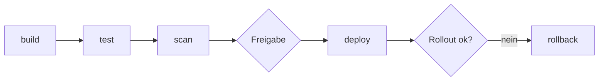

# Lab 6.2: Orchestrierung und CI/CD-Pipeline

**Leitfragen:**

<details>
<summary>Welcher Pipeline-Schritt verhindert, dass ein kompromittiertes Tool in Produktion gelangt?</summary>

Der Scan-Schritt vor dem Deploy: Abhängigkeits- und Image-Prüfung (`pip-audit`, Trivy) sowie ein Test, der Tool-Namen und -Beschreibungen gegen die freigegebene Liste prüft. Die manuelle Freigabe des Environments `production` ist die letzte Schranke.

</details>

<details>
<summary>Wie wird ein Rollback bei einem fehlerhaften MCP-Server-Release ausgelöst?</summary>

Mit `kubectl rollout undo deployment/vantra-ops-mcp`; die Pipeline führt das im Job `rollback` aus, sobald der Rollout fehlschlägt. Feste Image-Tags machen die Zielrevision eindeutig.

</details>

- Kubernetes betreibt den MCP-Server als Deployment mit Service; Konfiguration kommt aus ConfigMap und Secret, Gesundheit aus Probes.
- Eine Pipeline automatisiert Build, Test, Scan, Deploy und im Fehlerfall den Rollback.

## Grundmuster für den MCP-Server

| Ressource | Aufgabe | Im Projekt |
| --- | --- | --- |
| ConfigMap | unkritische Konfiguration | `vantra-ops-config`: Transport, Port, `MOCK_API_URL`, Rolle |
| Secret | geheime Werte | `vantra-ops-secrets`, Schlüssel `MOCK_API_TOKEN` (nur Referenz im Manifest) |
| Deployment | hält N Replikas am Laufen, Rollouts, Rollback | `vantra-ops-mcp`, 2 Replikas |
| Service | stabile Adresse und Lastverteilung | `vantra-ops-mcp`, Typ `ClusterIP`, Port 8000 |
| Probes | Start, Bereitschaft, Lebendigkeit | `GET /health` auf Port `mcp` |

## ConfigMap

`examples/m06-containerization-cicd/l02-orchestration-cicd/k8s.yaml`, Teil 1:

```yaml
apiVersion: v1
kind: ConfigMap
metadata:
  name: vantra-ops-config
  labels:
    app: vantra-ops-mcp
data:
  MCP_TRANSPORT: streamable-http
  MCP_HOST: 0.0.0.0
  MCP_PORT: "8000"                         # Zahlen in Anführungszeichen: ConfigMap-Werte sind Texte
  MOCK_API_URL: http://vantra-mock-api:8001
  TOOL_CALL_LOG: /data/tool_calls.jsonl
  VANTRA_ROLE: viewer
  LOG_LEVEL: INFO
```

## Secret: Referenz statt Wert

Der Wert steht nie in Git. Der Betrieb legt das Secret an:

```bash
kubectl create secret generic vantra-ops-secrets --from-literal=MOCK_API_TOKEN=<wert>
```

Das Deployment referenziert es (`optional: true`: der Pod startet auch ohne Secret):

```yaml
env:
  - name: MOCK_API_TOKEN
    valueFrom:
      secretKeyRef:
        name: vantra-ops-secrets
        key: MOCK_API_TOKEN
        optional: true
```

- Secrets sind in Kubernetes nur Base64-kodiert, nicht verschlüsselt; Zugriff regeln RBAC und Verschlüsselung im Cluster.

## Deployment

Teil 2 derselben Datei, mit Anmerkungen:

```yaml
apiVersion: apps/v1
kind: Deployment
metadata:
  name: vantra-ops-mcp
spec:
  replicas: 2
  selector:
    matchLabels:
      app: vantra-ops-mcp
  strategy:
    type: RollingUpdate
    rollingUpdate:
      maxUnavailable: 0              # nie unter 2 bereite Pods
      maxSurge: 1                    # ein zusätzlicher Pod beim Update
  template:
    metadata:
      labels:
        app: vantra-ops-mcp
    spec:
      securityContext:
        runAsNonRoot: true
        runAsUser: 10001             # gleiche uid wie im Dockerfile
        seccompProfile:
          type: RuntimeDefault
      containers:
        - name: mcp-server
          image: vantra-ops-mcp:1.0.0   # fester Tag statt latest
          ports:
            - name: mcp
              containerPort: 8000
          envFrom:
            - configMapRef:
                name: vantra-ops-config
          startupProbe:              # gibt dem Start Zeit: 15 x 2 s
            httpGet: { path: /health, port: mcp }
            periodSeconds: 2
            failureThreshold: 15
          readinessProbe:            # Verkehr nur an bereite Pods
            httpGet: { path: /health, port: mcp }
            periodSeconds: 5
            failureThreshold: 3
          livenessProbe:             # Neustart bei Hänger
            httpGet: { path: /health, port: mcp }
            periodSeconds: 15
            failureThreshold: 3
          resources:
            requests: { cpu: 100m, memory: 128Mi }
            limits: { cpu: 500m, memory: 256Mi }
          securityContext:
            allowPrivilegeEscalation: false
            readOnlyRootFilesystem: true
            capabilities:
              drop: ["ALL"]
          volumeMounts:
            - name: data
              mountPath: /data       # einziges beschreibbares Verzeichnis
      volumes:
        - name: data
          emptyDir: {}
```

(Gekürzt: Labels der Metadaten, `imagePullPolicy` und der Secret-Block aus dem vorigen Abschnitt stehen in der Projektdatei; die Probes sind dort ausgeschrieben.)

| Feld | Wirkung |
| --- | --- |
| `readinessProbe` | schlägt sie fehl, nimmt der Service den Pod aus der Verteilung |
| `livenessProbe` | schlägt sie fehl, startet Kubernetes den Container neu |
| `readOnlyRootFilesystem` + `emptyDir` auf `/data` | Schreiben nur dort, wo nötig |
| `resources.limits` | Obergrenze; Überschreiten des Speicherlimits beendet den Container (Exit-Code 137) |

## Service

```yaml
apiVersion: v1
kind: Service
metadata:
  name: vantra-ops-mcp
spec:
  type: ClusterIP                    # nur im Cluster erreichbar
  selector:
    app: vantra-ops-mcp              # wählt die Pods des Deployments
  ports:
    - name: mcp
      port: 8000
      targetPort: mcp                # benannter Container-Port
```

Agenten im Cluster erreichen den Server unter `http://vantra-ops-mcp:8000/mcp`.

## Validieren ohne Cluster

| Befehl | Prüft | Braucht Cluster? |
| --- | --- | --- |
| `kubeconform -strict -summary playground/k8s.yaml` | Schema je Ressource, unbekannte Felder (`-strict`) | nein (lädt Schemas; Internet oder lokaler Schema-Pfad) |
| `kubectl apply --dry-run=client --validate=false -f playground/k8s.yaml` | Manifest lesen und Ressourcen erkennen | je nach Version ja (API-Discovery) |
| `kubectl apply -f playground/k8s.yaml` | echtes Anwenden | ja |
| `python -c "import yaml; ..."` | nur YAML-Syntax | nein |

Eine Schema-Prüfung findet Tippfehler bei Feldnamen, nicht fehlende Inhalte: ein Manifest ohne Service ist gültig, aber unvollständig. Die Anzahl der Ressourcen im Summary zeigt das.

## CI/CD-Pipeline-Schritte



| Stufe | Inhalt im Beispiel (`pipeline.yml`, GitHub-Actions-Syntax) | Verhindert |
| --- | --- | --- |
| build | Image mit Commit-SHA als Tag bauen, bei `push` in die Registry schieben | uneindeutige Versionen |
| test | `pip install -r requirements.txt`, `pytest -q` | fehlerhaften Code |
| scan | `pip-audit`, Trivy (`CRITICAL,HIGH`), Policy-Test der Tool-Beschreibungen | kompromittierte Pakete und manipulierte Tools |
| deploy | Environment `production` mit manueller Freigabe, `kubectl set image`, `kubectl rollout status` | unkontrolliertes Ausrollen |
| rollback | läuft bei `failure()` des Deploys: `kubectl rollout undo` | dauerhaft defekte Releases |

Kernausschnitte:

```yaml
  scan:
    needs: [build, test]            # läuft nur nach erfolgreichem Build und Test
    steps:
      - run: pip install pip-audit && pip-audit -r requirements-server.txt
  deploy:
    needs: [build, scan]            # ohne bestandenen Scan kein Deploy
    if: github.ref == 'refs/heads/main'
    environment: production         # Schutzregel: manuelle Freigabe
    steps:
      - run: |
          kubectl set image deployment/vantra-ops-mcp mcp-server=${IMAGE}:${{ needs.build.outputs.tag }}
          kubectl rollout status deployment/vantra-ops-mcp --timeout=120s
  rollback:
    needs: [deploy]
    if: failure()
    steps:
      - run: kubectl rollout undo deployment/vantra-ops-mcp
```

- `needs` bildet die Reihenfolge ab; ein roter Scan stoppt die Kette.
- Action-Versionen vor dem Einsatz prüfen und auf Commit-SHAs festlegen; die Pipeline wird im Kurs nur skizziert, nicht ausgeführt.
- Das Cluster-Zugangsgeheimnis (`KUBECONFIG_DATA`) liegt als Secret der Plattform, nicht im Repository.

## Fazit

- Deployment, Service, ConfigMap und Secret bilden das Grundmuster; Probes auf `/health` steuern Verkehr und Neustart.
- Validierung findet Schemafehler; Unvollständigkeit zeigt die Zahl der Ressourcen.
- Die Pipeline stellt mit Scan, Freigabe und Rollback sicher, dass nur geprüfte Releases laufen und fehlerhafte zurückgenommen werden.

In der Übung wird das Starter-Manifest vervollständigt und validiert, danach entsteht die Pipeline-Skizze für den Vantra Ops Agent.
