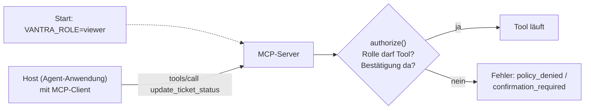
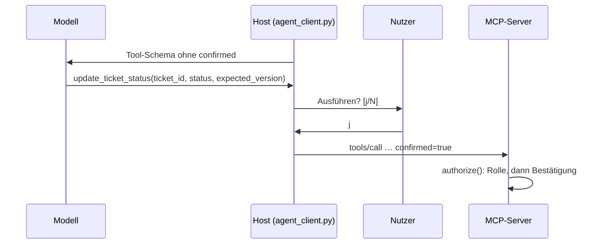

# Lab 7.1: Zugriffskontrolle und Sandbox-Prinzipien

**Leitfragen:**

<details>
<summary>Welche Tools dürfen nie ohne Bestätigung ausgeführt werden?</summary>

Alle Tools, die Zustand verändern oder nach außen wirken. Im Projekt ist das `update_ticket_status`; die lesenden Tools `get_ticket` und `get_deployment_log` laufen ohne Bestätigung.

</details>

<details>
<summary>Woran ließe sich ein Client erkennen, der mehr will, als er darf?</summary>

An gehäuften abgelehnten Aufrufen in kurzer Zeit (im Projekt mit dem Fehlercode `policy_denied`) oder an Schreibaufrufen direkt nach dem Lesen eines Tickets. Dafür muss der Server auch Ablehnungen festhalten; Protokoll und Alarme folgen in Lab 8.1.

</details>

- Der Server entscheidet über jeden Aufruf; Hinweise im Prompt oder Filter im Client sind nur zusätzliche Schichten.
- Eine Zugriffsrichtlinie (`policy.md`) legt fest, wer was darf. `auth.py` setzt sie im Server durch.

## Begriffe

| Begriff | Bedeutung in einem Satz |
| --- | --- |
| Authentifizierung | Feststellen, **wer** aufruft (z. B. über ein Token). |
| Autorisierung | Entscheiden, **was** dieser Aufrufer darf. |
| Rolle | Benanntes Bündel von Rechten, hier `viewer` (nur lesen) oder `operator` (lesen und schreiben). |
| Zugriffsrichtlinie (Policy) | Dokument, das Rollen, erlaubte Tools und Bedingungen festlegt. |
| Least Privilege | Jede Rolle bekommt nur die Rechte, die ihre Aufgabe braucht, nicht mehr. |
| Deny by default | Was nicht ausdrücklich erlaubt ist, wird abgelehnt. |
| Allow-List | Liste der ausdrücklich erlaubten Tools je Rolle; alles andere ist verboten. |
| Human-in-the-loop | Ein Mensch bestätigt einen riskanten Schritt, bevor er ausgeführt wird. |
| Sandbox | Begrenzung dessen, was ein Prozess technisch tun kann, auch wenn er fehlerhaft oder manipuliert ist. |
| Token | Zeichenkette, die ein Client mitschickt, um sich auszuweisen (wie ein Zugangsausweis). |

## Drei Fragen der Zugriffskontrolle

| Frage | Begriff | Im Vantra-Projekt |
| --- | --- | --- |
| Wer ruft auf? | Authentifizierung | **nicht umgesetzt**; stattdessen feste Rolle je Server-Prozess (`VANTRA_ROLE`), ein Server je Rolle |
| Was darf die Rolle? | Autorisierung | Allow-List je Rolle in `auth.py` |
| Was kann der Prozess technisch? | Sandbox | Eingabevalidierung, Obergrenzen, Nicht-Root-Container |

Das Modell im Projekt: Die Rolle wird beim Start des Servers gesetzt und gilt für jeden Aufruf an diesen Server. Ein Client weist sich nicht aus.



Eine Richtlinie hat sechs Abschnitte (Vorlage: `shared/policy-template.md`): Geltungsbereich, Grundsätze, Rollen und Tools, Bestätigungspflicht, Erkennung und Reaktion, Offene Punkte.

## Least Privilege und deny by default

Jede Rolle bekommt nur die Tools, die ihre Aufgabe braucht. Alles, was nicht ausdrücklich erlaubt ist, wird abgelehnt.

| Tool | Art | viewer | operator | Bedingung |
| --- | --- | --- | --- | --- |
| `get_ticket` | lesen | erlaubt | erlaubt | `ticket_id` im Format `VAN-<Zahl>` |
| `get_deployment_log` | lesen | erlaubt | erlaubt | höchstens 100 Zeilen pro Aufruf |
| `update_ticket_status` | schreiben | verboten | erlaubt, nur mit Bestätigung | `expected_version` zwingend, Status aus fester Liste |

Standardrolle ohne Angabe: `viewer`. Unbekannte Rollen und unbekannte Tools werden abgelehnt.

## Durchsetzung im Server: `auth.py`

Die Rolle kommt aus der Umgebung des Server-Prozesses, nie aus Tool-Argumenten oder Modell-Ausgaben.

```python
ROLE_TOOLS = {
    "viewer": frozenset({"get_ticket", "get_deployment_log"}),
    "operator": frozenset({"get_ticket", "get_deployment_log", "update_ticket_status"}),
}
WRITE_TOOLS = frozenset({"update_ticket_status"})

def authorize(tool: str, confirmed: bool = False, role: str | None = None) -> str:
    role = role or current_role()                       # aus VANTRA_ROLE, Standard viewer
    if tool not in ROLE_TOOLS.get(role, frozenset()):   # unbekannte Rolle: leere Menge
        raise PolicyDenied("policy_denied", f"Rolle '{role}' darf das Tool '{tool}' nicht aufrufen.", role=role, tool=tool)
    if tool in WRITE_TOOLS and not confirmed:
        raise PolicyDenied("confirmation_required", f"Das Schreib-Tool '{tool}' braucht eine Bestätigung durch den Nutzer (confirmed=true).", role=role, tool=tool)
    return role
```

Reihenfolge der Prüfung: zuerst die Rolle, dann die Bestätigung. Eine Bestätigung ersetzt kein fehlendes Recht.

Jedes Tool ruft `authorize(...)` als Erstes auf und übersetzt `PolicyDenied` in einen strukturierten Tool-Fehler (`is_error=True`). Die vollständige Datei: `examples/m07-security-hardening/l01-access-control/auth.py`.

| Fehlercode | Bedeutung | Echte Antwort (Auszug) |
| --- | --- | --- |
| `policy_denied` | Rolle darf das Tool nicht aufrufen | `Rolle 'viewer' darf das Tool 'update_ticket_status' nicht aufrufen.` |
| `confirmation_required` | Schreib-Tool ohne Bestätigung | `Das Schreib-Tool 'update_ticket_status' braucht eine Bestätigung durch den Nutzer (confirmed=true).` |
| `version_conflict` | Ticket zwischenzeitlich geändert (Lab 3.3) | `Ticket VAN-102 wurde zwischenzeitlich geändert. …` |

## Bestätigung (Human-in-the-loop)

- Der Host (Agent-Anwendung `shared/agent_client.py`) zeigt vor jedem Schreibaufruf Tool, Ticket und neuen Status und fragt den Nutzer.
- Erst nach „ja“ setzt der Host `confirmed=true`.
- Das Modell sieht das Argument nicht: `to_openai_tool` entfernt alle Namen aus `HIDDEN_ARGS = ("confirmed",)` aus dem Tool-Schema, bevor es an das Modell geht, und `execute_tool` löscht `confirmed` aus jedem Tool-Call des Modells.
- Grenze: Der Server prüft nur, ob `confirmed=true` ankommt, nicht wer es gesetzt hat. Ein Client, der das Argument selbst setzt, umgeht die Abfrage. Eine Bestätigung, die vom Server unabhängig vom Client erzwungen wird, ist im Projekt nicht umgesetzt (offener Punkt in `policy.md`).



## Sandbox-Prinzipien für Tool-Ausführung

Ein MCP-Server ist ein gewöhnlicher Prozess mit den Rechten seines Nutzers. Das Protokoll bietet keine Sandbox; sie entsteht durch den Betrieb (Quelle: MCP-Dokumentation „Local Server Security“, https://modelcontextprotocol.io/docs/2026-07-28/tutorials/security/local-server-security, abgerufen am 27.10.2026).

| Prinzip | Umsetzung | Fundstelle |
| --- | --- | --- |
| Eingaben validieren | `ticket_id` muss `^VAN-\d{1,6}$` entsprechen, sonst Validierungsfehler | Beispielstand `server.py` (`TicketId`); im eigenen Stand über die Erweiterung der Übung |
| Ausgaben begrenzen | höchstens 100 Log-Zeilen je Aufruf | Beispielstand `server.py` (`MAX_LOG_LINES`); im eigenen Stand über die Erweiterung |
| Keine Root-Rechte | Nicht-Root-Nutzer `app` (uid 10001) im Container | `Dockerfile` (Lab 5.2) |
| Wenig beschreibbarer Speicher | nur `/data` beschreibbar, `readOnlyRootFilesystem: true` | `Dockerfile`, `k8s.yaml` |
| Keine Secrets im Image | Konfiguration per Umgebung zur Laufzeit, Secret nur als Referenz | `Dockerfile`, `k8s.yaml` |
| Rolle nicht änderbar | `VANTRA_ROLE` nur beim Prozessstart, kein Tool kann sie setzen | `auth.py` |

Echte Antwort des Beispielstands auf eine manipulierte ID (`../etc/passwd`): `String should match pattern '^VAN-\d{1,6}$'`, `is_error=True`.

## Authentifizierung in MCP: der Ablauf in vier Schritten (Stand: 27.10.2026)

Die MCP-Spezifikation sieht für HTTP-Transporte eine Anmeldung mit Tokens nach OAuth vor (OAuth: verbreiteter Standard, mit dem ein Client von einer Anmeldestelle ein Token bekommt). Im Projekt ist das **nicht umgesetzt**.

1. Der Client holt sich bei einer Anmeldestelle (Authorization Server) ein Token für genau diesen MCP-Server.
2. Der Client schickt das Token bei jeder Anfrage im HTTP-Header `Authorization: Bearer <Token>` mit.
3. Der MCP-Server prüft: Ist das Token für **mich** ausgestellt (Audience)? Welche Rechte (Scopes) enthält es?
4. Der Server ordnet das Token einer Rolle zu und prüft die Tools wie oben mit `authorize`.

Auch mit Tokens bleibt Schritt 4, die Tool-Autorisierung, Aufgabe des Servers.

**Warum Token Passthrough gefährlich ist:** Token Passthrough heißt, ein Server akzeptiert ein Token, das für einen anderen Dienst ausgestellt wurde, und reicht es weiter. Dann handelt der Server mit fremden Rechten: Seine eigene Prüfung greift nicht, und im Protokoll des Zieldienstes erscheint der falsche Aufrufer. Die Spezifikation verbietet das: Ein Server darf nur Tokens akzeptieren, die für ihn ausgestellt wurden.

Im Projekt ist weder OAuth noch ein Token umgesetzt. Die Rolle gilt je Server-Prozess, bei HTTP für alle Verbindungen. Details der Spezifikation: Abschnitt „Vertiefung“.

## Typische Fehler

| Symptom | Ursache | Lösung |
| --- | --- | --- |
| Modell schreibt trotz Regel im Systemprompt | Prüfung nur im Prompt; das Modell kann sie ignorieren | Regel in `authorize` im Server durchsetzen |
| Jeder Aufrufer bekommt Schreibrechte | Rolle als Tool-Argument; der Aufrufer wählt sie selbst | Rolle nur aus `VANTRA_ROLE` lesen |
| Neues Tool ist sofort für alle offen | Standard „erlaubt“ für Unbekanntes | deny by default: `ROLE_TOOLS.get(role, frozenset())` |
| Aufrufe lassen sich keinem Client zuordnen | ein gemeinsamer Zugang für alle Clients | eigene Identität je Client (offener Punkt) |
| Eine manipulierte Anweisung ändert Daten | Schreib-Tool ohne Bestätigung | `WRITE_TOOLS` mit Bestätigungspflicht |
| `NotImplementedError` beim ersten Aufruf | `raise NotImplementedError` im Starter nicht entfernt | nach Aufgabe 7 die Zeile löschen |
| `ModuleNotFoundError: auth` | `auth.py` liegt nicht neben `server.py` | `auth.py` nach `playground/` kopieren |

## Fazit

- Least Privilege, deny by default und Durchsetzung im Server sind die Kernregeln der Policy.
- Schreibende Tools laufen nur mit Rolle `operator` und Bestätigung; die Rolle wird zuerst geprüft.
- Sandbox heißt Begrenzung durch Betrieb: Validierung, Obergrenzen, Nicht-Root, Konfiguration zur Laufzeit.
- Authentifizierung je Client (Token nach OAuth) ist für HTTP vorgesehen und im Projekt nicht umgesetzt.

Die Übung schreibt die Policy für die drei Vantra-Tools und setzt sie in `auth.py` im Server durch.

## Vertiefung: Autorisierung laut Spezifikation

Quelle: MCP-Spezifikation 2026-07-28, Abschnitt Authorization (https://modelcontextprotocol.io/specification/2026-07-28/basic/authorization), abgerufen am 27.10.2026. Die Tabelle gibt den Stand dieser Revision wieder; spätere Revisionen können abweichen.

| Aussage der Spezifikation | Bedeutung |
| --- | --- |
| Autorisierung ist optional und gilt auf Transportebene | Ein Server kann ohne sie betrieben werden |
| HTTP-basierte Transporte sollen der Spezifikation folgen (SHOULD) | Grundlage ist OAuth 2.1; der MCP-Server ist Resource Server (prüft Tokens), der MCP-Client OAuth-Client (holt Tokens) |
| MCP-Server müssen OAuth 2.0 Protected Resource Metadata (RFC 9728) bereitstellen | Ein maschinenlesbares Dokument, über das der Client die zuständige Anmeldestelle findet |
| stdio-Transport soll der Spezifikation nicht folgen (SHOULD NOT) | Zugangsdaten kommen aus der Umgebung des Prozesses |
| Server sollen benötigte Scopes im `WWW-Authenticate`-Header nennen | Der Client fordert nur die nötigen Rechte an: Least Privilege auch beim Token |
| Tokens nur akzeptieren, die für den Server ausgestellt sind | Verbot von Token Passthrough (siehe oben) |
