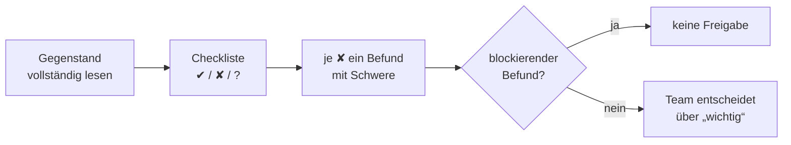

# Lab 7.3: Security-Review im Vieraugen-Prinzip

**Leitfragen:**

Welcher Befund blockiert einen Produktionseinsatz?

Einer, der ohne weitere Schwachstelle Zugriff, Rechteausweitung oder die Offenlegung von Secrets ermöglicht, etwa ein Schlüssel im Image, Root-Betrieb oder eine Rolle, die der Aufrufer selbst wählt.

Welcher Befund ist „nice to have“?

Eine Verbesserung ohne akutes Risiko, etwa ein fehlender `HEALTHCHECK` oder ein fehlendes Review-Intervall der Richtlinie.

- Vieraugenprinzip: Wer eine Konfiguration geschrieben hat, prüft sie nicht allein. Die zweite Person bewertet gegen eine feste Checkliste.
- Ein Review liefert dokumentierte Befunde mit Fundstelle, Schwere und Empfehlung, keine Meinungen.

## Begriffe

| Begriff | Bedeutung in einem Satz |
| --- | --- |
| Vieraugenprinzip | Eine zweite Person prüft, was die erste erstellt hat, bevor es freigegeben wird. |
| Review | Strukturierte Prüfung eines Artefakts (Dockerfile, Policy, Code) gegen festgelegte Kriterien. |
| Checkliste | Feste Liste von Prüffragen, damit jede Prüfung dieselben Punkte abdeckt. |
| Befund | Dokumentierte Abweichung von einem Prüfpunkt mit Fundstelle, Risiko und Empfehlung. |
| Schweregrad | Einstufung eines Befunds nach Dringlichkeit: blockierend, wichtig, nice to have. |
| Freigabe | Entscheidung, dass ein Stand in Produktion gehen darf. |
| Angriffsfläche | Alles, worüber ein Angreifer ein System erreichen kann (Ports, Dienste, Pakete). |

## Gegenstände und Material

| Gegenstand | Datei | Prüfgrundlage |
| --- | --- | --- |
| Dockerfile | `playground/Dockerfile` oder `examples/m07-security-hardening/l03-security-review/flawed/Dockerfile` | Checkliste A |
| Zugriffsrichtlinie | `playground/policy.md` oder `flawed/policy.md` | Checkliste B |
| Server und Betrieb | `playground/server.py`, Compose, Kubernetes | Checkliste C |

Die Checkliste liegt in `examples/m07-security-hardening/l03-security-review/checklist.md` (Starter: `starters/m07-l03-checklist.md`). Die Dateien in `flawed/` sind eine absichtlich fehlerhafte, synthetische Konfiguration (Platzhalter-Schlüssel, keine echten Zugangsdaten).

## Checkliste (Überblick)

| Gruppe | Prüfpunkte |
| --- | --- |
| A Dockerfile (A1–A8) | feste Image-Version, Nicht-Root, keine Secrets, gezieltes Kopieren, gepinnte Abhängigkeiten, `HEALTHCHECK`, nur nötige Ports und Pakete, restriktive Dateirechte |
| B Zugriffsrichtlinie (B1–B8) | Least Privilege, deny by default, Rolle aus vertrauenswürdiger Quelle, Bestätigung für Schreib-Tools, Durchsetzung im Server, Protokoll jedes Aufrufs, Identität je Client, Erkennung und Reaktion |
| C Server und Betrieb (C1–C5) | Eingaben validiert, Ergebnisse als Daten behandelt, Konfiguration außerhalb des Codes, keine Secrets und Ticket-Inhalte im Protokoll, Rollback-Weg |

Ergebnis je Punkt: ✔ erfüllt, ✘ nicht erfüllt, ? nicht prüfbar (Datei fehlt oder Information liegt nicht vor).

## Schweregrade

| Schwere | Kriterium | Folge |
| --- | --- | --- |
| blockierend | ermöglicht unmittelbar Zugriff, Rechteausweitung oder Offenlegung von Secrets | keine Freigabe, bis behoben |
| wichtig | erhöht Risiko oder Betriebsaufwand spürbar | vor Produktion beheben oder bewusst akzeptieren und dokumentieren |
| nice to have | Verbesserung ohne akutes Risiko | in den Backlog |

Hilfsfrage zur Einstufung: Kann ein Angreifer dadurch ohne weitere Schwachstelle Daten lesen, Daten ändern oder Rechte erhalten? Ja: blockierend. Die Einstufung bleibt eine Risikoabwägung; Abweichungen werden begründet.

## Befund-Format

| # | Gegenstand | Fundstelle | Befund | Schwere | Empfehlung |
| --- | --- | --- | --- | --- | --- |
| 1 | Dockerfile | `RUN curl … \| sh` | lädt unverifizierten Code beim Build | wichtig | Quelle festlegen, Prüfsumme verwenden |

Ein Befund nennt die Fundstelle (Datei und Zeile oder Regel), beschreibt das Risiko in einem Satz und gibt eine konkrete Empfehlung.

## Ablauf eines Reviews

1. Gegenstand vollständig lesen, bevor bewertet wird.
2. Checkliste Punkt für Punkt abarbeiten, bei ✘ die Fundstelle notieren.
3. Jeden ✘ als Befund formulieren und die Schwere vergeben.
4. Entscheiden: Mindestens ein blockierender Befund bedeutet keine Freigabe. Ohne blockierende Befunde entscheidet das Team über die „wichtig“-Befunde.
5. Befunde mit der Autorin oder dem Autor besprechen und die Behebung nachverfolgen.

## Typische Fehler

| Symptom | Ursache | Lösung |
| --- | --- | --- |
| Review besteht aus Meinungen („wirkt unsicher“) | keine Fundstelle, kein Risiko benannt | je Befund Datei und Zeile oder Regel nennen, Risiko in einem Satz |
| Nicht prüfbarer Punkt als ✔ markiert | Information fehlt in den Dateien | mit ? markieren und begründen |
| Alle Befunde sind „blockierend“ | Schwere ohne Kriterium vergeben | Hilfsfrage anwenden: ohne weitere Schwachstelle lesen, ändern, Rechte erhalten? |
| Empfehlung „sicherer machen“ | allgemeine Mahnung statt Maßnahme | konkrete Änderung nennen, z. B. `USER app` ergänzen |

## Fazit

- Ein Review prüft gegen eine feste Checkliste und liefert Befunde mit Fundstelle, Schwere und Empfehlung.
- Ein blockierender Befund verhindert die Freigabe; „nice to have“ wandert in den Backlog.
- Nicht prüfbare Punkte werden als ? markiert, nicht als erfüllt.

Die Übung prüft Dockerfile und Policy einer fehlerhaften Konfiguration (oder des Nachbarn) und dokumentiert die Befunde.
