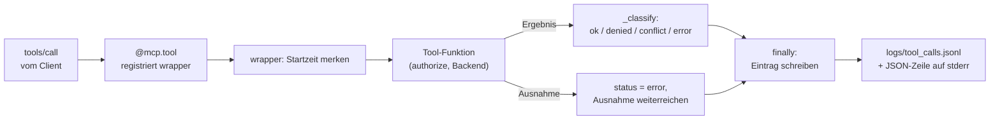

# Lab 8.1: Monitoring und Logging einrichten

**Leitfragen:**

<details>
<summary>Welche Metrik zeigt einen missbrauchten Tool-Call am schnellsten?</summary>

Die Rate abgelehnter Aufrufe (`status: denied`) je Zeitfenster. Wenige Ablehnungen sind normal, mehrere in kurzer Zeit deuten auf einen missbrauchten oder fehlerhaften Client.

</details>

<details>
<summary>Was gehört ins Log, was nicht (Datenschutz)?</summary>

Ins Log: Zeit, Tool, Rolle, Status, Fehlercode, Dauer und die Argumente (IDs, Status). Nicht ins Log: Ticket-Texte, Log-Inhalte der Deployments, Secrets und Tokens.

</details>

- Monitoring beantwortet zwei Fragen: Läuft der Server, und wird er so benutzt, wie die Policy es vorsieht?
- Grundlage ist ein Protokoll mit einer Zeile je Tool-Call. Metriken, Zeitleiste und Alarm lassen sich daraus ableiten.

## Begriffe

| Begriff | Bedeutung in einem Satz |
| --- | --- |
| Monitoring | Laufende Beobachtung, ob ein Dienst läuft und wie er genutzt wird. |
| Log | Aufzeichnung einzelner Ereignisse mit Zeitpunkt, z. B. „Tool X um 16:56 abgelehnt“. |
| Strukturiertes Log | Jede Log-Zeile ist ein JSON-Objekt mit festen Feldern statt Fließtext, damit Programme sie filtern und zählen können. |
| JSONL (JSON Lines) | Dateiformat mit genau einem JSON-Objekt pro Zeile; neue Einträge werden einfach angehängt. |
| Metrik | Zahl über einen Zeitraum, z. B. Anzahl abgelehnter Aufrufe pro Minute. |
| Trace | Verfolgung eines Vorgangs über mehrere Dienste hinweg (welcher Aufruf löste welchen aus). |
| Alarmregel | Bedingung, bei der ein Alarm ausgelöst wird: Status, Schwelle, Zeitfenster, Schwere. |
| Schwelle | Mindestanzahl passender Einträge, ab der die Regel auslöst. |
| Zeitfenster | Zeitraum, der vom aktuellen Zeitpunkt aus rückwärts gezählt wird, z. B. „die letzten 60 Sekunden“. |
| Decorator | Python-Funktion, die eine andere Funktion umhüllt und vor und nach ihrem Aufruf eigenen Code ausführt (Schreibweise `@name` über der Funktion). |
| stdout / stderr | Zwei getrennte Ausgabekanäle eines Prozesses: Standardausgabe und Fehlerausgabe. |

## Drei Signale

| Signal | Frage | Im Vantra-Projekt |
| --- | --- | --- |
| Log | Was ist passiert? | JSON-Zeilen auf stderr, eine JSONL-Datei je Tool-Call |
| Metrik | Wie oft, wie lange, wie viele Fehler? | aus der JSONL-Datei abgeleitet (Anzahl je Status, Dauer); Dashboard zeigt Summen |
| Trace | Welcher Aufruf löste welchen aus? | nicht umgesetzt; Ausblick siehe unten |

Bei stdio gehört stdout dem JSON-RPC-Protokoll. Alles andere (Logs) geht nach stderr oder in eine Datei.

## Tool-Call-Protokoll

Der Decorator `@logged("<tool>")` aus `logging_config.py` misst die Dauer und schreibt je Aufruf eine Zeile in die Datei aus `TOOL_CALL_LOG` (Standard `logs/tool_calls.jsonl`):

```json
{"ts": "2026-10-27T16:56:53.852+00:00", "tool": "update_ticket_status", "role": "viewer", "status": "denied", "error_code": "policy_denied", "duration_ms": 0.05, "args": {"ticket_id": "VAN-102", "status": "in_progress", "expected_version": 3}}
```

Dieselben Felder erscheinen als strukturierte Log-Zeile auf stderr (echter Auszug; `ts` und `duration_ms` variieren):

```json
{"ts": "2026-10-27T16:56:53.847+00:00", "level": "INFO", "logger": "vantra", "message": "tool_call get_ticket ok", "tool": "get_ticket", "role": "viewer", "status": "ok", "error_code": null, "duration_ms": 0.05, "args": {"ticket_id": "VAN-102"}}
```

| Feld | Bedeutung |
| --- | --- |
| `ts` | Zeitpunkt in UTC (ISO 8601) |
| `tool`, `role` | aufgerufenes Tool, Rolle des Servers |
| `status` | `ok`, `denied`, `conflict` oder `error` |
| `error_code` | z. B. `policy_denied`, `confirmation_required`, `version_conflict`; sonst `null` |
| `duration_ms` | Dauer des Aufrufs |
| `args` | Argumente ohne `confirmed` |

Die Zuordnung zu `status` übernimmt `_classify`: `policy_denied` und `confirmation_required` ergeben `denied`, `version_conflict` ergibt `conflict`, jeder andere Fehler `error`.

## So arbeitet `@logged`

Der Decorator legt sich um jede Tool-Funktion. Das SDK ruft den `wrapper` auf, der `wrapper` ruft die eigentliche Tool-Funktion auf und schreibt danach in jedem Fall einen Eintrag.



```python
def logged(tool_name):
    def decorator(fn):
        @functools.wraps(fn)                  # Signatur bleibt erhalten -> Tool-Schema stimmt
        def wrapper(*args, **kwargs):
            started = time.perf_counter()
            status, code = "ok", None
            try:
                result = fn(*args, **kwargs)
                status, code = _classify(result)
                return result
            except Exception as exc:
                status, code = "error", type(exc).__name__
                raise
            finally:                          # läuft nach return und nach raise
                ...                           # Eintrag bauen, log_tool_call(entry)
        return wrapper
    return decorator

@mcp.tool(annotations=READ_ONLY)              # außen: registriert die umhüllte Funktion
@logged("get_ticket")                         # innen: umhüllt die Tool-Funktion
def get_ticket(ticket_id: TicketId) -> Any: ...
```

- `finally` sorgt dafür, dass auch Ablehnungen und Ausnahmen im Protokoll landen.
- Decorators wirken von unten nach oben: `@logged` muss unter `@mcp.tool(...)` stehen, sonst registriert das SDK die Funktion ohne Protokoll.
- `_classify` liest den Fehlercode aus dem Ergebnis von `error_result(...)` (`structured_content["error"]`, Lab 7.1).

## Alarm

Eine Alarmregel besteht aus Status, Schwelle, Zeitfenster und Schwere. Beispiel: Schwelle 3 und Fenster 60 s bedeuten, dass die Regel auslöst, sobald unter den Einträgen der letzten 60 Sekunden mindestens drei den gesuchten Status haben. Ältere Einträge zählen nicht mehr; der Alarm verschwindet von selbst. Das Projekt definiert zwei Regeln (`ALERT_RULES` in `logging_config.py`):

```python
ALERT_RULES = [
    {"name": "viele-abgelehnte-aufrufe", "status": "denied", "schwelle": 3, "fenster_s": 60, "schwere": "hoch"},
    {"name": "viele-fehler", "status": "error", "schwelle": 5, "fenster_s": 300, "schwere": "mittel"},
]
```

Die Prüfung `evaluate_alerts` zählt Einträge je Regel im Fenster. Ausgabe nach drei Ablehnungen innerhalb von 60 Sekunden (`python examples/m08-observability-and-capstone/l01-monitoring/logging_config.py`):

```text
{'regel': 'viele-abgelehnte-aufrufe', 'schwere': 'hoch', 'anzahl': 3, 'fenster_s': 60}
```

Ohne Treffer lautet die Ausgabe `{'regel': 'keine Alarme'}`. Eine Reaktion (Sperren, Rolle entziehen, benachrichtigen) legt die Policy fest; das Projekt löst keine automatisch aus.

## Datenschutz im Log

| Ins Log | Nicht ins Log |
| --- | --- |
| Zeit, Tool, Rolle, Status, Fehlercode, Dauer | Ticket-Texte (`description`, `title`) |
| Argumente: Ticket-ID, Status, `expected_version`, `tail` | Inhalte der Deployment-Logs |
| | Secrets, Tokens, Schlüssel |
| | `confirmed` (wird entfernt) |

Auch Ticket-IDs und Rollen können je nach Umfeld auf Personen zurückführbar sein; das ist vor dem Betrieb zu klären. Aufbewahrungsdauer und Zugriff auf die Log-Dateien sind im Projekt nicht geregelt und gehören in die Policy.

## Mini-Dashboard (Showcase D)

`shared/dashboard/server.py` liest dieselbe JSONL-Datei und zeigt Summen je Status, die Zeitleiste der Aufrufe und ein Alarmbanner.

```bash
TOOL_CALL_LOG=logs/tool_calls.jsonl python shared/dashboard/server.py    # http://localhost:8080
```

| Route | Inhalt |
| --- | --- |
| `/` | Seite mit Zeitleiste |
| `/api/calls` | JSON mit `summary` (`total`, `by_status`, `alert`, `recent_denied`) und `calls` |
| `/health` | `{"status": "ok"}` |

Das Banner erscheint bei mindestens drei abgelehnten Aufrufen in den letzten 60 Sekunden. Die Schwelle ist im Dashboard fest eingetragen und entspricht der ersten Regel in `ALERT_RULES`. Mit `docker compose` startet das Dashboard zusammen mit Server und Mock-API (siehe Lab 8.2).

## Ausblick: Prometheus und OpenTelemetry (Stand: 27.10.2026)

Beides ist im Projekt nicht umgesetzt. Die MCP-Spezifikation 2026-07-28 dokumentiert Konventionen, um OpenTelemetry-Trace-Kontext in `_meta` zu transportieren (`traceparent`, `tracestate`, `baggage`). Quelle: Key Changes der Revision, Abschnitt Minor changes, https://modelcontextprotocol.io/specification/2026-07-28/changelog, abgerufen am 27.10.2026. Welche SDKs und Clients das unterstützen, belegt die Quelle nicht.

## Typische Fehler

| Symptom | Ursache | Lösung |
| --- | --- | --- |
| Protokoll bleibt leer | `@logged` steht über `@mcp.tool(...)` | Reihenfolge tauschen |
| Abgelehnte Aufrufe fehlen im Protokoll | Eintrag wird nur nach erfolgreichem `return` geschrieben | Eintrag im `finally`-Block schreiben |
| Client meldet Protokollfehler | Log-Ausgabe auf stdout (`print`) mischt sich in JSON-RPC | Logs nach stderr oder in die Datei |
| Ticket-Texte im Protokoll | ganzes Ergebnis statt Argumente geloggt | nur Metadaten und `args` protokollieren |

## Fazit

- Eine JSON-Zeile je Tool-Call, auch für abgelehnte, ist die Grundlage für Zeitleiste und Alarm.
- Die Rate abgelehnter Aufrufe ist das schnellste Signal für Missbrauch.
- Protokolliert werden Metadaten und IDs, nie Inhalte oder Secrets.

Die Übung ergänzt das strukturierte Logging im Server, erzeugt Aufrufe und prüft Zeitleiste und Alarm im Dashboard.
