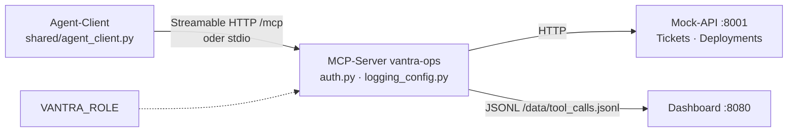

# Lab 8.2: Abschlussprojekt: sicherer MCP-Agent im Mini-Workflow

**Leitfragen:**

<details>
<summary>Welcher Schritt im Workflow hätte ohne die Security-Maßnahmen aus <code>m07</code> versagen können?</summary>

Schritt 3, die Statusänderung (`update_ticket_status`). Ohne Rollenprüfung und Bestätigung würde jeder Client sie ausführen, auch auf Anweisung eines manipulierten Ticket-Textes (Showcase C in Lab 7.2).

</details>

<details>
<summary>Was fehlt noch bis zum Produktivbetrieb?</summary>

Unter anderem Authentifizierung je Client, eine vom Client unabhängige Bestätigung, Ratenbegrenzung, Festlegungen zu Log-Aufbewahrung und -Zugriff, ein ausgeführter Test von Kubernetes und Pipeline sowie ein Test mit einem echten Modell. Die Liste steht unten.

</details>

- Der Gesamtstand vereint Server (Lab 2–3), Container (Lab 5–6), Policy (Lab 7.1) und Logging (Lab 8.1).
- Der Mini-Workflow zeigt, wie die Rolle über den Ausgang eines Schreibaufrufs entscheidet.

## Begriffe

| Begriff | Bedeutung in einem Satz |
| --- | --- |
| Mini-Workflow | Feste Folge von drei Schritten (Ticket lesen, Log lesen, Status ändern), an der alle Schutzmaßnahmen sichtbar werden. |
| End-to-End-Demo | Vorführung über alle Komponenten hinweg, vom Agenten bis zur Mock-API und zum Dashboard. |
| Compose-Stack | Alle Container, die eine Compose-Datei gemeinsam startet und stoppt. |
| Volume | Von Docker verwalteter Speicher, der einen Neustart der Container überdauert; hier für `tool_calls.jsonl`. |
| Policy-Entscheidung | Ergebnis von `authorize` für einen Aufruf: erlaubt, `policy_denied` oder `confirmation_required`. |
| DNS-Rebinding | Angriff, bei dem eine fremde Webseite im Browser über einen DNS-Trick einen lokalen Dienst wie `localhost:8000` anspricht; der Schutz des SDK prüft dafür den `Host`-Header. |
| Produktivbetrieb | Einsatz mit echten Daten und echten Nutzern, im Gegensatz zu Prototyp und Schulung. |

## Gesamtarchitektur



| Komponente | Aufgabe | Port |
| --- | --- | --- |
| MCP-Server | Tools, Rollenprüfung, Bestätigungspflicht, Tool-Call-Protokoll | 8000 (`/mcp`, `/health`) |
| Mock-API | gemeinsamer Zustand für Tickets und Deployments | 8001 |
| Dashboard | Zeitleiste, Summen, Alarmbanner aus dem Protokoll | 8080 |
| Agent-Client | Replay-LLM oder echtes Modell, fragt vor Schreibaufrufen | – |

## Dateien des Gesamtstands

Ordner: `examples/m08-observability-and-capstone/l02-capstone/`

| Datei | Inhalt |
| --- | --- |
| `server.py`, `context.py` | Tools mit `@logged`, Kontextschema |
| `auth.py`, `policy.md` | Rollen, Bestätigung, Richtlinie (Lab 7.1) |
| `logging_config.py` | JSON-Logs, Tool-Call-Protokoll, Alarmregeln (Lab 8.1) |
| `Dockerfile`, `docker-compose.yml` | Container mit Nicht-Root-Nutzer, `HEALTHCHECK`, Dienste `mcp-server`, `mock-api`, `dashboard` |
| `k8s.yaml`, `pipeline.yml` | Kubernetes-Manifest, CI/CD (Build, Test, Scan, Deploy, Rollback) |
| `run_demo.py` | Workflow ohne Container mit drei Läufen (viewer, operator mit Bestätigung, operator ohne Bestätigung) |

Der Starter `starters/m08-l02-capstone.md` ist die Vorlage für das Workflow-Protokoll (`playground/capstone.md`).

## Der Mini-Workflow

| Schritt | Eingabe | Tool-Call |
| --- | --- | --- |
| 1 | `Zeige Ticket VAN-102` | `get_ticket({"ticket_id": "VAN-102"})` |
| 2 | `Zeige das Deployment-Log dazu` | `get_deployment_log({})` (Ticket aus dem Kontext) |
| 3 | `Setze das Ticket auf in_progress` | `update_ticket_status({"ticket_id": "VAN-102", "status": "in_progress", "expected_version": 3})` |

Die Policy-Entscheidung in Schritt 3 hängt von Rolle und Bestätigung ab:

| Rolle | Bestätigung (`--confirm`) | Ergebnis |
| --- | --- | --- |
| `viewer` | `yes` | `policy_denied` |
| `operator` | `yes` | Ticket `in_progress`, Version 4 |
| `operator` | `none` | `confirmation_required` |

`authorize` prüft zuerst die Rolle und erst danach die Bestätigung. Deshalb endet `viewer` mit `--confirm yes` trotzdem mit `policy_denied`: Eine Bestätigung ersetzt kein fehlendes Recht.

## Start

Ohne Container (stdio, ein Befehl):

```bash
python examples/m08-observability-and-capstone/l02-capstone/run_demo.py
```

Mit Container (Rolle `viewer` als Standard, `operator` für Schreibrechte). Die Compose-Datei aus Lab 6.1 baut den Stand aus `playground/` und startet auch das Dashboard. `export` macht die Variable im aktuellen Terminal verfügbar; in jedem weiteren Terminal ist der Befehl erneut nötig. `-d` startet den Stack im Hintergrund und gibt das Terminal frei:

```bash
export COMPOSE=examples/m06-containerization-cicd/l01-docker/docker-compose.yml
docker compose -f "$COMPOSE" up -d --build                 # Rolle viewer
VANTRA_ROLE=operator docker compose -f "$COMPOSE" up -d    # Rollenwechsel: nur mcp-server wird neu erzeugt
docker compose -f "$COMPOSE" logs -f mcp-server            # Server-Logs verfolgen, Ctrl+C beendet nur die Anzeige
python shared/agent_client.py --url http://localhost:8000/mcp --replay workflow --confirm yes
docker compose -f "$COMPOSE" down                          # Stack stoppen; das Volume mit dem Protokoll bleibt
```

Das Dashboard läuft unter http://localhost:8080, die Mock-API unter http://localhost:8001/tickets; `curl -X POST http://localhost:8001/reset` setzt die Daten zurück. Der Gesamtstand liegt auch als fertiger Compose-Aufruf vor: `docker compose -f examples/m08-observability-and-capstone/l02-capstone/docker-compose.yml up --build`.

Der Container-Pfad ist mit Docker 29.2.0 und Compose v5.0.2 erprobt: drei Dienste `Up … (healthy)`, Workflow in beiden Rollen, Einträge im Dashboard. Startet ein Dienst als `unhealthy`, zuerst `docker compose ps` und `docker compose logs <dienst>` lesen; auf stark ausgelasteten Rechnern überschreiten Healthchecks das Timeout von 4 s, dann hilft ein erneutes `up -d`.

## Typische Fehler

| Symptom | Ursache | Lösung |
| --- | --- | --- |
| `docker compose -f ""` schlägt fehl | `COMPOSE` nur im ersten Terminal gesetzt | `export COMPOSE=…` im jeweiligen Terminal ausführen |
| Terminal ist blockiert, `down` nicht möglich | Stack ohne `-d` im Vordergrund gestartet | Ctrl+C, danach `up -d` |
| Dienst `unhealthy` | Healthcheck-Timeout oder Startfehler | `docker compose -f "$COMPOSE" logs <dienst>` lesen, erneut `up -d` |
| Schritt 3 liefert `version_conflict` | Ticket aus früherem Lauf schon geändert | `curl -X POST http://localhost:8001/reset` |
| Dashboard-Zahlen höher als erwartet | Volume `toolcalls` enthält frühere Läufe | Verhältnis `ok` zu `denied` auswerten oder `down -v` (löscht das Protokoll) |

## Maßnahmen im Workflow

| Risiko | Maßnahme | Modul / Lab |
| --- | --- | --- |
| Injection im Ticket-Text führt zu Schreibaufruf | Rolle `viewer`, Bestätigungspflicht | 7.1, 7.2 |
| manipulierte Eingaben (`../etc/passwd`) | Muster `^VAN-\d{1,6}$` | 7.1 |
| Prozess mit zu vielen Rechten im Container | Nicht-Root, nur `/data` beschreibbar, Konfiguration per Umgebung | 5.2, 6.1 |
| Ausfall unbemerkt | `HEALTHCHECK`, Probes in `k8s.yaml` | 5.2, 6.2 |
| Missbrauch unbemerkt | Tool-Call-Protokoll, Alarm, Dashboard | 8.1 |
| fehlerhafter Release | Rollback-Stufe in `pipeline.yml` (`kubectl rollout undo`) | 6.2 |

## Lücken bis zum Produktivbetrieb

| Lücke | Stand im Projekt |
| --- | --- |
| Authentifizierung je Client | nicht umgesetzt; Rolle gilt je Server-Prozess, bei HTTP für alle Verbindungen |
| Bestätigung unabhängig vom Client | `confirmed` setzt der Client; der Server prüft nur das Argument |
| Transportschutz bei `0.0.0.0` | der DNS-Rebinding-Schutz des SDKs ist bei Host `0.0.0.0` aus und im Projekt nicht konfiguriert |
| Ratenbegrenzung, Freigabe durch zweite Person | in `policy.md` als offene Punkte geführt |
| Log-Aufbewahrung und -Zugriff | nicht geregelt |
| Kontext je Client | ein Kontext je Serverprozess, nicht je Client |
| Ausführung der Infrastruktur | Docker-Build und Compose-Stack lokal ausgeführt; Kubernetes-Anwendung und Pipeline nicht ausgeführt, Manifest per `kubeconform`, Pipeline per `actionlint` geprüft |
| Echtes Modell | Tool-Auswahl durch ein echtes Modell nur über den OpenAI-kompatiblen Pfad gegen eine Testschnittstelle geprüft |

## Fazit

- Der Gesamtstand verbindet Server, Container, Policy und Logging; die Rolle entscheidet über Schritt 3.
- Die Wirkung der Security-Maßnahmen ist im Workflow beobachtbar: `policy_denied`, `confirmation_required`, Eintrag im Dashboard.
- Bis zum Produktivbetrieb bleiben Identität je Client, clientunabhängige Bestätigung und der ausgeführte Test von Kubernetes und Pipeline offen.

Die Übung führt den Workflow mit beiden Rollen aus, wertet ihn mit dem Dashboard aus und benennt die Lücken.
